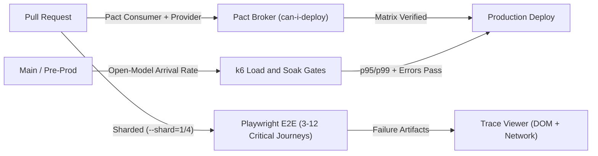
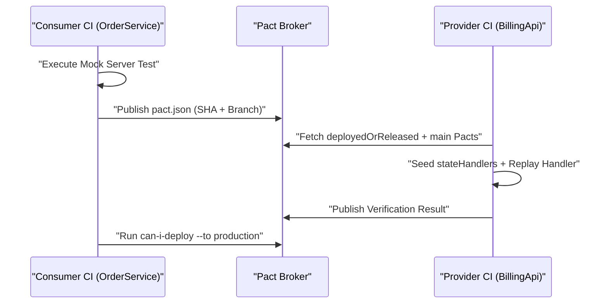

---
tags:
  - software-engineering
  - testing
  - e2e-testing
  - playwright
  - contract-testing
  - pact
  - load-testing
  - k6
created: 2026-11-13
updated: 2026-11-13
status: 🟢
level: mid-to-senior
---
# E2E, Contract & Load Testing

> [!abstract] Hub Context
> Part of [[Programming/Software Engineering/Testing/Testing Complete Guide|Testing Complete Guide]]. Connects to [[Programming/Software Engineering/Testing/Integration Testing|Integration Testing]], [[Programming/Software Engineering/Testing/Mocking|Mocking]], [[Programming/Software Engineering/DevOps/Pipeline Design|Pipeline Design]], [[Programming/Software Engineering/DevOps/GitHub Actions|GitHub Actions]], [[Programming/Software Engineering/System Design/API Design|API Design]], and [[Programming/Software Engineering/SDLC/Release Engineering & Migrations|Release Engineering & Migrations]].

Full-stack verification catches production failures that isolated unit and single-service integration suites structurally cannot observe: browser DOM hydration timing races, cookie/CORS/CSP enforcement across real HTTP boundaries, breaking cross-service API or Kafka event schema drift, and non-linear queuing tail latency (`p95`/`p99`) under realistic arrival traffic. Rather than building a monolithic end-to-end staging suite that tries to prove everything slowly in one browser harness, mature engineering teams decompose full-stack verification into three specialized layers: **Deterministic Browser E2E (Playwright)**, **Consumer-Driven Contract Testing (Pact v4)**, and **Open-Model Load & Soak Testing (k6)**.

---

## 1. First-Principles Mechanics & Complete Verification Architecture

### Why Unit & Single-Service Integration Tests Leave Full-Stack Blind Spots

1. **Browser Rendering, Hydration & Network Timing**:
   Server-side rendering (such as Next.js SSR) emits raw HTML before client JavaScript event listeners attach (**hydration**). Real browsers execute CSP headers, `HttpOnly`/`SameSite` cookies across redirects, React transitions, focus traps, CSS stacking contexts (sticky headers intercepting pointer hit-tests), and async `fetch` cascades that Node-only tests (`jsdom` or `happy-dom`) either skip or emulate inaccurately.
2. **Distributed Service Schema Drift ($O(N^2)$ Staging Bottleneck)**:
   Attempting to validate API compatibility across $N$ microservices by deploying every team's latest snapshot into one shared staging cluster causes deployment queues, cross-team data corruption, and cascading false failures whenever one unrelated service restarts. Contract verification isolates **schema and status semantics** per consumer-provider pair without shared staging environments.
3. **Non-Linear Queuing Latency & Coordinated Omission**:
   Integration tests execute at concurrency $1\text{–}8$. Production failures such as PostgreSQL connection pool starvation, thread-pool exhaustion, GC stop-the-world pauses, and TCP socket leaks emerge only when sustained open-model arrivals push system utilization $\rho \to 1$, where Kingman's equation dictates queuing wait time grows super-linearly as $\frac{\rho}{1 - \rho}$.

### Three-Tier Full-Stack Verification Topology



### Playwright Execution Mechanics

Playwright drives Chromium, WebKit, and Firefox out-of-process over the **Chrome DevTools Protocol (CDP)** / browser WebSocket rather than injecting fragile JavaScript runners inside the target page tab:

- **Zero-Cost Context Sandboxing**: Instead of launching a fresh browser binary per test ($1\text{–}3\text{s}$), Playwright creates an isolated `BrowserContext` per test in $\sim 10\text{ms}$ with private cookies, `localStorage`, `sessionStorage`, and IndexedDB—preventing session cross-contamination across parallel workers.
- **6-Step Actionability Pipeline**: Before executing `.click()` or `.fill()`, Playwright polls automatically until the target element is: (1) attached to DOM, (2) visible (non-zero bounding box, non-`hidden`), (3) **stable** (identical bounding coordinates across two consecutive animation frames—defeating CSS transition clicks), (4) receives pointer events (hit-test proves no modal backdrop or cookie banner intercepts the click center), (5) enabled, and (6) editable (for input actions).
- **Web-First Auto-Retrying Assertions**: `await expect(locator).toHaveText('Paid')` creates a continuous mutation/polling loop up to `expect.timeout` (`5s` default), whereas `expect(await locator.textContent()).toBe('Paid')` reads the DOM **once synchronously** and breaks whenever React/Next.js takes one extra frame to commit state.

### Pact v4 Consumer-Driven Contract Mechanics



**Pact** flips API compatibility verification from centralized staging integration to decentralized algebraic verification:

1. The **Consumer** defines minimal expectations using flexible **type/regex matchers** (`MatchersV3.like`, `regex`, `integer`) following **Postel's Law (Tolerant Reader)**—asserting only fields it actually deserializes.
2. Pact spins up a local mock HTTP server during consumer tests and emits an immutable contract JSON file (Pact Specification v4), covering both synchronous HTTP request/response pairs and **asynchronous message contracts** (Kafka/SQS/RabbitMQ JSON payloads).
3. Consumers publish contracts to a **Pact Broker** tagged with Git SHA and deployed environment (`main`, `production`).
4. The **Provider** pulls relevant consumer pacts in its own CI pipeline, executes **`stateHandlers`** to seed deterministic local state (e.g., `"invoice INV-100 exists in DRAFT status"`), replays each interaction directly against the real provider HTTP handler or message serializer, and publishes verification results back to the Broker.
5. Before any deploy, `pact-broker can-i-deploy` evaluates the compatibility matrix between the candidate service SHA and every active version already deployed in `production`.

### k6 Open-Model Workload Engine & Coordinated Omission

**k6** compiles test scripts into a high-concurrency Go scheduler driving embedded **Sobek** ES6 virtual machine goroutines. Choosing the wrong workload executor invalidates load test conclusions:

- **Closed Workload Model (`vus: 100`)**: Each Virtual User (VU) executes request $\to$ blocks until response returns $\to$ issues next request. If backend latency spikes from `50ms` to `2,000ms` during a lock stall, the 100 VUs automatically slow down from `2,000 RPS` to `50 RPS`. This artificial self-throttling hides queue explosion (**Coordinated Omission**).
- **Open Workload Model (`constant-arrival-rate` / `ramping-arrival-rate`)**: k6 schedules new iteration starts at an exact wall-clock rate $\lambda$ (e.g., `300 iterations/second`) regardless of response latency. If the server stalls, k6 pulls additional VUs up to `maxVUs`, exposing real tail-latency queue buildup (`p99`) faithfully.

---

## 2. Real-World Use Cases & Decision Matrix

| Verification Scenario | Optimal Test Tier | Why Other Tiers Fail or Cost Too Much |
|---|---|---|
| **Login, Checkout, RBAC Tenant Switch, Cookie Redirects** | **Playwright Critical E2E (3–12 specs)** | Only real browser engines prove SSR hydration, `HttpOnly` cookie flags, payment iframe redirects, and CSS layout hit-testing end-to-end. |
| **Microservice REST/gRPC & Kafka Payload Compatibility** | **Pact v4 HTTP & Message CDC** | Full-mesh staging E2E breaks whenever unrelated teams deploy broken branches; Pact proves schema compatibility in `< 20s` per repo. |
| **API Latency SLO Verification Before Release** | **k6 `ramping-arrival-rate` Load/Stress Gate** | Single-user integration suites never trigger connection pool starvation, lock queues, or CPU throttling under concurrent arrivals. |
| **Long-Term Heap, Socket & Connection Leak Detection** | **k6 4–24 Hour Soak Test** | Short 5-minute stress tests finish before slow `10 MB/hr` memory leaks or `TIME_WAIT`/FD leaks reach container `OOMKilled` thresholds. |
| **200 Form Validation Rules & Edge-Case Matrix** | **Vitest + React Testing Library + MSW (NOT Playwright)** | Driving 200 validation errors through Chromium wastes minutes of CI compute; test UI validation in-memory and keep 1 happy + 1 error E2E journey. |
| **SQL Locking (`40001`), Migrations & Redis Lua Scripts** | **Testcontainers Integration (NOT Playwright/k6)** | Covered in [[Programming/Software Engineering/Testing/Integration Testing\|Integration Testing]]; browser tests are the wrong abstraction for testing database isolation errors. |

---

## 3. Step-by-Step Practical Application ("How to Build With It in Production")

### Part A: Deterministic Sharded Playwright E2E Suite

#### Repository Layout

```text
web-app/
  playwright.config.ts
  tests/
    e2e/
      auth.setup.ts
      fixtures/
        tenant.fixture.ts
      pages/
        checkout.page.ts
      specs/
        checkout.spec.ts
  .github/
    workflows/
      e2e-sharded.yml
```

#### Playwright Configuration (`playwright.config.ts`)

Enforces `fullyParallel: true`, CI-strict `forbidOnly`, `blob` reporter for multi-runner sharding, `trace: 'on-first-retry'` for zero-overhead failure forensics, and `setup` project dependency:

```typescript
import { defineConfig, devices } from '@playwright/test';

const baseURL = process.env.E2E_BASE_URL ?? 'http://127.0.0.1:3000';

export default defineConfig({
  testDir: './tests/e2e',
  fullyParallel: true,
  forbidOnly: !!process.env.CI,
  retries: process.env.CI ? 2 : 0,
  workers: process.env.CI ? 2 : undefined,
  timeout: 30_000,
  expect: {
    timeout: 7_500,
  },
  reporter: process.env.CI
    ? [['blob'], ['github']]
    : [['list'], ['html', { open: 'never' }]],
  use: {
    baseURL,
    trace: 'on-first-retry',
    screenshot: 'only-on-failure',
    video: 'retain-on-failure',
    actionTimeout: 10_000,
    navigationTimeout: 15_000,
  },
  projects: [
    {
      name: 'setup',
      testMatch: /.*\.setup\.ts/,
    },
    {
      name: 'chromium',
      use: {
        ...devices['Desktop Chrome'],
        storageState: '.playwright/.auth/default-user.json',
      },
      dependencies: ['setup'],
    },
  ],
  webServer: process.env.E2E_BASE_URL
    ? undefined
    : {
        command: 'npm run start:test',
        url: `${baseURL}/api/health`,
        reuseExistingServer: !process.env.CI,
        timeout: 120_000,
      },
});
```

#### Single-Login Reusable Auth Setup (`tests/e2e/auth.setup.ts`)

Never repeat UI login form clicks across 300 specs. Authenticate once via fast API request (or one UI login), validate the cookie session, and persist `storageState`:

```typescript
import fs from 'node:fs/promises';
import path from 'node:path';
import { test as setup, expect } from '@playwright/test';

const authFile = path.resolve('.playwright/.auth/default-user.json');

setup('authenticate baseline session once', async ({ request }) => {
  await fs.mkdir(path.dirname(authFile), { recursive: true });

  const response = await request.post('/api/v1/auth/login', {
    data: {
      email: process.env.E2E_ADMIN_EMAIL ?? 'e2e-baseline@acme.test',
      password: process.env.E2E_ADMIN_PASSWORD ?? 'TestPass!2026',
    },
  });
  expect(response.ok()).toBeTruthy();

  await request.storageState({ path: authFile });
});
```

#### Per-Worker Synthetic Tenant Fixture & App Actions (`tests/e2e/fixtures/tenant.fixture.ts`)

> [!danger] Never Share One Mutable Account Across Parallel Workers
> Mounting a single `default-user.json` across 4 parallel workers causes deterministic collisions whenever Test A clears the cart or modifies organization settings while Test B asserts cart badge count! Use `storageState` setup strictly for read-only baseline credentials or single-worker smoke tests; for mutable workflows, provision an **isolated synthetic tenant/user per test or worker** inside a typed Playwright Fixture (`test.extend`).

```typescript
import { randomUUID } from 'node:crypto';
import { test as base, expect, type Page, type APIRequestContext } from '@playwright/test';
import { CheckoutPage } from '../pages/checkout.page';

export interface IsolatedTenant {
  tenantId: string;
  userId: string;
  email: string;
  authHeader: string;
}

export interface E2EFixtures {
  tenant: IsolatedTenant;
  authedPage: Page;
  checkoutPage: CheckoutPage;
  seedCartItem: (sku: string, quantity: number) => Promise<void>;
}

export const test = base.extend<E2EFixtures>({
  tenant: async ({ playwright, baseURL }, use, testInfo) => {
    const adminApi: APIRequestContext = await playwright.request.newContext({
      baseURL,
      extraHTTPHeaders: {
        'x-test-admin-secret': process.env.E2E_SEED_SECRET ?? 'local-seed-secret',
      },
    });

    const slug = `w${testInfo.parallelIndex}-${randomUUID().slice(0, 8)}`;
    const createRes = await adminApi.post('/api/test/tenants', {
      data: {
        slug,
        email: `${slug}@synthetic.test`,
      },
    });
    expect(createRes.status()).toBe(201);
    const created = (await createRes.json()) as IsolatedTenant;

    await use(created);

    // Deterministic cleanup even when test assertions fail
    await adminApi.delete(`/api/test/tenants/${created.tenantId}`).catch(() => undefined);
    await adminApi.dispose();
  },

  authedPage: async ({ browser, baseURL, tenant }, use) => {
    const context = await browser.newContext({ baseURL });
    // App Action: exchange synthetic tenant token directly into browser cookies before page load
    const loginRes = await context.request.post('/api/v1/auth/test-impersonate', {
      headers: { 'x-test-admin-secret': process.env.E2E_SEED_SECRET ?? 'local-seed-secret' },
      data: { userId: tenant.userId },
    });
    expect(loginRes.ok()).toBeTruthy();

    const page = await context.newPage();
    await use(page);
    await context.close();
  },

  seedCartItem: async ({ authedPage }, use) => {
    // App Action helper: prepares Arrange state in ~15ms via API rather than clicking through 4 catalog screens
    await use(async (sku: string, quantity: number) => {
      const res = await authedPage.request.post('/api/v1/cart/items', {
        data: { sku, quantity },
      });
      expect(res.status()).toBe(201);
    });
  },

  checkoutPage: async ({ authedPage }, use) => {
    await use(new CheckoutPage(authedPage));
  },
});

export { expect };
```

#### Semantic Page Object (`tests/e2e/pages/checkout.page.ts`) & Spec (`tests/e2e/specs/checkout.spec.ts`)

```typescript
// tests/e2e/pages/checkout.page.ts
import { expect, type Locator, type Page } from '@playwright/test';

export class CheckoutPage {
  readonly placeOrderButton: Locator;
  readonly promoInput: Locator;
  readonly applyPromoButton: Locator;
  readonly totalHeading: Locator;
  readonly confirmationStatus: Locator;

  constructor(private readonly page: Page) {
    this.promoInput = page.getByLabel('Promo Code');
    this.applyPromoButton = page.getByRole('button', { name: 'Apply Promo' });
    this.placeOrderButton = page.getByRole('button', { name: 'Place Order' });
    this.totalHeading = page.getByRole('region', { name: 'Order Summary' }).getByTestId('order-total');
    this.confirmationStatus = page.getByRole('status');
  }

  async goto(): Promise<void> {
    await this.page.goto('/checkout');
    // Wait on hydrated semantic control rather than deprecated networkidle
    await expect(this.placeOrderButton).toBeEnabled();
  }

  async applyPromoCode(code: string): Promise<void> {
    const quoteResp = this.page.waitForResponse(
      (res) => res.url().includes('/api/v1/cart/promo') && res.request().method() === 'POST',
    );
    await this.promoInput.fill(code);
    await this.applyPromoButton.click();
    const res = await quoteResp;
    expect(res.status()).toBe(200);
  }

  async submitOrder(): Promise<string> {
    const orderResp = this.page.waitForResponse(
      (res) => res.url().includes('/api/v1/orders') && res.request().method() === 'POST',
    );
    await this.placeOrderButton.click();
    const res = await orderResp;
    expect(res.status()).toBe(201);
    const body = (await res.json()) as { orderId: string };
    return body.orderId;
  }
}
```

```typescript
// tests/e2e/specs/checkout.spec.ts
import { test, expect } from '../fixtures/tenant.fixture';

test.describe('Critical Checkout Journey', () => {
  test('applies discount code, submits order via API boundary, and renders confirmation', async ({
    seedCartItem,
    checkoutPage,
    authedPage,
  }) => {
    await test.step('Arrange isolated tenant cart via API App Action', async () => {
      await seedCartItem('SKU-KEYBOARD-PRO', 2);
    });

    await test.step('Navigate to checkout and apply promo code', async () => {
      await checkoutPage.goto();
      await expect(checkoutPage.totalHeading).toHaveText('$200.00');
      await checkoutPage.applyPromoCode('SAVE20');
      await expect(checkoutPage.totalHeading).toHaveText('$160.00');
    });

    await test.step('Submit order and verify URL and web-first confirmation banner', async () => {
      const orderId = await checkoutPage.submitOrder();
      await expect(authedPage).toHaveURL(new RegExp(`/orders/${orderId}$`));
      await expect(checkoutPage.confirmationStatus).toContainText(`Order ${orderId} confirmed`);
    });
  });
});
```

#### Sharded GitHub Actions Workflow with Blob Merge (`.github/workflows/e2e-sharded.yml`)

```yaml
name: Playwright Sharded E2E
on:
  pull_request:
    branches: [main]

jobs:
  e2e-shards:
    runs-on: ubuntu-latest
    strategy:
      fail-fast: false
      matrix:
        shardIndex: [1, 2, 3, 4]
        shardTotal: [4]
    steps:
      - uses: actions/checkout@v4
      - uses: actions/setup-node@v4
        with:
          node-version: 22
          cache: npm
      - run: npm ci
      - run: npx playwright install --with-deps chromium
      - run: npm run build
      - name: Run Playwright shard
        env:
          CI: 'true'
          E2E_SEED_SECRET: ${{ secrets.E2E_SEED_SECRET }}
        run: npx playwright test --shard=${{ matrix.shardIndex }}/${{ matrix.shardTotal }}
      - name: Upload shard blob report
        if: ${{ !cancelled() }}
        uses: actions/upload-artifact@v4
        with:
          name: blob-report-${{ matrix.shardIndex }}
          path: blob-report
          retention-days: 3

  merge-e2e-reports:
    if: ${{ !cancelled() }}
    needs: [e2e-shards]
    runs-on: ubuntu-latest
    steps:
      - uses: actions/checkout@v4
      - uses: actions/setup-node@v4
        with:
          node-version: 22
          cache: npm
      - run: npm ci
      - name: Download all blob reports
        uses: actions/download-artifact@v4
        with:
          path: all-blob-reports
          pattern: blob-report-*
          merge-multiple: true
      - name: Merge Playwright HTML report
        run: npx playwright merge-reports --reporter html ./all-blob-reports
      - name: Upload unified HTML + Trace report
        uses: actions/upload-artifact@v4
        with:
          name: playwright-html-report
          path: playwright-report
          retention-days: 7
```

---

### Part B: Pact v4 HTTP & Async Message Contract Suite

#### Consumer HTTP & Message Pact Generation (`tests/pact/consumer/billing-client.pact.spec.ts`)

Notice strict adherence to **Tolerant Reader**: the consumer asserts only fields it consumes (`invoiceId`, `status`, `amountDueCents`) using `MatchersV3.like` / `regex` / `integer`—never exact provider timestamps or internal metadata columns.

```typescript
import path from 'node:path';
import { describe, it, expect } from 'vitest';
import {
  PactV4,
  MatchersV3,
  SpecificationVersion,
} from '@pact-foundation/pact';

const { like, integer, regex, uuid } = MatchersV3;

const httpProvider = new PactV4({
  consumer: 'OrderService',
  provider: 'BillingApi',
  dir: path.resolve(process.cwd(), 'pacts'),
  spec: SpecificationVersion.SPECIFICATION_VERSION_V4,
});

const messageProvider = new PactV4({
  consumer: 'OrderService',
  provider: 'BillingEvents',
  dir: path.resolve(process.cwd(), 'pacts'),
  spec: SpecificationVersion.SPECIFICATION_VERSION_V4,
});

describe('OrderService -> BillingApi Pact v4 Contracts', () => {
  it('fetches an open invoice by ID', async () => {
    await httpProvider
      .addInteraction()
      .given('invoice INV-100 exists in OPEN status', { invoiceId: 'INV-100' })
      .uponReceiving('a request for invoice INV-100')
      .withRequest('GET', '/v1/invoices/INV-100', (builder) => {
        builder.headers({ accept: 'application/json' });
      })
      .willRespondWith(200, (builder) => {
        builder.headers({ 'content-type': 'application/json' });
        builder.jsonBody({
          invoiceId: like('INV-100'),
          status: regex('^(OPEN|PAID|VOID)$', 'OPEN'),
          amountDueCents: integer(14900),
        });
      })
      .executeTest(async (mockServer) => {
        const res = await fetch(`${mockServer.url}/v1/invoices/INV-100`, {
          headers: { accept: 'application/json' },
        });
        expect(res.status).toBe(200);
        const body = (await res.json()) as {
          invoiceId: string;
          status: string;
          amountDueCents: number;
        };
        expect(body.status).toBe('OPEN');
        expect(body.amountDueCents).toBe(14900);
      });
  });

  it('consumes InvoiceSettled async Kafka message schema cleanly', async () => {
    await messageProvider
      .addAsynchronousMessage()
      .given('an invoice has been settled')
      .expectsToReceive('an InvoiceSettled v1 domain event')
      .withMetadata({ 'content-type': 'application/json', topic: 'billing.invoices.v1' })
      .withJSONContent({
        eventId: uuid(),
        eventType: 'InvoiceSettled',
        orderId: uuid(),
        settledAmountCents: integer(14900),
      })
      .verify(async (message) => {
        const payload = message.contents as {
          eventId: string;
          eventType: string;
          orderId: string;
          settledAmountCents: number;
        };
        expect(payload.eventType).toBe('InvoiceSettled');
        expect(payload.settledAmountCents).toBeGreaterThan(0);
      });
  });
});
```

#### Provider Verification (`tests/pact/provider/billing-provider.pact.spec.ts`) & `can-i-deploy`

On the `BillingApi` repository, CI runs the Pact `Verifier` directly against the live HTTP server (backed by Testcontainers PostgreSQL) and handles `stateHandlers` deterministically:

```typescript
import { describe, it, beforeAll, afterAll } from 'vitest';
import { Verifier } from '@pact-foundation/pact';
import { buildBillingServer } from '../../../src/server';
import { testPool } from '../../integration/worker-setup';

describe('BillingApi Pact Provider Verification', () => {
  let serverUrl: string;
  let closeServer: () => Promise<void>;

  beforeAll(async () => {
    const server = await buildBillingServer({ pool: testPool });
    serverUrl = await server.listen({ port: 0, host: '127.0.0.1' });
    closeServer = () => server.close();
  });

  afterAll(async () => {
    await closeServer();
  });

  it('satisfies all OrderService consumer contracts from Pact Broker', async () => {
    const verifier = new Verifier({
      provider: 'BillingApi',
      providerBaseUrl: serverUrl,
      pactBrokerUrl: process.env.PACT_BROKER_BASE_URL,
      pactBrokerToken: process.env.PACT_BROKER_TOKEN,
      providerVersion: process.env.GIT_SHA ?? 'dev-local',
      providerVersionBranch: process.env.GIT_BRANCH ?? 'main',
      publishVerificationResult: process.env.CI === 'true',
      // Verify contracts of consumers currently deployed to production AND main head
      consumerVersionSelectors: [
        { deployedOrReleased: true },
        { mainBranch: true },
      ],
      stateHandlers: {
        'invoice INV-100 exists in OPEN status': async (params) => {
          const invoiceId = String(params?.invoiceId ?? 'INV-100');
          await testPool.query('TRUNCATE TABLE invoices RESTART IDENTITY CASCADE');
          await testPool.query(
            `INSERT INTO invoices (id, status, amount_due_cents)
             VALUES ($1, 'OPEN', 14900)`,
            [invoiceId],
          );
        },
      },
      requestFilter: (req, _res, next) => {
        // Inject internal service auth header validated by provider middleware
        req.headers['x-service-auth'] = 'verified-pact-internal-token';
        next();
      },
    });

    await verifier.verifyProvider();
  }, 60_000);
});
```

Exact CI CLI workflow publishing pacts and enforcing safe deploys:

```bash
# 1. Consumer CI publishes pact JSON tagged with commit SHA and branch
npx pact-broker publish ./pacts \
  --consumer-app-version "$GIT_SHA" \
  --branch "$GIT_BRANCH" \
  --broker-base-url "$PACT_BROKER_BASE_URL" \
  --broker-token "$PACT_BROKER_TOKEN"

# 2. Before production deploy (on EITHER Consumer or Provider pipeline):
npx pact-broker can-i-deploy \
  --pacticipant BillingApi \
  --version "$GIT_SHA" \
  --to-environment production \
  --broker-base-url "$PACT_BROKER_BASE_URL" \
  --broker-token "$PACT_BROKER_TOKEN"

# 3. Immediately after production deploy succeeds, record version deployment in Broker matrix:
npx pact-broker record-deployment \
  --pacticipant BillingApi \
  --version "$GIT_SHA" \
  --environment production \
  --broker-base-url "$PACT_BROKER_BASE_URL" \
  --broker-token "$PACT_BROKER_TOKEN"
```

---

### Part C: k6 Open-Model Load, Stress & Soak Scripts

#### Open-Model Load & Spike Gate (`tests/perf/checkout-load.k6.js`)

Using `ramping-arrival-rate` avoids Coordinated Omission completely. Let's size `maxVUs` via Little's Law ($L = \lambda \cdot W$): at peak stress $\lambda = 400\text{ RPS}$ and worst-case $W = 2.0\text{ s}$ timeout/stall, active VUs required = $400 \times 2.0 = 800$. We allocate `preAllocatedVUs: 250` and `maxVUs: 1000` so k6 never hits `dropped_iterations`.

```javascript
import http from 'k6/http';
import { check } from 'k6';
import { Trend, Rate } from 'k6/metrics';

const checkoutSuccessDuration = new Trend('checkout_success_duration_ms', true);
const checkoutBusinessErrors = new Rate('checkout_business_errors');

export const options = {
  scenarios: {
    checkout_open_arrival: {
      executor: 'ramping-arrival-rate',
      startRate: 25,
      timeUnit: '1s',
      preAllocatedVUs: 250,
      maxVUs: 1000,
      stages: [
        { target: 150, duration: '2m' }, // Warm-up to baseline
        { target: 250, duration: '5m' }, // Sustained production peak
        { target: 400, duration: '2m' }, // 1.6x stress spike
        { target: 150, duration: '2m' }, // Recovery validation (verifies queue drains cleanly)
      ],
    },
  },
  thresholds: {
    http_req_failed: ['rate<0.005'],
    // Gate tail percentiles exclusively on successful responses AND overall HTTP duration
    'http_req_duration{expected_response:true}': ['p(95)<250', 'p(99)<600'],
    checkout_business_errors: ['rate<0.005'],
    dropped_iterations: ['count==0'], // Fails gate if k6 load generator itself starved for VUs
  },
};

export default function () {
  const uniqueKey = `k6-${__VU}-${__ITER}-${Date.now()}`;
  const payload = JSON.stringify({
    tenantId: `load-tenant-${__VU % 20}`,
    amountCents: 4900,
    currency: 'USD',
  });

  const res = http.post(`${__ENV.TARGET_BASE_URL}/v1/orders`, payload, {
    headers: {
      'content-type': 'application/json',
      'idempotency-key': uniqueKey,
      authorization: `Bearer ${__ENV.LOAD_TEST_TOKEN}`,
    },
    timeout: '3s',
  });

  const ok = check(res, {
    'status is 201': (r) => r.status === 201,
    'order status confirmed': (r) => r.status === 201 && r.json('status') === 'CONFIRMED',
  });

  checkoutBusinessErrors.add(!ok);
  if (ok) {
    checkoutSuccessDuration.add(res.timings.duration);
  }
}

export function handleSummary(data) {
  return {
    'k6-summary.json': JSON.stringify(data, null, 2),
  };
}
```

#### Endurance Soak Script (`tests/perf/soak-endurance.k6.js`)

Runs sustained 65% peak RPS for 4+ hours to uncover unclosed file descriptors, Redis pub/sub leaks, Postgres connection leaks, and GC heap creep:

```javascript
import http from 'k6/http';
import { check } from 'k6';

export const options = {
  scenarios: {
    sustained_soak: {
      executor: 'constant-arrival-rate',
      rate: 160,
      timeUnit: '1s',
      duration: '4h',
      preAllocatedVUs: 120,
      maxVUs: 400,
    },
  },
  thresholds: {
    http_req_failed: ['rate<0.001'],
    'http_req_duration{expected_response:true}': ['p(95)<200', 'p(99)<450'],
    dropped_iterations: ['count==0'],
  },
};

export default function () {
  const res = http.get(`${__ENV.TARGET_BASE_URL}/v1/catalog/featured`, {
    tags: { name: 'GET /v1/catalog/featured' },
  });
  check(res, { 'status 200': (r) => r.status === 200 });
}
```

---

## 4. Complete Framework Reference & Edge Cases

### Playwright Locator & Assertion Determinism Matrix

| Priority | Selector / Assertion API | Engineering Rationale & Traps |
|---|---|---|
| **1 (Best)** | `getByRole('button', { name: 'Place Order' })` | Resists Tailwind/CSS refactors AND enforces ARIA semantics (`button`, `checkbox`, `textbox`, `status`, `row`). |
| **2** | `getByLabel('Email Address')` | Directly verifies `<label for="...">` form accessibility linkage. |
| **3** | `getByPlaceholder(...)` / `getByText(...)` | Use `{ exact: true }` whenever substring collisions exist (e.g., `"Save"` vs `"Save Draft"`). |
| **4 (Fallback)** | `getByTestId('order-total')` | Use ONLY for non-interactive layout regions lacking clear ARIA landmarks or dynamic text. |
| **Banned** | `div > ul > li:nth-child(3) > button` | Breaks immediately on wrapper `<div>` edits and gives opaque failure messages. |
| **Assertion Rule** | `await expect(loc).toBeVisible()` / `.toHaveText()` | Auto-retries across async UI updates; **NEVER** write `expect(await loc.isVisible()).toBe(true)` or `await page.waitForTimeout(N)`. |

### Page Object Model (POM) vs App Actions Architecture

| Dimension | Classic Page Object Model | Playwright App Actions + Fixtures |
|---|---|---|
| **Arrange (State Setup)** | Navigates through UI sign-up, catalog, and cart screens ($8\text{–}15\text{s}$ per test) | Calls backend seed/API endpoints directly (`seedCartItem`), completing setup in $15\text{–}40\text{ms}$ |
| **Act & Assert** | Encapsulates UI locators & multi-step page actions cleanly in typed methods | Test directly drives UI or combines slim role-based Page Objects |
| **Recommended Hybrid** | **Use App Actions (`tenant.fixture.ts`) for `Arrange`** + **Slim Semantic Page Objects (`CheckoutPage`) for `Act`/`Assert`** | Maximizes speed, eliminates upstream login/setup coupling, and preserves readable domain specs |

### Playwright Edge Cases & Production Failure Modes

1. **SSR Hydration Race (Dropped Early Clicks)**:
   In Next.js / React SSR, initial HTML renders `<button>Place Order</button>` *before* the client JS bundle downloads and attaches `onClick`. Playwright sees an attached, visible, enabled button, clicks it, and nothing happens!
   - *Fix*: Disable interactive mutation controls during SSR until a `useHydrated()` flag flips `disabled={false}` (or attach `data-hydrated="true"` on root layout and wait on `expect(page.locator('[data-hydrated="true"]')).toBeVisible()`), OR verify clicking updates state via `await expect(async () => { ... }).toPass()` only for idempotent read triggers.
2. **Strict Mode Ambiguity Errors**:
   Playwright throws `strict mode violation: locator resolved to 2 elements` whenever `.click()` matches multiple buttons (e.g., `"Delete"` in every table row). Never suppress with `.first()` blindly; scope to the target row: `page.getByRole('row', { name: 'INV-100' }).getByRole('button', { name: 'Delete' }).click()`.
3. **Deprecated `waitForLoadState('networkidle')`**:
   SPAs using WebSockets, SSE streams, analytics beacons, or polling intervals never stay quiet for 500ms—causing deterministic timeouts or premature false triggers before client rendering finishes. Always await specific `page.waitForResponse(...)` and Web-First element assertions.
4. **`iframe`, Shadow DOM & File Downloads**:
   Semantic locators automatically pierce open Shadow DOM trees. For third-party payment `iframe` widgets (Stripe Elements), scope with `page.frameLocator('iframe[title="Secure payment input frame"]')`. For downloads, synchronize with `const downloadPromise = page.waitForEvent('download'); await exportBtn.click(); const download = await downloadPromise;`.

### Pact v4 Edge Cases

1. **Over-Specification Anti-Pattern**: Asserting exact hardcoded dates (`"2026-11-13T10:00:00Z"`) or internal fields the consumer ignores breaks valid provider deployments without fixing real bugs. Use `MatchersV3.iso8601DateTime()` or omit unused fields completely.
2. **State Handler Isolation**: Provider verifications replay multiple interactions sequentially against one running server. Every `stateHandlers` callback must idempotently `TRUNCATE` or upsert unique keys so interaction #1 does not poison interaction #2.
3. **Message Pact Execution**: Never spin up Kafka inside a Pact Message Provider verification. Pact invokes your **message producer/serializer function** directly in memory (`messageProviders: { 'an InvoiceSettled v1 domain event': () => buildInvoiceSettledEvent(...) }`) and validates the emitted JSON bytes against consumer schemas.

### k6 Edge Cases & Generator Sizing Limits

1. **Percentile Dilution From Fast `500` Errors**:
   If a crashed database causes `POST /v1/orders` to fail in `1ms` with HTTP `500`, global `http_req_duration` `p(95)` can *drop* from `80ms` to `5ms` while 90% of users fail! Always split thresholds using k6 built-in tags: `http_req_failed: ['rate<0.005']` AND `'http_req_duration{expected_response:true}': ['p(95)<250', 'p(99)<600']`.
2. **Load Generator Bottlenecks (`dropped_iterations` / Ephemeral Ports)**:
   Monitor `dropped_iterations` in k6 output. If `maxVUs` is undersized relative to $\lambda \times W_{\text{stall}}$, k6 drops scheduled iterations and hides tail stalls. Also raise `ulimit -n 65535` on Linux load generators so ephemeral TCP sockets do not fail with `cannot assign requested address`.

---

## 5. Production Debugging, Profiling & Operations Playbook

| Symptom | Root Cause | Exact Diagnostic Command / Tool | Concrete Fix |
|---|---|---|---|
| **Playwright passes locally 100%, fails 15% in CI (`TimeoutError: locator.click`)** | SSR hydration click drop, slow CI API response exceeding default `5s` check, or modal overlay intercepting pointer | Download `trace.zip` from CI artifact and inspect locally: `npx playwright show-trace playwright-report/data/<trace>.zip` | Inspect Actions timeline + Network waterfall + DOM snapshot before/after click; add `waitForResponse` and wait for hydrated state |
| **Parallel E2E workers collide (`409 Conflict` / missing cart items) when `workers > 1`** | Multiple specs mutate the same shared `storageState` user account simultaneously | Reproduce locally with `npx playwright test --workers=4 --repeat-each=5` | Migrate mutable workflows to `tenant.fixture.ts` creating an isolated synthetic tenant per `testInfo.parallelIndex` + UUID |
| **Pact `can-i-deploy` blocks release unexpectedly** | Provider verified `main` branch only, missing verification matrix record against consumer currently tagged in `production` | Query matrix interactively: `npx pact-broker can-i-deploy --pacticipant BillingApi --version $SHA --to-environment production` | Add `{ deployedOrReleased: true }` to `consumerVersionSelectors` and verify `record-deployment` executes on every deploy |
| **Pact Provider Verification fails with `401 Unauthorized` or missing state** | Provider middleware rejects unauthenticated Pact requests or `stateHandlers` string mismatches consumer `.given(...)` text | Run `npx vitest run billing-provider.pact.spec.ts` with `logLevel: 'debug'` in `Verifier` options | Match `.given(...)` string character-for-character in `stateHandlers` and inject local test auth token in `requestFilter` |
| **k6 prints `Insufficient VUs, reached maxVUs limit` / high `dropped_iterations`** | Backend stall exceeded `maxVUs / targetRate` seconds (Little's Law violation), causing k6 itself to throttle | Inspect `dropped_iterations` and `vus_max` counters in `k6-summary.json` | Raise `maxVUs >= targetRate * maxRequestTimeoutSec`, increase OS `ulimit -n`, or distribute across k6-operator pods |
| **4-hour k6 soak test triggers container `OOMKilled` after 2.5h despite passing 10-min stress test** | Gradual Node heap leak (unbounded `Map` cache, unclosed event listeners) or Postgres `idle in transaction` socket growth | Capture heap snapshots via `NODE_OPTIONS="--inspect"` + Chrome DevTools Memory tab; inspect sockets via `ss -tan \| awk '{print $1}' \| sort \| uniq -c` | Bound caches with LRU eviction, call `client.release()` in `finally`, and configure `max-old-space-size` + socket keepalive timeouts |

---

## 6. Worked Exercises & Solutions

### Exercise 1: Eliminating Four Hidden Flake Traps in a Playwright Spec

Inspect the Playwright snippet below. It passes 85% of runs locally with `--workers=1` and fails intermittently in CI with `--workers=4`:

```typescript
test('filter electronics and remove item from cart', async ({ page }) => {
  await page.goto('/catalog');
  await page.locator('div.sidebar > div:nth-child(2) > input').click();
  await page.waitForTimeout(500);
  const isVisible = await page.locator('.product-card').first().isVisible();
  expect(isVisible).toBe(true);
  const count = await page.locator('.product-card').count();
  expect(count).toBe(4);
  await page.goto('/cart');
  await page.locator('button:has-text("Remove")').click();
});
```

Identify all **4 architectural flake sources** and rewrite the test deterministically using our `tenant.fixture.ts` pattern.

---

### Solution 1

#### 4 Architectural Flake Sources
1. **`waitForTimeout(500)` + Non-Retrying `.isVisible()` / `.count()`**: When CI API responses exceed `500ms`, `isVisible()` and `count()` execute synchronously once without retrying—reading stale unfiltered items or an empty loading spinner.
2. **Brittle Positional CSS (`div.sidebar > div:nth-child(2) > input`)**: Any sidebar banner or wrapper refactor silently clicks the wrong checkbox.
3. **Strict-Mode Risk (`button:has-text("Remove")`)**: If the cart contains two items or a promo button matching `"Remove"`, `.click()` throws a strict-mode ambiguity failure.
4. **Shared Mutable User State Across `--workers=4`**: Reading `/cart` directly via shared `storageState` collides whenever parallel workers add or remove items simultaneously.

#### Deterministic Rewrite
```typescript
import { test, expect } from '../fixtures/tenant.fixture';

test('filters electronics and removes seeded cart item cleanly', async ({
  authedPage,
  seedCartItem,
}) => {
  await seedCartItem('SKU-MOUSE-01', 1);

  await authedPage.goto('/catalog');
  const filterResponse = authedPage.waitForResponse(
    (res) =>
      res.url().includes('/api/v1/products') &&
      res.url().includes('category=electronics') &&
      res.status() === 200,
  );

  await authedPage.getByRole('checkbox', { name: 'Electronics' }).check();
  await filterResponse;

  const cards = authedPage.getByTestId('product-card');
  await expect(cards).toHaveCount(4);
  await expect(cards.first()).toBeVisible();

  await authedPage.goto('/cart');
  const itemRow = authedPage.getByRole('row', { name: /SKU-MOUSE-01/i });
  await itemRow.getByRole('button', { name: 'Remove' }).click();
  await expect(itemRow).toHaveCount(0);
});
```

---

### Exercise 2: Diagnosing a React SSR Hydration Race & Strict-Mode Failure via Trace Viewer

A team deploys a Next.js App Router checkout page. In Playwright Trace Viewer for a failed CI run:
- The `Before` DOM snapshot shows the `"Place Order"` button visible at coordinates `(520, 410)`.
- `page.getByRole('button', { name: 'Place Order' }).click()` logs `succeeded in 14ms`.
- The Network tab shows **zero `POST /api/v1/orders` requests**, and the test subsequently times out waiting on `/orders/.*`.
- Meanwhile, on the Orders History table, clicking `page.getByRole('button', { name: 'Download Invoice' }).click()` fails with `strict mode violation: resolved to 3 elements`.

Explain the exact root cause of both issues and write the clean fixes.

---

### Solution 2

#### Root-Cause Diagnosis
1. **SSR Hydration Race (Early Click Drop)**: Next.js streamed the server-rendered `<button>Place Order</button>` HTML immediately (`200 OK`), so Playwright's actionability checks passed (`attached`, `visible`, `enabled`) before the client JavaScript chunk finished downloading and hydrating React event handlers. The native browser click landed on an unhydrated DOM element and was silently discarded, explaining zero `POST` calls.
2. **Unscoped Table Action Locator**: `getByRole('button', { name: 'Download Invoice' })` matches every row's download button in the table.

#### Exact Production Fixes
1. **Expose Hydration Readiness Deterministically**: Mark interactive root buttons `disabled` until hydration (`const hydrated = useHydrated();`) or expose `data-hydrated="true"` on the hydrated layout shell so Playwright waits until React event listeners are bound:
   ```typescript
   await authedPage.locator('[data-hydrated="true"]').waitFor();
   await expect(checkoutPage.placeOrderButton).toBeEnabled();
   ```
2. **Row-Scoped Semantic Locator**: Scope the action button to the unique order row via accessible row text:
   ```typescript
   await authedPage
     .getByRole('row', { name: /INV-100/ })
     .getByRole('button', { name: 'Download Invoice' })
     .click();
   ```

---

### Exercise 3: Catching Both Breaking HTTP and Kafka Schema Changes via Pact v4

`OrderService` consumes two interfaces from `BillingService`:
1. `GET /v1/customers/:id` expecting `{ id: string, tier: "GOLD" | "SILVER", creditLimitCents: integer }`.
2. Async Kafka event `InvoiceSettled` expecting `{ eventId: uuid, orderId: uuid, settledAmountCents: integer }`.

A `BillingService` PR makes two changes:
- Renames JSON field `tier` $\to$ `membershipLevel`.
- Changes Kafka field `settledAmountCents` from `14900` (number) to `"14900"` (string) while formatting numeric fields via a new serializer.

Explain how Pact v4 blocks **both** regressions inside `BillingService`'s own PR without running `OrderService` or Kafka, and fix a mistake in `OrderService`'s consumer pact where an engineer asserted `createdByAdminEmail: "ops@acme.test"` even though `OrderService` ignores that field.

---

### Solution 3

#### 1. How Pact v4 Blocks Both PR Regressions Independently
- **HTTP Break (`tier` $\to$ `membershipLevel`)**: `BillingService`'s PR executes `Verifier` against the published `OrderService-BillingApi.json` pact. Pact replays `GET /v1/customers/c-1` against `BillingService`'s local test server, parses the response, detects missing key `"tier"`, and fails the PR before merge.
- **Kafka Event Break (`integer` $\to$ `string`)**: `BillingService`'s PR executes `Verifier` with `messageProviders` calling the real `InvoiceSettled` event serializer function. Pact checks `typeof settledAmountCents === 'number' && Number.isInteger(...)`, rejects `"14900"`, and fails the PR—with zero live Kafka containers needed during contract verification.

#### 2. Fixing Consumer Over-Specification (Tolerant Reader Violation)
Asserting `createdByAdminEmail: "ops@acme.test"` inside `OrderService`'s consumer pact violates **Tolerant Reader** because `OrderService` does not parse that field; it unnecessarily blocks `BillingService` from removing or refactoring internal admin fields. Delete `createdByAdminEmail` from the consumer pact's `.jsonBody(...)` expectation and use `MatchersV3.regex('^(FREE|SILVER|GOLD)$', 'GOLD')` for `tier` so valid enum members remain compatible.

---

### Exercise 4: Debugging a Broken `can-i-deploy` Workflow & Provider State Collision

A microservices team reports two Pact Broker CI failures:
1. `BillingApi` passes Pact verification on `main`, deploys to `production`, and immediately breaks `CheckoutWeb` in `production` because `CheckoutWeb` v1.8 (still running in prod) expected an older optional-turned-required field that `CheckoutWeb` v2.0 (on `main`) removed.
2. When `BillingApi` runs 3 consumer interactions sequentially in `Verifier`, interaction #2 fails randomly with `23505 duplicate key value violates unique constraint "invoices_pkey"`.

Diagnose both failures and provide the exact configuration fixes.

---

### Solution 4

#### Root-Cause Diagnoses & Fixes
1. **Missing `deployedOrReleased` Selector in `Verifier`**:
   - *Cause*: `BillingApi`'s `consumerVersionSelectors` checked only `{ mainBranch: true }`. It verified against `CheckoutWeb` v2.0 (`main`), never against `CheckoutWeb` v1.8 actually deployed in `production`!
   - *Fix*: Configure `consumerVersionSelectors: [{ deployedOrReleased: true }, { mainBranch: true }]` in `Verifier`, ensure deploy pipelines run `pact-broker record-deployment`, and gate releases with `pact-broker can-i-deploy --to-environment production`.
2. **Non-Idempotent `stateHandlers`**:
   - *Cause*: Interaction #1 inserted `INV-100` via `stateHandlers['invoice INV-100 exists']`, and interaction #2 triggered a state handler inserting `INV-100` again without resetting tables first (`23505`).
   - *Fix*: Start every `stateHandlers` callback with deterministic cleanup (`TRUNCATE TABLE invoices RESTART IDENTITY CASCADE`) or use `INSERT ... ON CONFLICT (id) DO UPDATE`, keeping each interaction's seeded PostgreSQL state strictly isolated.

---

### Exercise 5: Fixing Coordinated Omission & `dropped_iterations` in a k6 Checkout Test

An engineer runs `k6` with `{ vus: 50, duration: '5m' }` against `POST /v1/checkout`. Average latency is `120ms`, throughput is `415 RPS`, and `p99` reports `190ms`. When marketing launches at `415 RPS`, production suffers a `1.4s` PostgreSQL lock spike every 20s and `p99` collapses to `11.5s`.
1. Explain mathematically why `{ vus: 50 }` masked the `11.5s` collapse (**Coordinated Omission**).
2. Calculate the exact `preAllocatedVUs` and `maxVUs` required for an open-model `constant-arrival-rate` test at `rate: 415` when worst-case backend stall + request timeout reaches `3.0s`, avoiding `dropped_iterations`.

---

### Solution 5

#### 1. Mathematical Explanation of Coordinated Omission
With closed `vus: 50`, each VU waits synchronously for its in-flight request before sending the next:
- During normal `120ms` operation: $\text{Throughput} = \frac{50}{0.12\text{s}} \approx 416\text{ RPS}$.
- During a `1.4s` database lock stall: all 50 VUs freeze on socket reads and generate **0 additional requests** until the stall clears—dropping request rate from `415 RPS` to $\frac{50}{1.4\text{s}} \approx 35\text{ RPS}$! Real external arrivals (`415 RPS`), however, keep arriving unabated: $415 \times 1.4 = 581$ extra requests queue up inside ingress/connection pools, amplifying queuing latency to $11.5\text{s}$.

#### 2. Little's Law Sizing for Open-Model `constant-arrival-rate`
By Little's Law ($L = \lambda \cdot W$):
- Steady-state concurrency at normal `120ms` latency: $L_{\text{normal}} = 415 \times 0.12 = 49.8 \implies$ set `preAllocatedVUs: 100` (2x steady-state headroom).
- Worst-case queued concurrency during a `3.0s` backend stall/timeout: $L_{\text{max}} = 415 \times 3.0 = 1{,}245 \implies$ set `maxVUs: 1500` and assert `dropped_iterations: ['count==0']` in `thresholds` so the load generator never runs dry during a stall.

---

### Exercise 6: Diagnosing a 6-Hour Soak Test OOM & `502` Drift Incident

A payment gateway service passes a 15-minute `ramping-arrival-rate` stress test at `400 RPS` with `p99 = 140ms` and zero errors. During a 6-hour `constant-arrival-rate` soak test at `200 RPS`, observability dashboards show:
- CPU stays flat at `22%` for 3 hours.
- Container RSS memory climbs linearly at `+180 MB/hour` until Kubernetes sends `SIGKILL` (`OOMKilled` at `1024 Mi`).
- `p99` gradually rises from `110ms` to `1,900ms`, followed by `502 Bad Gateway` spikes (`EMFILE: too many open files`).

Diagnose two concrete runtime failure classes producing this exact signature and prescribe the verification + production fixes.

---

### Solution 6

#### Root-Cause Failure Classes
1. **Unbounded Cache / Listener Retention (`+180 MB/hr` Linear RSS Climb)**:
   - *Mechanism*: An in-memory `Map<string, OrderSession>` (e.g., per-request idempotency cache without TTL eviction) or `EventEmitter` listener registered inside every HTTP handler (`redis.on('message', ...)` without `removeListener`) retains objects across the V8 old-generation heap. Short 15-minute stress tests allocate only `45 MB`, staying well under `1024 Mi`, whereas 3+ hours hits container memory limits and triggers frantic full-GC sweeps (explaining the `p99` climb from `110ms` to `1,900ms` prior to `OOMKilled`).
2. **Unclosed Socket / File Descriptor Leak (`EMFILE`)**:
   - *Mechanism*: Creating a new `http.Agent` or `pg.Pool` / `Redis` client inside a request path instead of sharing a singleton pool—or failing to consume/cancel `fetch()` response bodies on non-`2xx` paths—leaks open TCP sockets until OS per-process file descriptor limits (`ulimit -n`) exhaust, producing `EMFILE` and ingress `502` drops.

#### Verification & Production Fixes
- **Verification**: Profile a 30-minute accelerated soak with `NODE_OPTIONS="--heapsnapshot-signal=SIGUSR2"` (diff two heap snapshots 15 minutes apart in Chrome DevTools to isolate the growing constructor class) and track `process_open_fds` / `nodejs_heap_size_used_bytes` Prometheus gauges in CI soak gates.
- **Production Fix**: Replace unbounded `Map` caches with size-bounded `LRUCache` (`max: 10_000, ttl: 60_000`), instantiate HTTP `undici`/`Agent` and DB/Redis pools once at module boot (`OnModuleInit` / `OnModuleDestroy`), and always drain/cancel unread `fetch` bodies (`await res.body?.cancel()`) in error branches.
