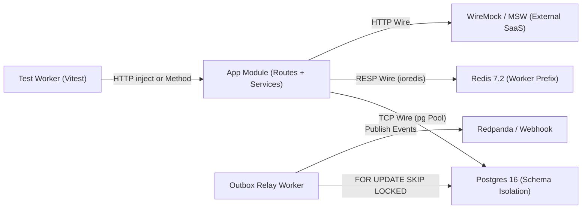
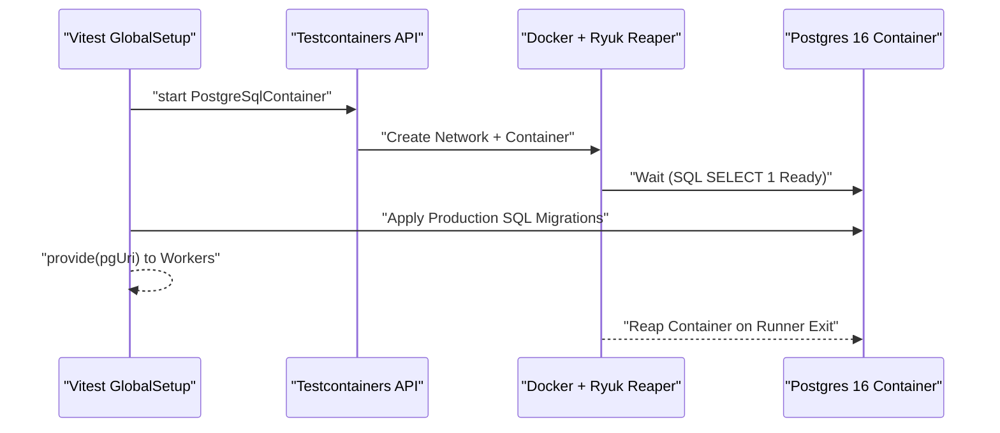

---
tags:
  - software-engineering
  - testing
  - integration-testing
  - testcontainers
  - vitest
  - postgresql
created: 2026-01-02
updated: 2026-11-13
status: 🟢
level: mid-to-senior
---
# Integration Testing

> [!abstract] Hub Context
> Part of [[Programming/Software Engineering/Testing/Testing Complete Guide|Testing Complete Guide]]. Connects to [[Programming/Software Engineering/Testing/Unit Testing|Unit Testing]], [[Programming/Software Engineering/Testing/Mocking|Mocking]], [[Programming/Software Engineering/Testing/E2E Testing|E2E Testing]], [[Programming/Software Engineering/Database Design/Transactions|Transactions]], and [[Programming/Software Engineering/SDLC/Release Engineering & Migrations|Release Engineering & Migrations]].

**Integration Testing** verifies the execution seams where application modules interact with real external infrastructure—relational databases, Redis caches, message brokers, local filesystems, HTTP servers, and dependency injection (DI) containers. Unit tests prove pure algorithmic invariants inside a single V8 or JVM memory space, yet production incidents overwhelmingly originate at infrastructure boundaries: SQL dialect bugs, transaction isolation races, constraint violations, serialization mismatches, broken DI wiring, and unconsumed broker offsets.

---

## 1. First-Principles Mechanics & Complete Architecture

### What Integration Tests Prove That Unit Tests Cannot

Mocking your own persistence or cache layers replaces real protocol state machines with simplified JavaScript or Java return values. Six critical defect classes pass 100% of unit tests and fail only against real engines:

1. **SQL Planner, Constraint & Driver Coercion Semantics**:
   PostgreSQL enforces `UNIQUE`, `CHECK`, `FOREIGN KEY`, `EXCLUDE USING gist`, and `DEFERRABLE INITIALLY DEFERRED` constraints dynamically inside transaction commit and tuple-insertion paths. Furthermore, database drivers impose concrete wire-type coercions: Node's `pg` driver parses `BIGINT` (`int8`) and `NUMERIC` as JavaScript `string` values rather than `number` to prevent 53-bit IEEE-754 precision loss, and `TIMESTAMPTZ` values round-trip through server timezone settings.
2. **Concurrency & MVCC Isolation Error Codes (`40001`, `23505`, `40P01`, `SKIP LOCKED`)**:
   Under `READ COMMITTED`, two concurrent transactions checking `SELECT count(*) ...` before `INSERT` both read zero rows and race into `23505` (`unique_violation`). Under `SERIALIZABLE`, conflicting read/write predicates abort one transaction with SQLSTATE `40001` (`serialization_failure`), requiring an application retry loop. Job queues using `SELECT ... FOR UPDATE SKIP LOCKED` rely on row-level `TupleLock` acquisition across separate TCP sessions—impossible to exercise on a single shared connection or an in-memory mock. See [[Programming/Software Engineering/Database Design/Transactions|Transactions]].
3. **Serialization, Validation & Protocol Wire Boundaries**:
   HTTP controllers serialize DTOs through validation pipes (for example NestJS `ValidationPipe` with `transform: true`, `whitelist: true`, `forbidNonWhitelisted: true`, or Fastify + Zod schemas), converting `Date` objects to ISO-8601 strings, rejecting unknown fields, stripping `undefined` keys, and mapping PostgreSQL constraint error codes into `409 Conflict` or `422 Unprocessable Entity` HTTP frames.
4. **Redis Atomic Primitives & Lua Script Semantics**:
   Redis executes Lua scripts (`EVAL` / `EVALSHA`) atomically on a single thread, returns 1-indexed Lua tables as arrays, coerces floating-point precision in `ZINCRBY`, and rejects cross-slot multi-key commands (`CROSSSLOT`) in cluster topologies unless keys share `{hash_tag}` prefixes. In-memory Redis mocks routinely diverge on `SET NX PX` return payloads, stream consumer groups (`XREADGROUP`), and Lua `cjson` edge cases.
5. **Broker Partitioning, Consumer Offsets & Crash Recovery**:
   Kafka and Redpanda consumers decouple message processing from offset commits (`autoCommit: false`). Integration tests prove that a consumer crashing after writing to PostgreSQL—before committing the Kafka offset—re-consumes the message cleanly through an idempotency table (`processed_events`) without double-charging or corrupting state.
6. **DI Container Graph Wiring & Request Pipelines**:
   Frameworks such as NestJS and Spring wire circular module dependencies, `APP_GUARD` / `APP_FILTER` / `APP_INTERCEPTOR` execution order, request-scoped providers (`Scope.REQUEST`), and `OnModuleDestroy` graceful connection draining only when the real container boots.

### Narrow vs Broad Integration Topologies



| Dimension | Narrow Integration Test | Broad Integration Test |
|---|---|---|
| **Execution Scope** | Single adapter + real infrastructure (e.g., `PgOrdersRepository` + PostgreSQL 16) | Full vertical slice inside one service (HTTP route $\to$ validation $\to$ service $\to$ DB $\to$ Redis $\to$ outbox worker) |
| **External Third-Party APIs** | Excluded or stubbed via local port | Stubbed strictly at the TCP/HTTP boundary (`WireMock` or `MSW`) |
| **Median Latency** | $15\text{–}80\text{ms}$ per test (after container boot) | $80\text{–}350\text{ms}$ per test |
| **Primary Defect Class Caught** | SQL syntax, index constraints, `ON CONFLICT`, Lua scripts, driver serialization | Middleware auth filters, transaction boundaries, DI wiring, outbox async handoffs |

### Why In-Memory Emulators (`SQLite`, `H2`, `pg-mem`) Fail Production Verification

Running SQLite or `pg-mem` to verify a PostgreSQL backend introduces systematic **dialect divergence**:

- SQLite ignores `SELECT ... FOR UPDATE SKIP LOCKED`, lacks native `JSONB` containment (`@>`) and GIN indexes, treats `VARCHAR(10)` length bounds as unbounded text, and does not enforce PostgreSQL `SERIALIZABLE` predicate locks (`40001`).
- `pg-mem` fails on custom extensions (`pgcrypto`, `uuid-ossp`, `pg_trgm`), advisory locks (`pg_advisory_xact_lock`), `ALTER TABLE` migration syntax variants, and multi-session lock contention.
- **Engineering Invariant**: Execute integration tests against the **exact major engine version and Docker image family** deployed to production (`postgres:16-alpine`, `redis:7.2-alpine`, `redpandadata/redpanda:v24.2`).

### Testcontainers Boot & Amortization Architecture

**Testcontainers** provisions ephemeral Docker containers bound to random unprivileged host ports (`0 -> 5432`), eliminating port-collision failures across parallel CI agents. A lightweight sidecar reaper container (**Ryuk**) maintains a TCP heartbeat with the test runner process and guarantees container/network cleanup even on `SIGKILL`.



Booting and migrating a fresh container in every `beforeEach` or every `.spec.ts` file imposes a $5\text{–}30\text{s}$ penalty per file. Amortize container startup to **once per test suite invocation** via Vitest `globalSetup`, run schema migrations once into a base schema or template, and isolate individual workers and tests cheaply inside that running engine.

---

## 2. Real-World Use Cases & Decision Matrix

| Engineering Scenario | Recommended Verification Tier | Rationale & Trade-Offs |
|---|---|---|
| **Double-Entry Ledger / Transfer Repository** | **Narrow DB Integration (`postgres:16-alpine`)** | Must prove `SERIALIZABLE` retry on SQLSTATE `40001`, negative balance `CHECK` constraints, and `BIGINT` minor-unit precision without HTTP overhead. |
| **Order Checkout Endpoint (HTTP + DB + Redis + PSP)** | **Broad Vertical Slice Integration** | Exercises Fastify/NestJS DTO validation, `23505` idempotency handling, Redis stock reservation/locks, and WireMock PSP error mapping in one flow. |
| **Sliding-Window Rate Limiter in Redis** | **Narrow Redis Integration (`redis:7.2-alpine`)** | Exercises Lua `EVALSHA` script atomicity, `ZREMRANGEBYSCORE`, and TTL expiry (`PTTL`) directly against real RESP protocol semantics. |
| **Transactional Outbox + Kafka Consumer** | **Broad Integration + Broker Container** | Proves `AFTER` commit persistence, `FOR UPDATE SKIP LOCKED` relay polling, and `processed_events` deduplication across simulated consumer crashes. |
| **Complex Pricing, Discount & Tax Formulas** | **Pure Unit + Property-Based Tests (NOT Integration)** | Zero I/O dependencies; running 500 combinatorial pricing rules through Docker containers wastes minutes of CI time for zero extra coverage. See [[Programming/Software Engineering/Testing/Unit Testing\|Unit Testing]]. |
| **Cross-Service Contract Compatibility (10+ Microservices)** | **Contract Tests (Pact CDC) (NOT Broad Multi-Repo Integration)** | Booting 10 Docker service containers simultaneously creates slow, brittle CI pipelines. Use [[Programming/Software Engineering/Testing/E2E Testing\|E2E Testing]] Pact CDC instead. |

### When NOT to Write an Integration Test

1. **Pure Domain Rules With Zero I/O**: Tax brackets, discount allocation, state machine transitions, and date boundary logic belong in sub-millisecond unit and `fast-check` property tests.
2. **Exhaustive Input Permutations Through HTTP**: Verify schema validation once at the HTTP controller boundary (1 valid, 1 invalid payload, 1 auth failure), rather than repeating 40 boundary permutations through TCP and PostgreSQL.
3. **Internal Domain Collaborator Interactions**: Never boot Testcontainers merely to spy on internal helper call counts; assert persisted database rows, returned HTTP payloads, or outbound messages at unmanaged boundaries.

---

## 3. Step-by-Step Practical Application ("How to Build With It in Production")

This complete TypeScript + Vitest + Fastify + PostgreSQL 16 + Redis 7.2 + WireMock production slice demonstrates **Schema-Per-Worker** parallel isolation, container reuse for local development, atomic SQL idempotency (`23505`), `SERIALIZABLE` conflict handling (`40001`), transactional outbox polling, and deterministic async waiting.

### Production Repository Layout

```text
orders-service/
  src/
    app.ts
    db/
      migrations/
        001_orders_outbox.sql
    modules/
      orders/
        orders.repository.ts
      payments/
        payment-gateway.client.ts
    workers/
      outbox-relay.worker.ts
  test/
    integration/
      global-setup.ts
      worker-setup.ts
      helpers/
        wait-for.ts
      orders.integration.spec.ts
      outbox-relay.integration.spec.ts
      payment-gateway.wiremock.spec.ts
  vitest.integration.config.ts
```

### Production Migration (`src/db/migrations/001_orders_outbox.sql`)

Real production DDL—never duplicated `CREATE TABLE` strings inside test files—defines exact constraints, indexes, and outbox lock paths:

```sql
CREATE TABLE IF NOT EXISTS orders (
  id UUID PRIMARY KEY,
  tenant_id TEXT NOT NULL,
  idempotency_key TEXT NOT NULL,
  amount_cents BIGINT NOT NULL CHECK (amount_cents > 0),
  currency CHAR(3) NOT NULL,
  status TEXT NOT NULL CHECK (status IN ('PENDING', 'CONFIRMED', 'FAILED')),
  version INTEGER NOT NULL DEFAULT 1,
  created_at TIMESTAMPTZ NOT NULL DEFAULT NOW(),
  CONSTRAINT uq_orders_tenant_idem UNIQUE (tenant_id, idempotency_key)
);

CREATE TABLE IF NOT EXISTS outbox_events (
  id UUID PRIMARY KEY,
  aggregate_id UUID NOT NULL REFERENCES orders(id) ON DELETE CASCADE,
  event_type TEXT NOT NULL,
  payload JSONB NOT NULL,
  attempts INTEGER NOT NULL DEFAULT 0,
  available_at TIMESTAMPTZ NOT NULL DEFAULT NOW(),
  published_at TIMESTAMPTZ NULL,
  created_at TIMESTAMPTZ NOT NULL DEFAULT NOW()
);

CREATE INDEX IF NOT EXISTS idx_outbox_unpublished
  ON outbox_events (available_at, created_at)
  WHERE published_at IS NULL;

CREATE TABLE IF NOT EXISTS processed_events (
  event_id UUID PRIMARY KEY,
  consumer_name TEXT NOT NULL,
  processed_at TIMESTAMPTZ NOT NULL DEFAULT NOW()
);
```

### Vitest Configuration (`vitest.integration.config.ts`)

Running `fileParallelism: true` unlocks full multi-core test execution once each worker owns an isolated PostgreSQL schema and Redis key prefix:

```typescript
import { defineConfig } from 'vitest/config';

export default defineConfig({
  test: {
    name: 'integration',
    include: ['test/integration/**/*.integration.spec.ts', 'test/integration/**/*.wiremock.spec.ts'],
    environment: 'node',
    globalSetup: ['./test/integration/global-setup.ts'],
    setupFiles: ['./test/integration/worker-setup.ts'],
    fileParallelism: true,
    maxWorkers: 4,
    testTimeout: 30_000,
    hookTimeout: 60_000,
    sequence: {
      hooks: 'stack',
    },
  },
});
```

### Global Container Lifecycle (`test/integration/global-setup.ts`)

Notice how `global-setup.ts` detects CI vs local developer runs. Locally, `.withReuse()` keeps containers warm across consecutive `vitest` runs when `~/.testcontainers.properties` contains `testcontainers.reuse.enable=true` (reducing subsequent runs from ~6s to ~0.4s); in CI (`process.env.CI === 'true'`), containers remain strictly ephemeral and Ryuk-managed.

```typescript
import fs from 'node:fs/promises';
import path from 'node:path';
import type { TestProject } from 'vitest/node';
import { PostgreSqlContainer, type StartedPostgreSqlContainer } from '@testcontainers/postgresql';
import { RedisContainer, type StartedRedisContainer } from '@testcontainers/redis';
import { Pool } from 'pg';

declare module 'vitest' {
  export interface ProvidedContext {
    pgBaseUri: string;
    redisUri: string;
  }
}

export default async function setup(project: TestProject) {
  const isCi = process.env.CI === 'true';

  let pgBuilder = new PostgreSqlContainer('postgres:16-alpine')
    .withDatabase('orders_test')
    .withUsername('postgres')
    .withPassword('postgres')
    // Ephemeral test speed optimization: disable fsync inside disposable container
    .withCommand(['postgres', '-c', 'fsync=off', '-c', 'full_page_writes=off', '-c', 'synchronous_commit=off']);

  let redisBuilder = new RedisContainer('redis:7.2-alpine');

  if (!isCi) {
    // Requires ~/.testcontainers.properties: testcontainers.reuse.enable=true
    pgBuilder = pgBuilder.withReuse();
    redisBuilder = redisBuilder.withReuse();
  }

  const [pgContainer, redisContainer]: [StartedPostgreSqlContainer, StartedRedisContainer] =
    await Promise.all([pgBuilder.start(), redisBuilder.start()]);

  const pgBaseUri = pgContainer.getConnectionUri();
  const redisUri = redisContainer.getConnectionUrl();

  // Apply production SQL migrations once into base template schema `template_app`
  const adminPool = new Pool({ connectionString: pgBaseUri });
  try {
    const migrationSql = await fs.readFile(
      path.resolve(process.cwd(), 'src/db/migrations/001_orders_outbox.sql'),
      'utf8',
    );
    await adminPool.query('CREATE SCHEMA IF NOT EXISTS template_app;');
    await adminPool.query('SET search_path TO template_app;');
    await adminPool.query(migrationSql);
  } finally {
    await adminPool.end();
  }

  project.provide('pgBaseUri', pgBaseUri);
  project.provide('redisUri', redisUri);

  return async function teardown() {
    // Never stop reused local containers so the next watch/test run starts instantaneously
    if (isCi) {
      await Promise.all([pgContainer.stop(), redisContainer.stop()]);
    }
  };
}
```

### Schema-Per-Worker Setup (`test/integration/worker-setup.ts`)

Each parallel Vitest worker reads `process.env.VITEST_POOL_ID` (or `VITEST_WORKER_ID`), provisions a private PostgreSQL schema (`worker_${workerId}`), applies production migrations inside that schema, and binds every new pooled TCP connection directly via the PostgreSQL startup `options` parameter (`-c search_path=worker_${workerId}`). Because workers operate in completely disjoint schemas, `TRUNCATE ... CASCADE` never collides across workers.

```typescript
import fs from 'node:fs/promises';
import path from 'node:path';
import { beforeAll, afterEach, afterAll, inject } from 'vitest';
import { Pool } from 'pg';
import Redis from 'ioredis';

const workerId = process.env.VITEST_POOL_ID ?? process.env.VITEST_WORKER_ID ?? '1';
export const workerSchema = `worker_${workerId}`;
export const workerRedisPrefix = `w${workerId}:`;

export let testPool: Pool;
export let testRedis: Redis;

beforeAll(async () => {
  const baseUri = inject('pgBaseUri');
  const redisUri = inject('redisUri');

  const bootstrapPool = new Pool({ connectionString: baseUri });
  try {
    await bootstrapPool.query(`DROP SCHEMA IF EXISTS ${workerSchema} CASCADE;`);
    await bootstrapPool.query(`CREATE SCHEMA ${workerSchema};`);
    const migrationSql = await fs.readFile(
      path.resolve(process.cwd(), 'src/db/migrations/001_orders_outbox.sql'),
      'utf8',
    );
    await bootstrapPool.query(`SET search_path TO ${workerSchema};`);
    await bootstrapPool.query(migrationSql);
  } finally {
    await bootstrapPool.end();
  }

  // Startup option guarantees search_path is bound atomically during PostgreSQL handshake
  const workerUrl = new URL(baseUri);
  workerUrl.searchParams.set('options', `-c search_path=${workerSchema}`);
  testPool = new Pool({ connectionString: workerUrl.toString(), max: 10 });

  testRedis = new Redis(redisUri, {
    keyPrefix: workerRedisPrefix,
    maxRetriesPerRequest: 2,
  });
  await testRedis.ping();
});

afterEach(async () => {
  // Fast cleanup strictly inside workerSchema: zero lock contention with other workers
  await testPool.query(`
    DO $$ DECLARE r RECORD;
    BEGIN
      FOR r IN (
        SELECT tablename FROM pg_tables
        WHERE schemaname = '${workerSchema}'
      ) LOOP
        EXECUTE 'TRUNCATE TABLE ' || quote_ident('${workerSchema}') || '.' || quote_ident(r.tablename) || ' RESTART IDENTITY CASCADE';
      END LOOP;
    END $$;
  `);

  // Flush only keys belonging to this worker's prefix
  const keys = await testRedis.keys(`${workerRedisPrefix}*`);
  if (keys.length > 0) {
    const rawKeys = keys.map((k) => k.slice(workerRedisPrefix.length));
    await testRedis.del(...rawKeys);
  }
});

afterAll(async () => {
  if (testPool) await testPool.end();
  if (testRedis) await testRedis.quit();
});
```

> [!warning] Avoid Non-Awaited `pool.on('connect')` for Schema Binding
> Calling `client.query('SET search_path ...')` inside `pool.on('connect', ...)` without synchronous queuing races against the first application query fired on a freshly created socket. Passing `options=-c search_path=...` inside the PostgreSQL startup connection URI ensures the backend process sets `search_path` during connection authentication before any SQL statement executes.

### Production Application Modules (`src/modules/orders/*`, `src/app.ts`, `src/workers/outbox-relay.worker.ts`)

```typescript
// src/modules/payments/payment-gateway.client.ts
export interface ChargeRequest {
  orderId: string;
  amountCents: number;
  currency: string;
  idempotencyKey: string;
}

export interface ChargeResult {
  providerTxId: string;
  status: 'CAPTURED';
}

export interface PaymentGatewayPort {
  charge(req: ChargeRequest): Promise<ChargeResult>;
}

export class HttpPaymentGatewayClient implements PaymentGatewayPort {
  constructor(
    private readonly baseUrl: string,
    private readonly apiKey: string,
    private readonly timeoutMs = 1500,
  ) {}

  async charge(req: ChargeRequest): Promise<ChargeResult> {
    let lastError: unknown;
    // Bounded retry strictly on transient 502/503/504 or network failures with shared Idempotency-Key
    for (let attempt = 1; attempt <= 2; attempt++) {
      try {
        const res = await fetch(`${this.baseUrl}/v1/charges`, {
          method: 'POST',
          headers: {
            'content-type': 'application/json',
            authorization: `Bearer ${this.apiKey}`,
            'idempotency-key': req.idempotencyKey,
          },
          body: JSON.stringify({
            orderId: req.orderId,
            amountCents: req.amountCents,
            currency: req.currency,
          }),
          signal: AbortSignal.timeout(this.timeoutMs),
        });

        if (res.status >= 500 && attempt === 1) {
          continue;
        }
        if (!res.ok) {
          throw new Error(`PaymentGatewayError: HTTP ${res.status}`);
        }
        return (await res.json()) as ChargeResult;
      } catch (err) {
        lastError = err;
        if (attempt === 2) throw err;
      }
    }
    throw lastError;
  }
}
```

```typescript
// src/modules/orders/orders.repository.ts
import { randomUUID } from 'node:crypto';
import type { Pool, PoolClient } from 'pg';

export class DuplicateIdempotencyError extends Error {
  constructor(public readonly existingOrderId: string) {
    super(`Duplicate order idempotency key for order ${existingOrderId}`);
  }
}

export class OptimisticLockError extends Error {}

export interface OrderRecord {
  id: string;
  tenantId: string;
  idempotencyKey: string;
  amountCents: string; // pg returns BIGINT as string
  currency: string;
  status: 'PENDING' | 'CONFIRMED' | 'FAILED';
  version: number;
}

function isPgError(err: unknown, code: string): boolean {
  return typeof err === 'object' && err !== null && (err as { code?: string }).code === code;
}

export class OrdersRepository {
  constructor(private readonly pool: Pool) {}

  async withSerializableRetry<T>(fn: (client: PoolClient) => Promise<T>, maxAttempts = 3): Promise<T> {
    for (let attempt = 1; attempt <= maxAttempts; attempt++) {
      const client = await this.pool.connect();
      try {
        await client.query('BEGIN ISOLATION LEVEL SERIALIZABLE');
        const result = await fn(client);
        await client.query('COMMIT');
        return result;
      } catch (err) {
        await client.query('ROLLBACK').catch(() => undefined);
        if (isPgError(err, '40001') && attempt < maxAttempts) {
          continue;
        }
        throw err;
      } finally {
        client.release();
      }
    }
    throw new Error('Unreachable retry state');
  }

  async createOrderWithOutbox(input: {
    tenantId: string;
    idempotencyKey: string;
    amountCents: number;
    currency: string;
  }): Promise<OrderRecord> {
    return this.withSerializableRetry(async (client) => {
      const orderId = randomUUID();
      try {
        const insertOrder = await client.query<{
          id: string;
          tenant_id: string;
          idempotency_key: string;
          amount_cents: string;
          currency: string;
          status: 'PENDING' | 'CONFIRMED' | 'FAILED';
          version: number;
        }>(
          `INSERT INTO orders (id, tenant_id, idempotency_key, amount_cents, currency, status)
           VALUES ($1, $2, $3, $4, $5, 'PENDING')
           RETURNING id, tenant_id, idempotency_key, amount_cents, currency, status, version`,
          [orderId, input.tenantId, input.idempotencyKey, input.amountCents, input.currency],
        );

        const row = insertOrder.rows[0];
        await client.query(
          `INSERT INTO outbox_events (id, aggregate_id, event_type, payload)
           VALUES ($1, $2, $3, $4::jsonb)`,
          [
            randomUUID(),
            row.id,
            'OrderCreated',
            JSON.stringify({
              orderId: row.id,
              tenantId: row.tenant_id,
              amountCents: Number(row.amount_cents),
              currency: row.currency,
            }),
          ],
        );

        return {
          id: row.id,
          tenantId: row.tenant_id,
          idempotencyKey: row.idempotency_key,
          amountCents: row.amount_cents,
          currency: row.currency,
          status: row.status,
          version: row.version,
        };
      } catch (err) {
        if (isPgError(err, '23505')) {
          const existing = await this.pool.query<{ id: string }>(
            'SELECT id FROM orders WHERE tenant_id = $1 AND idempotency_key = $2',
            [input.tenantId, input.idempotencyKey],
          );
          throw new DuplicateIdempotencyError(existing.rows[0]?.id ?? 'unknown');
        }
        throw err;
      }
    });
  }

  async confirmOrderOptimistic(orderId: string, expectedVersion: number): Promise<OrderRecord> {
    const res = await this.pool.query<{
      id: string;
      tenant_id: string;
      idempotency_key: string;
      amount_cents: string;
      currency: string;
      status: 'PENDING' | 'CONFIRMED' | 'FAILED';
      version: number;
    }>(
      `UPDATE orders
       SET status = 'CONFIRMED', version = version + 1
       WHERE id = $1 AND version = $2
       RETURNING id, tenant_id, idempotency_key, amount_cents, currency, status, version`,
      [orderId, expectedVersion],
    );

    if (res.rowCount === 0) {
      throw new OptimisticLockError(`Version mismatch for order ${orderId}`);
    }

    const row = res.rows[0];
    return {
      id: row.id,
      tenantId: row.tenant_id,
      idempotencyKey: row.idempotency_key,
      amountCents: row.amount_cents,
      currency: row.currency,
      status: row.status,
      version: row.version,
    };
  }
}
```

```typescript
// src/app.ts
import Fastify, { type FastifyInstance } from 'fastify';
import { z } from 'zod';
import type { Pool } from 'pg';
import type Redis from 'ioredis';
import {
  DuplicateIdempotencyError,
  OptimisticLockError,
  OrdersRepository,
} from './modules/orders/orders.repository';
import type { PaymentGatewayPort } from './modules/payments/payment-gateway.client';

const createOrderSchema = z.object({
  tenantId: z.string().min(1),
  amountCents: z.number().int().positive(),
  currency: z.string().length(3).toUpperCase(),
});

export function buildApp(deps: {
  pool: Pool;
  redis: Redis;
  paymentGateway: PaymentGatewayPort;
}): FastifyInstance {
  const app = Fastify({ logger: false });
  const repo = new OrdersRepository(deps.pool);

  app.post('/v1/orders', async (request, reply) => {
    const idempotencyKey = request.headers['idempotency-key'];
    if (typeof idempotencyKey !== 'string' || idempotencyKey.length < 8) {
      return reply.code(400).send({ error: 'Missing or invalid idempotency-key header' });
    }

    const parsed = createOrderSchema.safeParse(request.body);
    if (!parsed.success) {
      return reply.code(400).send({ error: 'ValidationError', issues: parsed.error.issues });
    }

    // Redis short-lived lock stops redundant concurrent gateway calls on identical keys
    const lockKey = `order-lock:${parsed.data.tenantId}:${idempotencyKey}`;
    const lockAcquired = await deps.redis.set(lockKey, '1', 'PX', 5000, 'NX');
    if (!lockAcquired) {
      return reply.code(409).send({ error: 'Concurrent request with same idempotency-key' });
    }

    try {
      const order = await repo.createOrderWithOutbox({
        tenantId: parsed.data.tenantId,
        idempotencyKey,
        amountCents: parsed.data.amountCents,
        currency: parsed.data.currency,
      });

      await deps.paymentGateway.charge({
        orderId: order.id,
        amountCents: Number(order.amountCents),
        currency: order.currency,
        idempotencyKey,
      });

      const confirmed = await repo.confirmOrderOptimistic(order.id, order.version);
      return reply.code(201).send(confirmed);
    } catch (err) {
      if (err instanceof DuplicateIdempotencyError) {
        return reply.code(409).send({ error: 'DuplicateIdempotencyKey', orderId: err.existingOrderId });
      }
      if (err instanceof OptimisticLockError) {
        return reply.code(409).send({ error: 'OptimisticLockConflict' });
      }
      throw err;
    } finally {
      await deps.redis.del(lockKey).catch(() => undefined);
    }
  });

  return app;
}
```

```typescript
// src/workers/outbox-relay.worker.ts
import type { Pool } from 'pg';

export interface EventBusPublisher {
  publish(event: { id: string; eventType: string; payload: unknown }): Promise<void>;
}

export class OutboxRelayWorker {
  constructor(
    private readonly pool: Pool,
    private readonly publisher: EventBusPublisher,
  ) {}

  async processBatch(batchSize = 10): Promise<number> {
    const client = await this.pool.connect();
    try {
      await client.query('BEGIN');
      const claimed = await client.query<{
        id: string;
        event_type: string;
        payload: unknown;
      }>(
        `SELECT id, event_type, payload
         FROM outbox_events
         WHERE published_at IS NULL AND available_at <= NOW()
         ORDER BY created_at ASC
         LIMIT $1
         FOR UPDATE SKIP LOCKED`,
        [batchSize],
      );

      for (const row of claimed.rows) {
        await this.publisher.publish({
          id: row.id,
          eventType: row.event_type,
          payload: row.payload,
        });
        await client.query('UPDATE outbox_events SET published_at = NOW() WHERE id = $1', [row.id]);
      }

      await client.query('COMMIT');
      return claimed.rows.length;
    } catch (err) {
      await client.query('ROLLBACK').catch(() => undefined);
      throw err;
    } finally {
      client.release();
    }
  }
}
```

### Bounded Asynchronous Polling Helper (`test/integration/helpers/wait-for.ts`)

```typescript
export async function waitForCondition<T>(
  probe: () => Promise<T>,
  predicate: (value: T) => boolean,
  options: { timeoutMs?: number; initialDelayMs?: number; maxDelayMs?: number; label: string },
): Promise<T> {
  const timeoutMs = options.timeoutMs ?? 5_000;
  const maxDelayMs = options.maxDelayMs ?? 250;
  let delayMs = options.initialDelayMs ?? 20;
  const deadline = Date.now() + timeoutMs;
  let lastValue: T | undefined;
  let lastError: unknown;

  while (Date.now() < deadline) {
    try {
      lastValue = await probe();
      if (predicate(lastValue)) {
        return lastValue;
      }
      lastError = undefined;
    } catch (err) {
      lastError = err;
    }
    const remaining = deadline - Date.now();
    if (remaining <= 0) break;
    await new Promise((resolve) => setTimeout(resolve, Math.min(delayMs, remaining)));
    delayMs = Math.min(delayMs * 2, maxDelayMs);
  }

  throw new Error(
    `waitForCondition(${options.label}) timed out after ${timeoutMs}ms. ` +
      `Last value=${JSON.stringify(lastValue)}, lastError=${String(lastError)}`,
  );
}
```

### Runnable Integration Specs (`orders.integration.spec.ts` & `outbox-relay.integration.spec.ts`)

```typescript
// test/integration/orders.integration.spec.ts
import { describe, it, expect, beforeEach, afterEach } from 'vitest';
import type { FastifyInstance } from 'fastify';
import { buildApp } from '../../src/app';
import { testPool, testRedis } from './worker-setup';
import type { PaymentGatewayPort } from '../../src/modules/payments/payment-gateway.client';

describe('POST /v1/orders Integration Suite (Postgres + Redis + Fastify inject)', () => {
  let app: FastifyInstance;
  let gatewayCalls: number;

  beforeEach(async () => {
    gatewayCalls = 0;
    const stubGateway: PaymentGatewayPort = {
      async charge() {
        gatewayCalls += 1;
        return { providerTxId: `tx_${gatewayCalls}`, status: 'CAPTURED' };
      },
    };
    app = buildApp({ pool: testPool, redis: testRedis, paymentGateway: stubGateway });
    await app.ready();
  });

  afterEach(async () => {
    await app.close();
  });

  it('persists order, writes atomic outbox event, and confirms version via real PostgreSQL commit', async () => {
    const res = await app.inject({
      method: 'POST',
      url: '/v1/orders',
      headers: { 'idempotency-key': 'idem-key-0001' },
      payload: { tenantId: 'tenant-acme', amountCents: 12900, currency: 'usd' },
    });

    expect(res.statusCode).toBe(201);
    const body = res.json();
    expect(body.status).toBe('CONFIRMED');
    expect(body.currency).toBe('USD');
    expect(body.version).toBe(2);
    expect(body.amountCents).toBe('12900'); // Proves real pg BIGINT string coercion

    const outbox = await testPool.query<{ event_type: string; published_at: Date | null }>(
      'SELECT event_type, published_at FROM outbox_events WHERE aggregate_id = $1',
      [body.id],
    );
    expect(outbox.rows).toHaveLength(1);
    expect(outbox.rows[0].event_type).toBe('OrderCreated');
    expect(outbox.rows[0].published_at).toBeNull();
  });

  it('prevents double charges under simultaneous identical requests via Redis NX lock and DB 23505', async () => {
    const req = {
      method: 'POST' as const,
      url: '/v1/orders',
      headers: { 'idempotency-key': 'idem-race-9999' },
      payload: { tenantId: 'tenant-acme', amountCents: 5000, currency: 'EUR' },
    };

    const [resA, resB] = await Promise.all([app.inject(req), app.inject(req)]);
    const codes = [resA.statusCode, resB.statusCode].sort();
    expect(codes).toEqual([201, 409]);
    expect(gatewayCalls).toBe(1);

    // Subsequent serial retry still triggers PostgreSQL 23505 unique constraint after Redis lock expires
    const resC = await app.inject(req);
    expect(resC.statusCode).toBe(409);
    expect(resC.json().error).toBe('DuplicateIdempotencyKey');
  });
});
```

```typescript
// test/integration/outbox-relay.integration.spec.ts
import { randomUUID } from 'node:crypto';
import { describe, it, expect } from 'vitest';
import { testPool } from './worker-setup';
import { OrdersRepository } from '../../src/modules/orders/orders.repository';
import { OutboxRelayWorker } from '../../src/workers/outbox-relay.worker';
import { waitForCondition } from './helpers/wait-for';

describe('OutboxRelayWorker Concurrency & Crash-Safe Idempotency', () => {
  it('claims disjoint outbox batches across concurrent workers via FOR UPDATE SKIP LOCKED', async () => {
    const repo = new OrdersRepository(testPool);
    const o1 = await repo.createOrderWithOutbox({
      tenantId: 't1',
      idempotencyKey: 'k-1000001',
      amountCents: 1000,
      currency: 'USD',
    });
    const o2 = await repo.createOrderWithOutbox({
      tenantId: 't1',
      idempotencyKey: 'k-1000002',
      amountCents: 2000,
      currency: 'USD',
    });

    const deliveredIds: string[] = [];
    const relayA = new OutboxRelayWorker(testPool, {
      async publish(ev) {
        await new Promise((r) => setTimeout(r, 30));
        deliveredIds.push(ev.id);
      },
    });
    const relayB = new OutboxRelayWorker(testPool, {
      async publish(ev) {
        deliveredIds.push(ev.id);
      },
    });

    // Two distinct transactions claiming batchSize=1 concurrently
    const [countA, countB] = await Promise.all([relayA.processBatch(1), relayB.processBatch(1)]);
    expect(countA).toBe(1);
    expect(countB).toBe(1);
    expect(new Set(deliveredIds).size).toBe(2);

    const remaining = await waitForCondition(
      async () => {
        const res = await testPool.query<{ cnt: string }>(
          'SELECT COUNT(*)::text AS cnt FROM outbox_events WHERE aggregate_id IN ($1, $2) AND published_at IS NULL',
          [o1.id, o2.id],
        );
        return Number(res.rows[0].cnt);
      },
      (cnt) => cnt === 0,
      { timeoutMs: 2_000, label: 'outbox_published_zero' },
    );
    expect(remaining).toBe(0);
  });

  it('recovers cleanly when broker succeeds but consumer crashes before offset commit', async () => {
    const eventId = randomUUID();
    const consumeIdempotently = async (id: string): Promise<'PROCESSED' | 'DEDUPED'> => {
      const client = await testPool.connect();
      try {
        await client.query('BEGIN');
        const dedup = await client.query(
          `INSERT INTO processed_events (event_id, consumer_name)
           VALUES ($1, 'billing-consumer')
           ON CONFLICT (event_id) DO NOTHING`,
          [id],
        );
        if (dedup.rowCount === 0) {
          await client.query('ROLLBACK');
          return 'DEDUPED';
        }
        await client.query('COMMIT');
        return 'PROCESSED';
      } finally {
        client.release();
      }
    };

    expect(await consumeIdempotently(eventId)).toBe('PROCESSED');
    // Simulated consumer crash prior to Kafka offset commit causes redelivery of same eventId
    expect(await consumeIdempotently(eventId)).toBe('DEDUPED');
  });
});
```

---

## 4. Complete Construct Reference & Edge Cases

### Database Isolation Strategies Compared Benchmark-Style

| Isolation Mechanism | Cleanup Cost / Test | Parallel Safety (`fileParallelism`) | Fatal Failure Modes & Architectural Traps |
|---|---|---|---|
| **1. Transaction Rollback (`BEGIN` $\to$ `ROLLBACK`)** | $1\text{–}3\text{ms}$ | Safe if tests stay single-connection | Breaks silently when SUT uses pooled connections, tests `AFTER_COMMIT` outbox hooks, relies on `DEFERRABLE INITIALLY DEFERRED` constraints, or exercises `SERIALIZABLE` retries |
| **2. `TRUNCATE ... RESTART IDENTITY CASCADE`** | $10\text{–}45\text{ms}$ | **Fails catastrophically** on shared schema (`40P01` deadlocks + row erasure) | Acquires `ACCESS EXCLUSIVE` locks across FK graphs; resets identity sequences unless omitted; destroys static lookup seed tables |
| **3. Leaf-to-Root Ordered `DELETE`** | $5\text{–}20\text{ms}$ | Unsafe on shared schema | Preserves static lookup tables and sequences without `ACCESS EXCLUSIVE`, yet requires maintaining topological FK deletion order as schemas evolve |
| **4. Database-Per-Worker (`CREATE DATABASE ... TEMPLATE`)** | $35\text{–}90\text{ms}$ once per worker + $8\text{ms}$ cleanup | **Full multi-core isolation** | `CREATE DATABASE ... TEMPLATE` fails (`55006`) if *any* active connection remains open to the template DB (`pg_terminate_backend` or close admin pool first) |
| **5. Schema-Per-Worker (`SET search_path`)** | $15\text{–}40\text{ms}$ once per worker + $8\text{ms}$ cleanup | **Full multi-core isolation** | Breaks if application SQL hardcodes `public.orders` instead of unqualified `orders`, or if `pg` pool connections run queries before `search_path` initializes |

### Why Transaction Rollback Fails on NestJS, Spring & Multi-Connection Endpoints

Wrapping a test case in an outer transaction (`BEGIN ... ROLLBACK`) forces the test connection and production code onto a single uncommitted transaction handle. This fails under four real-world conditions:

1. **Multi-Connection HTTP Requests (`supertest` / Fastify / NestJS)**:
   When an HTTP handler pulls a connection from `pg.Pool` or Prisma's Rust engine pool, that connection runs in its own session. Under `READ COMMITTED`, records inserted inside the test's uncommitted `BEGIN` block are **invisible** to the HTTP endpoint (`404 Not Found`), and rows committed by the endpoint persist past the test's `ROLLBACK`, polluting subsequent tests.
2. **Swallowed `AFTER_COMMIT` Hooks & Domain Events**:
   Spring `@TransactionalEventListener(phase = TransactionPhase.AFTER_COMMIT)` and TypeORM/Prisma post-commit hooks never execute when the enclosing test transaction aborts via `ROLLBACK`.
3. **Unchecked `DEFERRABLE INITIALLY DEFERRED` Constraints**:
   PostgreSQL postpones validation of deferred unique and foreign-key constraints until `COMMIT`. Rolling back bypasses validation completely, masking invalid relational writes.
4. **Detached ORM Sessions (`LazyInitializationException`)**:
   Keeping one Hibernate/TypeORM EntityManager open across the entire test method masks lazy-loading crashes that detonate in production when the HTTP controller serializes entities after the service transaction closes.

### External HTTP Service Simulation: WireMock Container vs MSW (`msw/node`)

When testing outbound adapters (`HttpPaymentGatewayClient`, OAuth token exchangers, webhook senders), choose the wire stub matching your protocol fidelity requirement:

| Tool | Interception Layer | Strengths | Key Edge Cases |
|---|---|---|---|
| **Docker WireMock (`wiremock/wiremock:3.9.1`)** | Real loopback TCP socket & HTTP server | Language-agnostic; real TLS, chunked transfer, TCP `CONNECTION_RESET_BY_PEER`, `fixedDelayMilliseconds` timeouts, stateful scenarios (`503` $\to$ `200`) | Slightly heavier startup (~1.2s per container); requires dynamic container URL injection |
| **MSW (`msw/node`)** | Node `fetch`/`undici`/`http` interceptors in-process | Zero Docker container overhead (~2ms); shares exact handler modules with Vitest component tests and Playwright browser suites | Node-only; cannot simulate raw OS-level TCP half-close or kernel socket buffers across non-Node sidecars |

```typescript
// test/integration/payment-gateway.wiremock.spec.ts
import { describe, it, expect, beforeAll, afterAll, beforeEach } from 'vitest';
import { GenericContainer, Wait, type StartedTestContainer } from 'testcontainers';
import { HttpPaymentGatewayClient } from '../../src/modules/payments/payment-gateway.client';

describe('HttpPaymentGatewayClient WireMock Resilience', () => {
  let wiremock: StartedTestContainer;
  let baseUrl: string;

  beforeAll(async () => {
    wiremock = await new GenericContainer('wiremock/wiremock:3.9.1')
      .withExposedPorts(8080)
      .withWaitStrategy(Wait.forHttp('/__admin/mappings', 8080).forStatusCode(200))
      .start();
    baseUrl = `http://${wiremock.getHost()}:${wiremock.getMappedPort(8080)}`;
  }, 60_000);

  beforeEach(async () => {
    await fetch(`${baseUrl}/__admin/reset`, { method: 'POST' });
  });

  afterAll(async () => {
    if (wiremock) await wiremock.stop();
  });

  it('retries transient 503 using identical Idempotency-Key and succeeds on attempt 2', async () => {
    // Stateful WireMock scenario: Attempt 1 returns 503; Attempt 2 returns 201
    await fetch(`${baseUrl}/__admin/mappings`, {
      method: 'POST',
      headers: { 'content-type': 'application/json' },
      body: JSON.stringify({
        scenarioName: 'psp-retry',
        requiredScenarioState: 'Started',
        newScenarioState: 'Recovered',
        request: {
          method: 'POST',
          url: '/v1/charges',
          headers: { 'idempotency-key': { equalTo: 'idem-retry-42' } },
        },
        response: { status: 503, jsonBody: { error: 'upstream_overloaded' } },
      }),
    });

    await fetch(`${baseUrl}/__admin/mappings`, {
      method: 'POST',
      headers: { 'content-type': 'application/json' },
      body: JSON.stringify({
        scenarioName: 'psp-retry',
        requiredScenarioState: 'Recovered',
        request: {
          method: 'POST',
          url: '/v1/charges',
          headers: { 'idempotency-key': { equalTo: 'idem-retry-42' } },
        },
        response: {
          status: 201,
          jsonBody: { providerTxId: 'ch_wire_9001', status: 'CAPTURED' },
        },
      }),
    });

    const client = new HttpPaymentGatewayClient(baseUrl, 'sk_test_wire', 500);
    const result = await client.charge({
      orderId: 'ord-1',
      amountCents: 4500,
      currency: 'USD',
      idempotencyKey: 'idem-retry-42',
    });

    expect(result).toEqual({ providerTxId: 'ch_wire_9001', status: 'CAPTURED' });
  });

  it('aborts cleanly when WireMock stalls longer than AbortSignal timeout', async () => {
    await fetch(`${baseUrl}/__admin/mappings`, {
      method: 'POST',
      headers: { 'content-type': 'application/json' },
      body: JSON.stringify({
        request: { method: 'POST', url: '/v1/charges' },
        response: { status: 200, fixedDelayMilliseconds: 1200, jsonBody: {} },
      }),
    });

    const client = new HttpPaymentGatewayClient(baseUrl, 'sk_test_wire', 150);
    await expect(
      client.charge({
        orderId: 'ord-2',
        amountCents: 1000,
        currency: 'USD',
        idempotencyKey: 'idem-timeout-1',
      }),
    ).rejects.toThrow();
  });
});
```

### Redis Lua Scripts & Kafka/Redpanda Broker Consumer Verification

In-memory mock caches (`ioredis-mock`) cannot execute Lua `cjson` or sorted-set expiry scripts with production fidelity. Always test Lua scripts against real Redis (`redis:7.2-alpine`) and verify manual offset commits against real Kafka-protocol brokers (`@testcontainers/redpanda`):

```typescript
// Testing an atomic Redis Lua token-bucket / sliding-window limiter
const SLIDING_WINDOW_LUA = `
  local key = KEYS[1]
  local now = tonumber(ARGV[1])
  local windowMs = tonumber(ARGV[2])
  local limit = tonumber(ARGV[3])
  redis.call('ZREMRANGEBYSCORE', key, 0, now - windowMs)
  local count = redis.call('ZCARD', key)
  if count >= limit then
    return {0, limit - count}
  end
  redis.call('ZADD', key, now, tostring(now) .. ':' .. ARGV[4])
  redis.call('PEXPIRE', key, windowMs)
  return {1, limit - count - 1}
`;

it('enforces atomic Lua rate-limit boundary under concurrent bursts', async () => {
  const now = 1_730_000_000_000;
  const results = await Promise.all(
    [1, 2, 3, 4].map((seq) =>
      testRedis.eval(SLIDING_WINDOW_LUA, 1, 'rl:tenant-9', now + seq, 60_000, 3, String(seq)),
    ),
  );
  const allowedCount = results.filter((r) => Array.isArray(r) && Number(r[0]) === 1).length;
  expect(allowedCount).toBe(3);
});
```

```typescript
// Testing Kafka consumer manual offset commits with @testcontainers/redpanda
import { RedpandaContainer } from '@testcontainers/redpanda';
import { Kafka } from 'kafkajs';

it('does not advance committed consumer offset when handler throws mid-batch', async () => {
  const redpanda = await new RedpandaContainer('docker.redpanda.com/redpandadata/redpanda:v24.2.4').start();
  const kafka = new Kafka({ brokers: [redpanda.getBootstrapServers()] });
  const admin = kafka.admin();
  await admin.connect();
  await admin.createTopics({ topics: [{ topic: 'orders.v1', numPartitions: 1 }] });

  const producer = kafka.producer();
  await producer.connect();
  await producer.send({
    topic: 'orders.v1',
    messages: [{ key: 'ord-1', value: JSON.stringify({ orderId: 'ord-1', totalCents: 1200 }) }],
  });

  const consumer = kafka.consumer({ groupId: 'billing-test-group' });
  await consumer.connect();
  await consumer.subscribe({ topic: 'orders.v1', fromBeginning: true });

  // Start consumer once, then poll received state cleanly until offset commit settles
  const received: string[] = [];
  let shouldFail = true;
  await consumer.run({
    autoCommit: false,
    eachMessage: async ({ topic, partition, message }) => {
      if (shouldFail) {
        shouldFail = false;
        throw new Error('Simulated crash before offset commit');
      }
      received.push(message.value?.toString() ?? '');
      await consumer.commitOffsets([
        { topic, partition, offset: (Number(message.offset) + 1).toString() },
      ]);
    },
  });

  await expect
    .poll(async () => {
      const offsets = await admin.fetchOffsets({ groupId: 'billing-test-group', topics: ['orders.v1'] });
      return { count: received.length, committed: offsets[0].partitions[0].offset };
    }, { timeout: 10_000, interval: 100 })
    .toEqual({ count: 1, committed: '1' });

  await Promise.all([consumer.disconnect(), producer.disconnect(), admin.disconnect()]);
  await redpanda.stop();
}, 90_000);
```

### NestJS & Spring DI Integration Wiring Checklists

When testing full DI containers (see [[Programming/Backend/NestJS Complete Guide|NestJS Complete Guide]] and [[Programming/Backend/NestJS Advanced Guide|NestJS Advanced Guide]]):

- **Bind Real Pipes, Guards & Filters**: Use `Test.createTestingModule({ imports: [AppModule] })`, override *only* unmanaged outbound ports (`overrideProvider(PAYMENT_GATEWAY_PORT).useValue(...)`), call `applyGlobalFiltersAndPipes(app)`, and invoke `await app.init()`. Never invoke controller methods directly in unit-style calls, which skips NestJS parameter transformation and exception filter serialization:
  ```typescript
  import request from 'supertest';
  import { Test } from '@nestjs/testing';
  import { ValidationPipe } from '@nestjs/common';

  const moduleRef = await Test.createTestingModule({ imports: [AppModule] })
    .overrideProvider('PAYMENT_GATEWAY')
    .useValue(stubGateway)
    .compile();

  const app = moduleRef.createNestApplication();
  app.useGlobalPipes(new ValidationPipe({ whitelist: true, forbidNonWhitelisted: true, transform: true }));
  await app.init();

  await request(app.getHttpServer())
    .post('/v1/orders')
    .send({ unexpectedField: true })
    .expect(400);
  await app.close();
  ```
- **Pass Worker Schema via Connection URL**: For Prisma (`DATABASE_URL`), append `?schema=worker_${workerId}` cleanly before instantiating `PrismaClient` inside the test module so Prisma queries stay completely isolated across Vitest/Jest workers.
- **Deterministic `expect.poll` vs Custom Polling**: Vitest 2+ provides built-in `await expect.poll(async () => repo.findStatus(id), { interval: 50, timeout: 4000 }).toBe('CONFIRMED')` for single assertions, eliminating manual `sleep()` across queue workers and eventual projections.

---

## 5. Production Debugging, Profiling & Operations Playbook

| Symptom | Root Cause | Exact Diagnostic Command / Probe | Concrete Fix |
|---|---|---|---|
| **Vitest/Jest hangs indefinitely after printing all passing tests** | Unclosed `pg.Pool`, `ioredis` socket, BullMQ worker, or non-reused container keeping `libuv` handles open | `npx vitest run --no-file-parallelism --reporter=verbose` or inspect open sockets with `lsof -i -P -n \| grep node` / `why-is-node-running` | Await `await app.close()`, `await testPool.end()`, `await testRedis.quit()`, and `await container.stop()` inside `afterAll` / `globalSetup` teardown |
| **Parallel run throws `40P01 deadlock detected` or random empty query results** | Multiple workers running `TRUNCATE ... CASCADE` or `INSERT` against the same `public` schema | Query `SHOW search_path;` inside test connection and check `SELECT pid, relation::regclass, mode FROM pg_locks WHERE NOT granted;` | Isolate every worker via Schema-Per-Worker (`options=-c search_path=worker_${id}`) or `CREATE DATABASE ... TEMPLATE` |
| **Testcontainer fails with `ECONNRESET` / `Connection terminated unexpectedly` right after boot** | Custom wait strategy only checked TCP port open while Postgres `initdb` temporarily bound and closed port `5432` before starting main postmaster | Inspect container logs via `docker logs <container_id>` for `database system is ready to accept connections` appearing twice | Use official `@testcontainers/postgresql` wait strategy (`SELECT 1` over wire protocol) rather than `Wait.forListeningPort()` |
| **Local integration tests pass with wrong schema after switching git branches** | `.withReuse()` kept yesterday's container running with stale tables/columns from another feature branch | Run `docker ps --filter "label=org.testcontainers=true"` and inspect `\d+ orders` via `psql` | Drop and recreate worker schemas in `beforeAll` (`DROP SCHEMA IF EXISTS worker_1 CASCADE`), or remove cached container with `docker rm -f <id>` |
| **CI fails with `Cannot connect to Docker daemon` or Ryuk permission error** | Rootless Docker / DinD runner missing socket path or restricting privileged container sidecars | Check `docker info`, `echo $DOCKER_HOST`, and `ls -la /var/run/docker.sock` inside CI step | Mount `/var/run/docker.sock`, export `DOCKER_HOST`, and verify `TESTCONTAINERS_RYUK_CONTAINER_IMAGE` mirror access |
| **Integration CI job exceeds 10-minute budget** | Per-file container creation, cold Docker Hub pulls, or Postgres `fsync` disk flushes on slow CI NVMe volumes | Time `globalSetup` vs test execution via `vitest --reporter=verbose --reporter=json` | Pull base images via CI Docker cache, start 1 shared container per run, and pass `fsync=off -c synchronous_commit=off` + `--tmpfs /var/lib/postgresql/data:rw` |

---

## 6. Worked Exercises & Solutions

### Exercise 1: Diagnosing 3 Silent False-Greens in a Transaction-Rollback Suite

A backend team configures their integration harness so every test starts `BEGIN` in `beforeEach` and invokes `ROLLBACK` in `afterEach`. All 90 integration tests pass green in CI. After shipping to production, three outages occur immediately:
1. `POST /v1/orders` commits orders to PostgreSQL, but the transactional outbox relay or Spring `@TransactionalEventListener(phase = AFTER_COMMIT)` handler never fires in production because of a miswired listener configuration.
2. An HTTP endpoint reading an entity via an internal connection pool returns `404` or throws a detached-session lazy-loading exception during JSON serialization.
3. A `DEFERRABLE INITIALLY DEFERRED` uniqueness constraint allows conflicting rows during the test and crashes on `COMMIT` in production.

Diagnose why Transaction Rollback masked all three production failures and prescribe the exact isolation architecture to eliminate them.

---

### Solution 1

#### Root-Cause Analysis
1. **`AFTER_COMMIT` Hooks Never Fire on `ROLLBACK`**: Framework post-commit hooks and outbox event listeners register on successful transaction completion. Rolling back every test skips the entire `AFTER_COMMIT` execution path, leaving misconfigured or unregistered listeners untested.
2. **Session Scope Bleed & Pool Divergence**: Keeping a single ORM/DB session open across test setup, SUT call, and assertions hides detached-session exceptions (`LazyInitializationException`) because the persistence context stays alive during assertion serialization. Conversely, if the HTTP endpoint acquires a second connection from `pg.Pool`, uncommitted setup rows written on the test's transaction remain invisible under `READ COMMITTED`, forcing teams into hacks that mask real isolation errors.
3. **`INITIALLY DEFERRED` Validation Skips Until `COMMIT`**: PostgreSQL defers checking deferred constraints until transaction commit. Executing `ROLLBACK` discards the deferred trigger queue without validating any constraint.

#### Isolation Redesign
- Delete outer `BEGIN` / `ROLLBACK` wrappers from HTTP and boundary integration tests.
- Allow production services and repositories to open, execute, and `COMMIT` real transactions cleanly.
- Isolate tests using **Schema-Per-Worker** (`worker_${id}`) plus per-test `TRUNCATE ... RESTART IDENTITY CASCADE` (or ordered leaf-to-root `DELETE`) inside `afterEach`.

---

### Exercise 2: Eliminating SQLite `:memory:` Dialect Drift and `sleep(1500)` Flakiness

Review the Vitest integration test below for a distributed worker queue (`claimNextJob`) and identify **4 distinct engineering defects** causing false confidence and CI flakiness. Then write the corrected PostgreSQL Testcontainers implementation.

```typescript
test('two workers cannot claim the same pending job', async () => {
  const db = await openSqliteInMemory();
  await db.exec('CREATE TABLE jobs (id INT PRIMARY KEY, status TEXT)');
  await db.run("INSERT INTO jobs VALUES (1, 'PENDING')");

  const [jobA, jobB] = await Promise.all([
    workerA.claimNextJob(db), // Production uses PostgreSQL FOR UPDATE SKIP LOCKED
    workerB.claimNextJob(db),
  ]);

  await new Promise((r) => setTimeout(r, 1500));
  expect([jobA, jobB].filter(Boolean)).toHaveLength(1);
});
```

---

### Solution 2

#### 4 Identified Defects
1. **Engine Dialect Divergence**: SQLite does not implement PostgreSQL row-level locking (`FOR UPDATE SKIP LOCKED`), forcing either conditional fallback SQL or testing totally different concurrency semantics than production.
2. **Inline Schema Drift**: Hardcoding `CREATE TABLE jobs (id INT PRIMARY KEY, status TEXT)` inside the test drifts from production migrations (missing `NOT NULL`, constraints, indexes, `created_at`, and `version` columns).
3. **Serialized Single-Connection Fallacy**: Passing a single SQLite/DB connection handle (`db`) into `Promise.all` serializes queries sequentially onto one connection rather than racing two independent PostgreSQL backend sessions and `TupleLock` acquisitions.
4. **Arbitrary `setTimeout(1500)`**: Both promises already resolved at `Promise.all`; sleeping 1.5s afterward adds dead CI wall time while masking real asynchronous bugs if background completion ever happens out-of-band.

#### Fixed Production-Fidelity PostgreSQL Test
```typescript
test('two concurrent sessions claim disjoint pending jobs via SKIP LOCKED', async () => {
  await testPool.query(
    "INSERT INTO jobs (id, status) VALUES ('job-1', 'PENDING'), ('job-2', 'PENDING')",
  );

  // Uses shared pg.Pool so each worker checks out its own distinct TCP session
  const [claimA, claimB] = await Promise.all([
    jobRepo.claimNextJob(testPool),
    jobRepo.claimNextJob(testPool),
  ]);

  expect(claimA).not.toBeNull();
  expect(claimB).not.toBeNull();
  expect(claimA?.id).not.toBe(claimB?.id);

  const persisted = await testPool.query<{ id: string; status: string }>(
    'SELECT id, status FROM jobs ORDER BY id ASC',
  );
  expect(persisted.rows).toEqual([
    { id: 'job-1', status: 'RUNNING' },
    { id: 'job-2', status: 'RUNNING' },
  ]);
});
```

---

### Exercise 3: Scaling 240 Database Tests Across 8 Parallel Vitest Workers

A team has 240 PostgreSQL integration tests running sequentially in `135s` against one container. When they enable `fileParallelism: true` with `maxWorkers: 8`, 55% of tests fail with `40P01 deadlock detected` on `TRUNCATE` and assertions randomly find `0 rows` immediately after inserting rows.
1. Trace the exact lock and cross-worker interaction causing both failures.
2. Compare **Schema-Per-Worker (`options=-c search_path=...`)** vs **Database-Per-Worker (`CREATE DATABASE ... TEMPLATE`)** and explain two concrete configuration traps when implementing each with `pg.Pool` or Prisma.

---

### Solution 3

#### 1. Root Cause of Deadlocks & Missing Rows
- **Missing Rows**: Worker 1 executes `INSERT INTO orders ...`, then yields `await`. In that microsecond, Worker 2's `afterEach` fires `TRUNCATE TABLE orders CASCADE`, wiping Worker 1's row before Worker 1's `SELECT` assertion executes.
- **`40P01` Deadlocks**: Two workers executing `TRUNCATE TABLE orders, outbox_events CASCADE` simultaneously acquire `ACCESS EXCLUSIVE` locks in different internal lock acquisition orders across foreign-key dependencies, forcing PostgreSQL's deadlock detector to abort one worker transaction (`40P01`).

#### 2. Strategy Comparison & Configuration Traps
- **Schema-Per-Worker (`worker_${id}`)**:
  - *Mechanism*: Provision schema `worker_${id}`, apply migrations once per worker, and pass `options=-c search_path=worker_${id}` in the PostgreSQL connection URI.
  - *Trap 1 (Async `pool.on('connect')` Race)*: Executing `client.query('SET search_path ...')` inside a non-awaited `connect` listener races against the first application query on a freshly opened socket. Passing `-c search_path=worker_${id}` inside the connection string startup packet guarantees atomic initialization before the first query executes.
  - *Trap 2 (Explicit Schema Qualifiers)*: Raw SQL queries written as `SELECT * FROM public.orders` bypass `search_path` completely and collide across workers. Enforce unqualified table names (`orders`) or Prisma's `?schema=worker_${id}` URI query parameter.
- **Database-Per-Worker (`CREATE DATABASE w_${id} TEMPLATE template_db`)**:
  - *Mechanism*: Migrate `template_db` once in `globalSetup`, close all connections to `template_db`, and clone `w_${id}` per worker in `~40ms`.
  - *Trap*: PostgreSQL refuses `CREATE DATABASE ... TEMPLATE` with SQLSTATE `55006` (`source database is being accessed by other users`) if the migration pool in `globalSetup` forgot `await adminPool.end()`. Even schema-qualified queries (`public.orders`) stay safely isolated inside separate databases.

---

### Exercise 4: Testing Crash-Safe Outbox & Idempotent Consumer Redelivery

An engineer tests an event-driven billing pipeline by writing:
```typescript
await ordersService.placeOrder(cmd);
await new Promise((r) => setTimeout(r, 800));
expect(await billingRepo.countInvoices(cmd.orderId)).toBe(1);
```
1. Explain why this test fails intermittently on busy CI runners AND fails to prove crash safety.
2. Design and implement an integration test verifying that: (a) asynchronous relay projection eventually succeeds without `sleep()`, and (b) crashing the consumer *after* applying its database write and *before* committing the broker offset produces strictly 1 invoice on redelivery.

---

### Solution 4

#### 1. Why `sleep(800)` + Happy-Path Fails
- Under CI runner CPU contention, the outbox relay + consumer pipeline occasionally takes `950ms`, failing the test spuriously; on fast dev laptops, every run wastes `750ms` idling.
- Testing only the happy path never exercises duplicate delivery (`at-least-once` broker semantics when a consumer crashes before offset commit).

#### 2. Deterministic Bounded-Poll & Crash-Redelivery Integration Test
```typescript
it('projects invoice once via outbox and remains idempotent across redelivery crashes', async () => {
  const order = await ordersRepo.createOrderWithOutbox({
    tenantId: 'tenant-1',
    idempotencyKey: 'idem-crash-77',
    amountCents: 8900,
    currency: 'USD',
  });

  // Trigger real background relay without fixed sleep()
  const relayWorker = new OutboxRelayWorker(testPool, kafkaPublisher);
  await relayWorker.processBatch(10);

  const invoiceCount = await waitForCondition(
    () => billingRepo.countInvoices(order.id),
    (count) => count === 1,
    { timeoutMs: 4_000, initialDelayMs: 25, label: 'invoice_projection' },
  );
  expect(invoiceCount).toBe(1);

  // Extract persisted outbox event and replay directly to simulate broker redelivery after crash before offset commit
  const { rows } = await testPool.query<{ id: string; payload: unknown }>(
    'SELECT id, payload FROM outbox_events WHERE aggregate_id = $1',
    [order.id],
  );
  await billingConsumer.handleOrderCreated({ eventId: rows[0].id, payload: rows[0].payload });

  // Deduplication table (`processed_events`) guarantees invoice count remains strictly 1
  expect(await billingRepo.countInvoices(order.id)).toBe(1);
});
```

---

### Exercise 5: Catching a Broken Retry Idempotency Bug With WireMock Fault Injection

Your `HttpPaymentGatewayClient` has unit tests mocking `fetch` with `vi.fn()`. In production, a payment partner returned `504 Gateway Timeout` after `1.6s`, your client retried, and customers were double-charged because the retry silently regenerated a fresh `Idempotency-Key` header inside an interceptor.
Write a WireMock integration test proving that:
1. Request #1 experiences a socket timeout / `503`.
2. Request #2 sends the **exact same `Idempotency-Key`** and succeeds.
3. Any client implementation generating a different key on attempt #2 fails the integration test immediately.

---

### Solution 5

#### WireMock Stateful Verification With Strict Header Matching
By matching `headers: { 'idempotency-key': { equalTo: 'idem-fixed-key' } }` across **both** the initial `503` / slow-timeout state (`Started`) and the recovery `201` state (`Recovered`), WireMock rejects attempt #2 with `404 No response could be served` if the client regenerates a new UUID on retry!

```typescript
it('preserves identical Idempotency-Key across transient failure retries', async () => {
  const fixedKey = 'idem-fixed-key-123';

  await registerWireMockStub(wiremockUrl, {
    scenarioName: 'strict-idempotency-retry',
    requiredScenarioState: 'Started',
    newScenarioState: 'Retried',
    request: {
      method: 'POST',
      url: '/v1/charges',
      headers: { 'idempotency-key': { equalTo: fixedKey } },
    },
    response: { status: 503, jsonBody: { error: 'temporary_unavailable' } },
  });

  await registerWireMockStub(wiremockUrl, {
    scenarioName: 'strict-idempotency-retry',
    requiredScenarioState: 'Retried',
    request: {
      method: 'POST',
      url: '/v1/charges',
      headers: { 'idempotency-key': { equalTo: fixedKey } },
    },
    response: { status: 201, jsonBody: { providerTxId: 'ch_safe_1', status: 'CAPTURED' } },
  });

  const client = new HttpPaymentGatewayClient(wiremockUrl, 'sk_test', 400);
  const charge = await client.charge({
    orderId: 'ord-99',
    amountCents: 2500,
    currency: 'USD',
    idempotencyKey: fixedKey,
  });

  expect(charge.providerTxId).toBe('ch_safe_1');

  // Verify WireMock received exactly 2 requests, both carrying the identical key
  const countRes = await fetch(`${wiremockUrl}/__admin/requests/count`, {
    method: 'POST',
    headers: { 'content-type': 'application/json' },
    body: JSON.stringify({
      method: 'POST',
      url: '/v1/charges',
      headers: { 'idempotency-key': { equalTo: fixedKey } },
    }),
  });
  const { count } = (await countRes.json()) as { count: number };
  expect(count).toBe(2);
});
```

---

### Exercise 6: Debugging a Testcontainers CI Hang, Transient Boot Bounce, and Reuse Cache Poisoning

A team configures Vitest integration tests with Testcontainers and observes three intermittent CI incidents:
- **Incident A**: Test suites pass every assertion, then sit idle until the 15-minute GitHub Actions job timeout kills the step.
- **Incident B**: Using a custom `GenericContainer('postgres:16-alpine').withWaitStrategy(Wait.forListeningPort())`, 15% of runs fail immediately on the first query with `ECONNRESET`.
- **Incident C**: An engineer enables `.withReuse()` unconditionally without `if (!process.env.CI)`. Inside a persistent self-hosted CI runner, a rollback PR fails with `column orders.tax_cents does not exist` even though the PR deleted `tax_cents`.

Diagnose all three incidents and provide the exact fixes.

---

### Solution 6

#### Incident Diagnoses & Fixes
1. **Incident A (Event-Loop Handle Leak)**:
   - *Cause*: `pg.Pool` keeps idle TCP sockets open in Node's `libuv` loop (`idleTimeoutMillis` defaults to 10s, or `ioredis` maintains an active `INFO`/keep-alive socket, or Fastify/BullMQ queues stay open). Vitest waits for active handles or fails to finish cleanly when `afterAll` omits teardown.
   - *Fix*: Explicitly call `await app.close()`, `await testPool.end()`, and `await testRedis.quit()` inside `afterAll`, and run `vitest` teardown cleanly in `globalSetup`.
2. **Incident B (`initdb` Transient Port Bounce)**:
   - *Cause*: During first-time initialization, Postgres starts temporarily to execute `initdb`, briefly opens or resets listeners, shuts down, and restarts the real postmaster. `Wait.forListeningPort()` resolves prematurely during initialization, causing the first `Pool.query()` to hit a closing socket (`ECONNRESET`).
   - *Fix*: Use `@testcontainers/postgresql`'s built-in `PostgreSqlContainer` wait strategy (which checks log readiness and real SQL `SELECT 1` stability), or configure `Wait.forLogMessage('database system is ready to accept connections', 2)`.
3. **Incident C (Unconditional `.withReuse()` on Persistent Runner)**:
   - *Cause*: Enabling `.withReuse()` on a self-hosted runner reattaches to a container left behind by the previous build, retaining stale tables/columns (`tax_cents`) from another branch!
   - *Fix*: Gate `.withReuse()` strictly behind `if (!process.env.CI)` (ephemeral fresh containers in CI), AND run `DROP SCHEMA IF EXISTS worker_${id} CASCADE` + `CREATE SCHEMA` in `worker-setup.ts` so even local reused containers always boot clean schemas from the current branch's SQL migrations.
