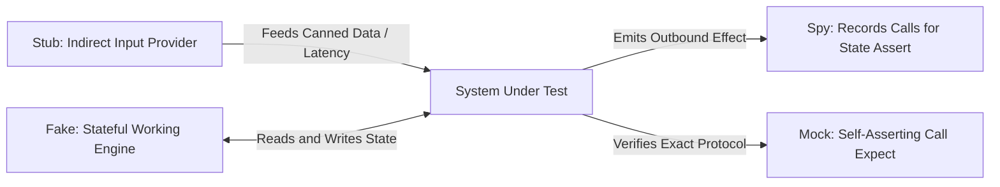
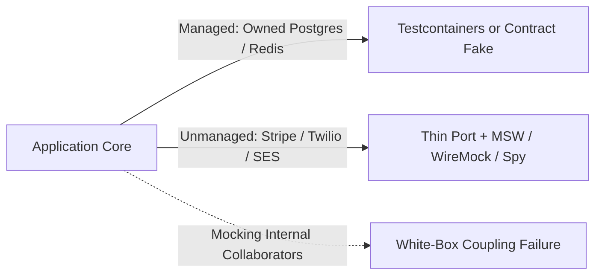

---
tags:
  - software-engineering
  - testing
  - mocking
  - test-doubles
created: 2026-11-13
updated: 2026-11-13
status: 🟢
level: mid-to-senior
---
# Mocking & Test Doubles

> [!abstract] Hub Context
> Part of [[Programming/Software Engineering/Testing/Testing Complete Guide|Testing Complete Guide]]. Integrates directly with [[Programming/Software Engineering/Testing/Unit Testing|Unit Testing]], [[Programming/Software Engineering/Testing/Integration Testing|Integration Testing]], [[Programming/Software Engineering/Testing/TDD|TDD]], [[Programming/Software Engineering/Testing/E2E Testing|E2E Testing]], and [[Programming/Software Engineering/SOLID/Dependency Inversion|Dependency Inversion]].

Using "mock" as a generic label for every test replacement masks critical architectural distinctions. Replacing real collaborators with arbitrary `vi.mock()` patches couples test suites to private library internals, suppresses real serialization errors, and causes **white-box test rot**—where tests verify only that scripted stubs echoed canned inputs back to the System Under Test (SUT). Selecting the exact test double type and confining doubles strictly to architectural boundaries keeps test suites both sub-millisecond fast and resilient across major refactors.

---

## 1. First-Principles Mechanics & Complete Architecture

### Gerard Meszaros's 5-Type Test Double Taxonomy

Gerard Meszaros (*xUnit Test Patterns*) classifies every test replacement into five distinct mechanisms based on **data direction** (indirect inputs flowing *into* the SUT vs indirect outputs emitted *out* of the SUT) and **verification mode** (state vs interaction):



| Test Double | Runtime Mechanism | Verification Mode | Canonical Production Role |
|---|---|---|---|
| **Dummy** | Object passed solely to satisfy a static type signature or constructor; contains no logic and throws if accidentally invoked | None (never asserted) | `NullAuditLogger` supplied when exercising unrelated domain calculation paths |
| **Stub** | Returns pre-configured canned answers (values, errors, or artificial timeouts) to **indirect inputs** queried by the SUT | **State-based** on SUT output (never assert call count on a stub!) | `FixedClock` returning `2026-11-13T12:00:00Z` or `StubFxProvider` simulating a timeout |
| **Spy** | Records **indirect outputs** emitted by the SUT (captured arguments, message payloads, counts) for explicit assertion after `Act` | **Effect / State-based** inspection after execution | `InMemoryEmailOutbox` capturing `{ to, templateId }` payloads emitted across an SMTP port |
| **Mock** | Pre-programmed expectation object configured *before* `Act` that fails the test directly if expected method signatures/counts mismatch | **Interaction-based (Strict)** | `vi.fn()` expectation verifying an unmanaged third-party port call signature |
| **Fake** | Lightweight **working implementation** enforcing real business/storage semantics in memory without production I/O overhead | **State-based** against real behavioral semantics | `InMemoryOrderRepo` backed by `Map` + `structuredClone` + version locking + unique keys |

#### Critical Rule: Never Assert Call Counts on Indirect Inputs (Stubs)

When the SUT queries a dependency solely to retrieve data (`clock.now()`, `fxRateService.getRate('EUR')`, `repo.findById(id)`), that double is a **Stub** or **Fake**, never a Mock. Asserting `expect(clock.now).toHaveBeenCalledTimes(1)` creates immediate refactoring fragility: if a performance optimization caches the rate or checks `status === 'PAID'` before querying `clock.now()`, the test fails even though business behavior is identical. Verify **indirect inputs** by checking the SUT's resulting state or return value, and reserve invocation assertions exclusively for **unmanaged outbound side effects**.

---

### Vladimir Khorikov's Managed vs Unmanaged Dependency Rule

Vladimir Khorikov divides out-of-process dependencies into two strict architectural categories that dictate whether real code, stateful fakes, or boundary mocks are permitted:



1. **Managed Dependencies** (out-of-process state owned entirely by *your* application, invisible to external consumers—your Postgres database, Redis cluster, internal message broker, or sibling domain classes):
   - **Rule**: **NEVER mock internal collaborations or database drivers (`vi.mock('pg')`, `vi.mock('@prisma/client')`).**
   - Inside unit/application tests, use **real domain objects** plus **Contract-Verified Stateful In-Memory Fakes** (`InMemoryOrderRepo`). Inside integration tests, run against **real Docker engines via Testcontainers** (`[[Programming/Software Engineering/Testing/Integration Testing|Integration Testing]]`).
2. **Unmanaged Dependencies** (external systems you do not control or whose side effects are visible outside your application boundary—Stripe, Twilio, SendGrid SMTP, AWS S3 external buckets, third-party OAuth):
   - **Rule**: **Isolate behind a narrow domain Port (`PaymentGateway`, `EmailDispatcher`), double outbound calls with a Spy/Fake in application tests, and verify the concrete HTTP adapter directly against MSW or Docker WireMock.**

---

### Why Mocking What You Don't Own Causes Silent Contract Drift

Mocking third-party SDKs directly (`vi.mock('stripe')`, `vi.mock('axios')`, `vi.mock('pg')`) encodes undocumented assumptions inside test setups that silently diverge from reality over time:

- **Type & Serialization Drift**: `node-postgres` (`pg`) returns SQL `BIGINT` (`int8`) columns as strings (`"500"`) rather than JavaScript numbers (`500`). A mocked `pool.query` returning `{ rows: [{ balance: 500 }] }` passes 100% of unit tests while production code fails arithmetic checks (`"500" + 100 === "500100"`).
- **Error Class & Retry Header Drift**: Mocking `axios.post` to throw `new Error('timeout')` skips `AxiosError` property checks (`error.response?.status === 429` or `Retry-After` header parsing) that break during library minor upgrades.
- **Architectural Fix**:
  1. **Wrap external SDKs in a Thin Port Adapter** owned by your domain (`[[Programming/Software Engineering/Architectural Patterns/Hexagonal Architecture|Hexagonal Architecture]]`).
  2. **Test the Adapter at the HTTP Wire Boundary** via **MSW** or **WireMock** so real JSON parsing, headers, and `AbortSignal` timeouts execute verbatim.
  3. **Verify Stateful Fakes with Shared Contract Test Suites** executed identically against both `InMemory*Repo` and real `Pg*Repo` (Testcontainers).
  4. **Verify Cross-Service HTTP/Event Schemas** with **Pact CDC** (`[[Programming/Software Engineering/Testing/E2E Testing|E2E Testing]]`).

---

### Vitest `vi.mock()` Hoisting & Lifecycle Mechanics

When teams do patch ES modules in Vitest (for legacy refactoring seams or specific browser environment shims), misunderstanding Vite's AST hoisting and mock-reset semantics causes subtle cross-test crashes.

#### Why `vi.mock()` Crashes with `ReferenceError` (Hoisting Internals)

Vite transforms every test file before execution by **hoisting all top-level `vi.mock(...)` factory calls above every `import` statement**:

```typescript
// BROKEN: Vite hoists vi.mock() ABOVE `const mockCharge = vi.fn()`, causing ReferenceError!
const mockCharge = vi.fn();
vi.mock('../src/stripe-client', () => ({ chargeCard: mockCharge }));
```

When variables referenced inside `vi.mock()` must be initialized before imports run, wrap them explicitly inside **`vi.hoisted()`**:

```typescript
const { mockCharge } = vi.hoisted(() => ({
  mockCharge: vi.fn(),
}));
vi.mock('../src/stripe-client', () => ({ chargeCard: mockCharge }));
```

#### `vi.clearAllMocks()` vs `vi.resetAllMocks()` vs `vi.restoreAllMocks()`

| Vitest Cleanup API | Clears `.mock.calls` & `.mock.results`? | Resets `mockImplementation` / `mockReturnValue`? | Restores `vi.spyOn()` Original Method? | Safe Default for `afterEach`? |
|---|---|---|---|---|
| **`vi.clearAllMocks()`** | **Yes** | **No** (retains queued return values!) | **No** (leaves spies attached) | Dangerous if Test 1 alters a shared mock's return value |
| **`vi.resetAllMocks()`** | **Yes** | **Yes** (wipes implementations back to `undefined`!) | **No** | Dangerous with `vi.mock()` factories—wipes default factory return values after Test 1! |
| **`vi.restoreAllMocks()`** | **Yes** | **Yes** (resets `vi.fn()` mocks) | **Yes** (restores original real functions on `vi.spyOn`) | **Recommended baseline** (`restoreMocks: true` in `vitest.config.ts`) |

*(Note: `vi.restoreAllMocks()` restores `vi.spyOn()` targets cleanly, whereas module replacements created via `vi.mock()` persist for the entire test file lifetime unless explicitly altered with `vi.doMock()` + `vi.resetModules()`).*

---

### Network-Boundary Interception: MSW v2 vs Docker WireMock

When testing concrete HTTP client adapters (`StripePaymentGateway`, `ShippingRateClient`), mocking `fetch` or `axios` bypasses URL encoding, header casing, status code branching, stream decoding, and `AbortSignal.timeout`. Two wire-boundary tools preserve real HTTP execution:

| Dimension | MSW v2 (Mock Service Worker) | Docker WireMock |
|---|---|---|
| **Interception Layer** | **In-Process Node (`msw/node` `undici`/`http` interceptor) & Browser Service Worker (`msw/browser`)** | **Out-of-Process Real TCP HTTP Server** inside Docker container |
| **Language Scope** | TypeScript / JavaScript ecosystem (Vitest, Jest, Playwright, Storybook) | Language-agnostic (Go, Java, Rust, Python, Node, polyglot CI compose stacks) |
| **Fault & Chaos Modes** | Status errors, `HttpResponse.error()` network failure, `delay()` async timeouts, dynamic JS request inspection | Fixed/random chunked delays, TCP `CONNECTION_RESET_BY_PEER`, malformed HTTP junk bytes, stateful JSON scenarios |
| **Safety Guardrail** | `server.listen({ onUnhandledRequest: 'error' })` aborts loudly on unstubbed internet calls | Unmatched requests return explicit `404` diagnostic diff showing nearest stub mismatch |

---

## 2. Real-World Use Cases & Decision Matrix

| Collaborator / Dependency | Classification | Recommended Double Strategy | Why Other Doubles Fail |
|---|---|---|---|
| **Domain Value Objects (`Money`, `TaxPolicy`)** | Pure Domain Code | **Zero Doubles** (Real objects) | Mocking domain logic hides integration mismatches and causes maximum refactoring fragility |
| **System Time / UUID Generator** | Indirect Input (Unmanaged Boundary) | **Stub** (`FakeClock`, `SequenceIdGenerator`) | Asserting call counts (`Mock`) breaks benign optimizations; real `Date.now()` causes midnight/timezone flakes |
| **Audit Logger (Non-Functional in Test)** | Orthogonal Side Effect | **Dummy** (`NullLogger`) | Using a full spy or mock adds irrelevant noise unless audit logging itself is the tested requirement |
| **Email / SMS / Webhook Gateway** | Unmanaged Outbound Side Effect | **Spy** (`InMemoryEmailOutbox`) in unit tests; **MSW/WireMock** on concrete HTTP adapter | Real SMTP leaks spam or blocks offline CI; strict Mocks couple tests to method signatures instead of delivered payload |
| **PostgreSQL / Redis Repository** | Managed Persistence | **Stateful In-Memory Fake + Shared Contract Suite** in fast tests; **Testcontainers** in integration tests | Mocking `pg`/`prisma` misses SQL constraint violations (`23505`), `BIGINT` string coercion, and locking bugs |
| **External Stripe / GitHub HTTP API** | Unmanaged External SaaS | **MSW v2** (`setupServer` in Vitest, `setupWorker` in Browser) or **Docker WireMock** | Patching `fetch`/`axios` skips real query serialization, `AbortSignal.timeout`, and status error handling |

---

## 3. Step-by-Step Practical Application (Complete Runnable Production Suites)

### Implementation 1: All 5 Meszaros Test Doubles in Strict TypeScript

```typescript
// src/doubles/meszaros-doubles.ts
export interface LoggerPort {
  info(message: string, meta?: Record<string, unknown>): void;
}

export interface ClockPort {
  nowUtc(): Date;
}

export interface FxRatePort {
  fetchUsdToEurRate(signal?: AbortSignal): Promise<number>;
}

export interface EmailMessage {
  readonly to: string;
  readonly subject: string;
  readonly body: string;
}

export interface EmailDispatcherPort {
  send(message: EmailMessage): Promise<void>;
}

// 1. DUMMY: Satisfies LoggerPort signature; crashes loudly if unexpectedly invoked
export class DummyLogger implements LoggerPort {
  info(message: string): void {
    throw new Error(`DummyLogger must never be invoked during this test; got: ${message}`);
  }
}

// 2. STUB: Supplies deterministic indirect inputs + optional latency/timeout failure simulation
export class StubClock implements ClockPort {
  constructor(private readonly fixedDateUtc: Date) {}
  nowUtc(): Date {
    return new Date(this.fixedDateUtc.getTime());
  }
}

export class StubFxRateProvider implements FxRatePort {
  constructor(
    private readonly rate: number,
    private readonly simulatedDelayMs = 0,
  ) {}

  async fetchUsdToEurRate(signal?: AbortSignal): Promise<number> {
    if (this.simulatedDelayMs > 0) {
      await new Promise<void>((resolve, reject) => {
        const timer = setTimeout(resolve, this.simulatedDelayMs);
        signal?.addEventListener(
          'abort',
          () => {
            clearTimeout(timer);
            reject(signal.reason ?? new Error('Aborted'));
          },
          { once: true },
        );
      });
    }
    return this.rate;
  }
}

// 3. SPY: Records outbound side effects for post-execution inspection
export class SpyEmailOutbox implements EmailDispatcherPort {
  readonly sentMessages: EmailMessage[] = [];

  async send(message: EmailMessage): Promise<void> {
    this.sentMessages.push(structuredClone(message));
  }
}

// 4. MOCK: Pre-configured expectation validator that self-verifies interaction contract
export class MockEmailDispatcher implements EmailDispatcherPort {
  private expectedCalls: Array<{ to: string; subjectContains: string }> = [];
  private observedCalls: EmailMessage[] = [];

  expectSend(to: string, subjectContains: string): void {
    this.expectedCalls.push({ to, subjectContains });
  }

  async send(message: EmailMessage): Promise<void> {
    this.observedCalls.push(message);
  }

  verify(): void {
    if (this.observedCalls.length !== this.expectedCalls.length) {
      throw new Error(
        `Mock expectation failed: expected ${this.expectedCalls.length} sends, observed ${this.observedCalls.length}`,
      );
    }
    for (let i = 0; i < this.expectedCalls.length; i += 1) {
      const exp = this.expectedCalls[i]!;
      const obs = this.observedCalls[i]!;
      if (obs.to !== exp.to || !obs.subject.includes(exp.subjectContains)) {
        throw new Error(
          `Mock expectation mismatch at index ${i}: expected to=${exp.to}, got to=${obs.to}, subject=${obs.subject}`,
        );
      }
    }
  }
}

// 5. STATEFUL FAKE: Working in-memory implementation preserving real state invariants
export interface OutboxRecord {
  readonly id: string;
  readonly message: EmailMessage;
  status: 'PENDING' | 'DISPATCHED';
}

export class InMemoryEmailOutboxFake {
  private readonly records = new Map<string, OutboxRecord>();
  private nextSeq = 0;

  async enqueue(message: EmailMessage): Promise<OutboxRecord> {
    this.nextSeq += 1;
    const record: OutboxRecord = {
      id: `msg_${this.nextSeq}`,
      message: structuredClone(message),
      status: 'PENDING',
    };
    this.records.set(record.id, record);
    return structuredClone(record);
  }

  async listPending(): Promise<OutboxRecord[]> {
    return [...this.records.values()]
      .filter((r) => r.status === 'PENDING')
      .map((r) => structuredClone(r));
  }

  async markDispatched(id: string): Promise<void> {
    const existing = this.records.get(id);
    if (!existing) {
      throw new Error(`Outbox record ${id} not found`);
    }
    existing.status = 'DISPATCHED';
  }
}
```

```typescript
// tests/unit/meszaros-doubles.spec.ts
import { describe, expect, it } from 'vitest';
import {
  InMemoryEmailOutboxFake,
  MockEmailDispatcher,
  SpyEmailOutbox,
  StubClock,
  StubFxRateProvider,
} from '../../src/doubles/meszaros-doubles';

describe('Meszaros 5-Double Taxonomy Behavior', () => {
  it('verifies Stub latency timeout cancellation without real network wait', async () => {
    const slowFx = new StubFxRateProvider(0.92, 500);
    await expect(slowFx.fetchUsdToEurRate(AbortSignal.timeout(20))).rejects.toThrow(/aborted|Timeout/i);

    const fastFx = new StubFxRateProvider(0.92);
    expect(await fastFx.fetchUsdToEurRate()).toBe(0.92);
  });

  it('contrasts Spy post-hoc state verification vs Mock pre-programmed verification', async () => {
    const clock = new StubClock(new Date('2026-11-13T10:00:00.000Z'));
    const spy = new SpyEmailOutbox();
    await spy.send({
      to: 'billing@acme.test',
      subject: `Invoice ${clock.nowUtc().toISOString()}`,
      body: 'Amount due: $49.00',
    });
    expect(spy.sentMessages).toHaveLength(1);
    expect(spy.sentMessages[0]?.to).toBe('billing@acme.test');

    const mock = new MockEmailDispatcher();
    mock.expectSend('billing@acme.test', 'Invoice');
    await mock.send({
      to: 'billing@acme.test',
      subject: 'Invoice #104',
      body: 'Paid',
    });
    expect(() => mock.verify()).not.toThrow();
  });

  it('demonstrates Stateful Fake enforcing outbox state lifecycle and clone isolation', async () => {
    const fakeOutbox = new InMemoryEmailOutboxFake();
    const created = await fakeOutbox.enqueue({
      to: 'ops@acme.test',
      subject: 'Alert',
      body: 'Disk 90%',
    });

    // Mutating returned object does NOT bypass fake state storage
    created.status = 'DISPATCHED';
    expect(await fakeOutbox.listPending()).toHaveLength(1);

    await fakeOutbox.markDispatched(created.id);
    expect(await fakeOutbox.listPending()).toHaveLength(0);
  });
});
```

---

### Implementation 2: Stateful In-Memory Fake + Shared Contract Test Suite (`OrderRepository`)

A Stateful In-Memory Fake is **dangerous unless guaranteed to match real PostgreSQL repository semantics**. Placing both `InMemoryOrderRepository` and `PgOrderRepository` under an identical **Shared Contract Test Suite** guarantees zero semantic drift in uniqueness errors, case normalization, defensive copying, sorting, and optimistic locking.

#### `src/ports/order-repository.ts`

```typescript
export interface OrderRecord {
  readonly id: string;
  readonly customerEmail: string;
  readonly totalCents: number;
  readonly version: number;
  readonly createdAtUtcMs: number;
}

export class DuplicateOrderError extends Error {
  constructor(id: string) {
    super(`Order ${id} already exists`);
    this.name = 'DuplicateOrderError';
  }
}

export class OptimisticConcurrencyError extends Error {
  constructor(id: string, expectedVersion: number) {
    super(`Version conflict updating order ${id} at expected version ${expectedVersion}`);
    this.name = 'OptimisticConcurrencyError';
  }
}

export interface OrderRepositoryPort {
  insert(order: OrderRecord): Promise<void>;
  update(order: OrderRecord, expectedVersion: number): Promise<OrderRecord>;
  findById(id: string): Promise<OrderRecord | undefined>;
  listByCustomerEmail(email: string): Promise<OrderRecord[]>;
}
```

#### `src/fakes/in-memory-order-repository.ts`

```typescript
import {
  DuplicateOrderError,
  OptimisticConcurrencyError,
  type OrderRecord,
  type OrderRepositoryPort,
} from '../ports/order-repository';

function normalizeEmail(email: string): string {
  return email.trim().toLowerCase();
}

export class InMemoryOrderRepository implements OrderRepositoryPort {
  private readonly rows = new Map<string, OrderRecord>();

  async insert(order: OrderRecord): Promise<void> {
    if (this.rows.has(order.id)) {
      throw new DuplicateOrderError(order.id);
    }
    this.rows.set(order.id, {
      ...structuredClone(order),
      customerEmail: normalizeEmail(order.customerEmail),
    });
  }

  async update(order: OrderRecord, expectedVersion: number): Promise<OrderRecord> {
    const current = this.rows.get(order.id);
    if (!current || current.version !== expectedVersion) {
      throw new OptimisticConcurrencyError(order.id, expectedVersion);
    }
    const updated: OrderRecord = {
      ...structuredClone(order),
      customerEmail: normalizeEmail(order.customerEmail),
      version: expectedVersion + 1,
    };
    this.rows.set(order.id, updated);
    return structuredClone(updated);
  }

  async findById(id: string): Promise<OrderRecord | undefined> {
    const row = this.rows.get(id);
    return row ? structuredClone(row) : undefined;
  }

  async listByCustomerEmail(email: string): Promise<OrderRecord[]> {
    const normalized = normalizeEmail(email);
    return [...this.rows.values()]
      .filter((row) => row.customerEmail === normalized)
      .sort((a, b) => a.createdAtUtcMs - b.createdAtUtcMs || a.id.localeCompare(b.id))
      .map((row) => structuredClone(row));
  }
}
```

#### `tests/contracts/order-repository.contract.ts`

```typescript
import { describe, expect, it } from 'vitest';
import {
  DuplicateOrderError,
  OptimisticConcurrencyError,
  type OrderRecord,
  type OrderRepositoryPort,
} from '../../src/ports/order-repository';

export function runOrderRepositoryContractSuite(
  suiteName: string,
  createRepo: () => Promise<{ repo: OrderRepositoryPort; cleanup: () => Promise<void> }>,
): void {
  describe(`${suiteName} (OrderRepository Contract Parity)`, () => {
    it('inserts, finds by ID, and isolates persisted state from caller object mutation', async () => {
      const { repo, cleanup } = await createRepo();
      try {
        const draft: OrderRecord = {
          id: 'ord-1',
          customerEmail: 'Alice@Acme.com',
          totalCents: 4_200,
          version: 1,
          createdAtUtcMs: 1_700_000_000_000,
        };
        await repo.insert(draft);

        // Mutating caller object after insert must NOT alter persisted repository state
        (draft as { totalCents: number }).totalCents = 999_999;

        const fetched = await repo.findById('ord-1');
        expect(fetched?.totalCents).toBe(4_200);
        expect(fetched?.version).toBe(1);
      } finally {
        await cleanup();
      }
    });

    it('rejects duplicate IDs with DuplicateOrderError', async () => {
      const { repo, cleanup } = await createRepo();
      try {
        const order: OrderRecord = {
          id: 'ord-dup',
          customerEmail: 'bob@acme.com',
          totalCents: 1_000,
          version: 1,
          createdAtUtcMs: 1_700_000_000_000,
        };
        await repo.insert(order);
        await expect(repo.insert(order)).rejects.toThrow(DuplicateOrderError);
      } finally {
        await cleanup();
      }
    });

    it('enforces optimistic concurrency version checks and increments version on commit', async () => {
      const { repo, cleanup } = await createRepo();
      try {
        const initial: OrderRecord = {
          id: 'ord-ver',
          customerEmail: 'carol@acme.com',
          totalCents: 2_000,
          version: 1,
          createdAtUtcMs: 1_700_000_000_000,
        };
        await repo.insert(initial);

        const committed = await repo.update({ ...initial, totalCents: 2_500 }, 1);
        expect(committed.version).toBe(2);
        expect(committed.totalCents).toBe(2_500);

        // Stale writer attempting update against version 1 fails deterministically
        await expect(repo.update({ ...initial, totalCents: 3_000 }, 1)).rejects.toThrow(
          OptimisticConcurrencyError,
        );
      } finally {
        await cleanup();
      }
    });

    it('matches customer emails case-insensitively and returns deterministic ascending order', async () => {
      const { repo, cleanup } = await createRepo();
      try {
        await repo.insert({
          id: 'ord-b',
          customerEmail: 'Dana@Acme.com',
          totalCents: 3_000,
          version: 1,
          createdAtUtcMs: 2_000,
        });
        await repo.insert({
          id: 'ord-a',
          customerEmail: 'dana@acme.com',
          totalCents: 1_500,
          version: 1,
          createdAtUtcMs: 1_000,
        });

        const results = await repo.listByCustomerEmail('DANA@ACME.COM');
        expect(results.map((r) => r.id)).toEqual(['ord-a', 'ord-b']);
      } finally {
        await cleanup();
      }
    });
  });
}
```

#### `tests/unit/in-memory-order-repository.spec.ts`

```typescript
import { InMemoryOrderRepository } from '../../src/fakes/in-memory-order-repository';
import { runOrderRepositoryContractSuite } from '../contracts/order-repository.contract';

runOrderRepositoryContractSuite('InMemoryOrderRepository', async () => ({
  repo: new InMemoryOrderRepository(),
  cleanup: async () => {},
}));

// In tests/integration/pg-order-repository.spec.ts, invoke the exact same function:
// runOrderRepositoryContractSuite('PgOrderRepository (Postgres 16)', async () => ({ ... }));
```

---

### Implementation 3: MSW v2 HTTP Boundary Testing (`StripePaymentGateway` + `msw/node`)

#### `src/adapters/stripe-payment-gateway.ts`

```typescript
export interface ChargeRequest {
  readonly amountCents: number;
  readonly currency: 'usd' | 'eur';
  readonly paymentMethodToken: string;
  readonly idempotencyKey: string;
}

export interface ChargeReceipt {
  readonly chargeId: string;
  readonly status: 'succeeded';
}

export class CardDeclinedError extends Error {
  constructor(readonly declineCode: string) {
    super(`Payment declined: ${declineCode}`);
    this.name = 'CardDeclinedError';
  }
}

export class UpstreamGatewayError extends Error {
  constructor(readonly statusCode: number, message: string) {
    super(message);
    this.name = 'UpstreamGatewayError';
  }
}

export class StripePaymentGateway {
  constructor(
    private readonly baseUrl: string,
    private readonly apiKey: string,
    private readonly options: {
      readonly timeoutMs: number;
      readonly maxRetries: number;
      readonly retryDelayMs: number;
    },
  ) {}

  async charge(request: ChargeRequest): Promise<ChargeReceipt> {
    let lastError: unknown;

    for (let attempt = 0; attempt <= this.options.maxRetries; attempt += 1) {
      try {
        const response = await fetch(`${this.baseUrl}/v1/charges`, {
          method: 'POST',
          headers: {
            authorization: `Bearer ${this.apiKey}`,
            'content-type': 'application/json',
            'idempotency-key': request.idempotencyKey,
          },
          body: JSON.stringify({
            amount: request.amountCents,
            currency: request.currency,
            source: request.paymentMethodToken,
          }),
          signal: AbortSignal.timeout(this.options.timeoutMs),
        });

        if (response.status === 402) {
          const payload = (await response.json()) as { error?: { code?: string } };
          throw new CardDeclinedError(payload.error?.code ?? 'card_declined');
        }

        if (response.status === 429 || response.status >= 500) {
          throw new UpstreamGatewayError(response.status, `Transient HTTP ${response.status}`);
        }

        if (!response.ok) {
          throw new UpstreamGatewayError(response.status, `Client HTTP ${response.status}`);
        }

        const body = (await response.json()) as Partial<ChargeReceipt>;
        if (typeof body.chargeId !== 'string' || body.status !== 'succeeded') {
          throw new Error('Invalid charge payload returned by payment gateway');
        }
        return { chargeId: body.chargeId, status: body.status };
      } catch (error) {
        lastError = error;
        const isTransientHttp =
          error instanceof UpstreamGatewayError &&
          (error.statusCode === 429 || error.statusCode >= 500);
        const isNetworkError = error instanceof TypeError;

        if ((isTransientHttp || isNetworkError) && attempt < this.options.maxRetries) {
          if (this.options.retryDelayMs > 0) {
            await new Promise((r) => setTimeout(r, this.options.retryDelayMs));
          }
          continue;
        }
        throw error;
      }
    }

    throw lastError;
  }
}
```

#### `tests/integration/stripe-payment-gateway.msw.spec.ts`

```typescript
import { delay, http, HttpResponse } from 'msw';
import { setupServer } from 'msw/node';
import { afterAll, afterEach, beforeAll, describe, expect, it } from 'vitest';
import {
  CardDeclinedError,
  StripePaymentGateway,
  UpstreamGatewayError,
} from '../../src/adapters/stripe-payment-gateway';

const server = setupServer();

describe('StripePaymentGateway (MSW v2 HTTP Wire Tests)', () => {
  beforeAll(() => {
    // Rejects any unstubbed external HTTP request so tests never leak onto the network
    server.listen({ onUnhandledRequest: 'error' });
  });

  afterEach(() => {
    server.resetHandlers();
  });

  afterAll(() => {
    server.close();
  });

  it('sends bearer auth + Idempotency-Key header and parses 201 receipt', async () => {
    let capturedIdempotencyKey: string | null = null;
    let capturedBody: unknown = null;

    server.use(
      http.post('https://payments.test/v1/charges', async ({ request }) => {
        if (request.headers.get('authorization') !== 'Bearer sk_live_secret') {
          return HttpResponse.json({ error: 'unauthorized' }, { status: 401 });
        }
        capturedIdempotencyKey = request.headers.get('idempotency-key');
        capturedBody = await request.json();
        return HttpResponse.json({ chargeId: 'ch_9001', status: 'succeeded' }, { status: 201 });
      }),
    );

    const gateway = new StripePaymentGateway('https://payments.test', 'sk_live_secret', {
      timeoutMs: 300,
      maxRetries: 0,
      retryDelayMs: 0,
    });

    const receipt = await gateway.charge({
      amountCents: 4_500,
      currency: 'usd',
      paymentMethodToken: 'pm_card_visa',
      idempotencyKey: 'idem-order-77',
    });

    expect(receipt).toEqual({ chargeId: 'ch_9001', status: 'succeeded' });
    expect(capturedIdempotencyKey).toBe('idem-order-77');
    expect(capturedBody).toEqual({ amount: 4_500, currency: 'usd', source: 'pm_card_visa' });
  });

  it('retries transient HTTP 429 rate limits and succeeds on retry without dropping headers', async () => {
    let attempts = 0;
    server.use(
      http.post('https://payments.test/v1/charges', () => {
        attempts += 1;
        if (attempts === 1) {
          return HttpResponse.json(
            { error: 'rate_limited' },
            { status: 429, headers: { 'Retry-After': '0' } },
          );
        }
        return HttpResponse.json({ chargeId: 'ch_retry_ok', status: 'succeeded' }, { status: 201 });
      }),
    );

    const gateway = new StripePaymentGateway('https://payments.test', 'sk_live_secret', {
      timeoutMs: 300,
      maxRetries: 2,
      retryDelayMs: 5,
    });

    const receipt = await gateway.charge({
      amountCents: 2_000,
      currency: 'eur',
      paymentMethodToken: 'pm_card_eu',
      idempotencyKey: 'idem-retry-1',
    });

    expect(receipt.chargeId).toBe('ch_retry_ok');
    expect(attempts).toBe(2);
  });

  it('fails fast on HTTP 402 card decline without retrying', async () => {
    let attempts = 0;
    server.use(
      http.post('https://payments.test/v1/charges', () => {
        attempts += 1;
        return HttpResponse.json({ error: { code: 'insufficient_funds' } }, { status: 402 });
      }),
    );

    const gateway = new StripePaymentGateway('https://payments.test', 'sk_live_secret', {
      timeoutMs: 300,
      maxRetries: 2,
      retryDelayMs: 5,
    });

    await expect(
      gateway.charge({
        amountCents: 9_000,
        currency: 'usd',
        paymentMethodToken: 'pm_declined',
        idempotencyKey: 'idem-402',
      }),
    ).rejects.toThrow(CardDeclinedError);
    expect(attempts).toBe(1);
  });

  it('aborts cleanly via AbortSignal.timeout when upstream stalls past timeoutMs', async () => {
    server.use(
      http.post('https://payments.test/v1/charges', async () => {
        await delay(400);
        return HttpResponse.json({ chargeId: 'ch_late', status: 'succeeded' }, { status: 201 });
      }),
    );

    const gateway = new StripePaymentGateway('https://payments.test', 'sk_live_secret', {
      timeoutMs: 60,
      maxRetries: 0,
      retryDelayMs: 0,
    });

    await expect(
      gateway.charge({
        amountCents: 1_000,
        currency: 'usd',
        paymentMethodToken: 'pm_slow',
        idempotencyKey: 'idem-timeout',
      }),
    ).rejects.toThrow(/TimeoutError|aborted/i);
  });

  it('surfaces UpstreamGatewayError when retries exhaust across continuous 503 outage', async () => {
    server.use(
      http.post('https://payments.test/v1/charges', () =>
        HttpResponse.json({ error: 'unavailable' }, { status: 503 }),
      ),
    );

    const gateway = new StripePaymentGateway('https://payments.test', 'sk_live_secret', {
      timeoutMs: 200,
      maxRetries: 1,
      retryDelayMs: 1,
    });

    await expect(
      gateway.charge({
        amountCents: 1_000,
        currency: 'usd',
        paymentMethodToken: 'pm_down',
        idempotencyKey: 'idem-503',
      }),
    ).rejects.toThrow(UpstreamGatewayError);
  });
});
```

#### Browser Service Worker Setup Parity (`src/mocks/browser.ts`)

For browser tests (Playwright, Storybook, or Vitest Browser Mode), the exact same handler array plugs into `setupWorker` without rewriting stub definitions:

```typescript
import { http, HttpResponse } from 'msw';
import { setupWorker } from 'msw/browser';

export const paymentBrowserHandlers = [
  http.post('https://payments.test/v1/charges', () =>
    HttpResponse.json({ chargeId: 'ch_browser_ok', status: 'succeeded' }, { status: 201 }),
  ),
];

export const worker = setupWorker(...paymentBrowserHandlers);
```

---

### Implementation 4: Docker WireMock CI Configuration (Polyglot / Stateful Faults)

#### `docker-compose.wiremock.yml`

```yaml
services:
  wiremock-psp:
    image: wiremock/wiremock:3.9.2-alpine
    ports:
      - "8089:8080"
    volumes:
      - ./wiremock/mappings:/home/wiremock/mappings:ro
    command:
      - "--verbose"
      - "--global-response-templating"
    healthcheck:
      test: ["CMD", "wget", "-qO-", "http://localhost:8080/__admin/health"]
      interval: 2s
      timeout: 2s
      retries: 10
```

#### `wiremock/mappings/stripe-retry-scenario.json` (Stateful `503` $\to$ `201` Transition)

```json
{
  "mappings": [
    {
      "scenarioName": "StripeTransientRetry",
      "requiredScenarioState": "Started",
      "newScenarioState": "SecondAttemptSucceeded",
      "request": {
        "method": "POST",
        "urlPath": "/v1/charges",
        "headers": {
          "Idempotency-Key": { "equalTo": "idem-ci-retry" }
        }
      },
      "response": {
        "status": 503,
        "jsonBody": { "error": { "code": "service_unavailable" } },
        "headers": { "Content-Type": "application/json" }
      }
    },
    {
      "scenarioName": "StripeTransientRetry",
      "requiredScenarioState": "SecondAttemptSucceeded",
      "request": {
        "method": "POST",
        "urlPath": "/v1/charges",
        "headers": {
          "Idempotency-Key": { "equalTo": "idem-ci-retry" }
        }
      },
      "response": {
        "status": 201,
        "jsonBody": { "chargeId": "ch_wiremock_ok", "status": "succeeded" },
        "headers": { "Content-Type": "application/json" }
      }
    },
    {
      "request": {
        "method": "POST",
        "urlPath": "/v1/charges",
        "headers": {
          "Idempotency-Key": { "equalTo": "idem-ci-tcp-reset" }
        }
      },
      "response": {
        "fault": "CONNECTION_RESET_BY_PEER"
      }
    }
  ]
}
```

---

### Implementation 5: Migrating a Flaky `vi.mock()` White-Box Suite to Resilient Port Fakes

#### BEFORE: Fragile White-Box Suite (Mocking Drivers, Modules & Internals)

```typescript
// ANTI-PATTERN: Couples to pg driver SQL internals, axios SDK, and leaks mock state
import { vi, describe, it, expect, afterEach } from 'vitest';

const { mockQuery, mockAxiosPost } = vi.hoisted(() => ({
  mockQuery: vi.fn(),
  mockAxiosPost: vi.fn(),
}));

vi.mock('pg', () => ({ Pool: vi.fn(() => ({ query: mockQuery })) }));
vi.mock('axios', () => ({ default: { post: mockAxiosPost } }));

describe('Flaky White-Box Invoice Service', () => {
  afterEach(() => {
    vi.clearAllMocks(); // leaves mockResolvedValueOnce remnants if a test fails early!
  });

  it('charges invoice and sends receipt', async () => {
    mockQuery
      .mockResolvedValueOnce({ rows: [{ id: 'inv-1', amount: 5000, status: 'OPEN' }] })
      .mockResolvedValueOnce({ rows: [] });
    mockAxiosPost.mockResolvedValueOnce({ data: { id: 'ch_1' } });

    // Any refactor splitting SQL queries or swapping axios for native fetch destroys this test
    expect(true).toBe(true);
  });
});
```

#### AFTER: Clean Hexagonal Ports + Stateful Fake + Boundary Spy

```typescript
// RESILIENT PATTERN: Zero vi.mock() patches, high refactoring resistance, genuine invariant checks
import { describe, expect, it } from 'vitest';

interface Invoice {
  readonly id: string;
  readonly customerEmail: string;
  readonly amountCents: number;
  status: 'OPEN' | 'PAID';
}

interface InvoiceRepoPort {
  findById(id: string): Promise<Invoice | undefined>;
  save(invoice: Invoice): Promise<void>;
}

interface PaymentPort {
  charge(amountCents: number, idempotencyKey: string): Promise<{ chargeId: string }>;
}

interface ReceiptMailerPort {
  sendReceipt(to: string, chargeId: string, amountCents: number): Promise<void>;
}

class PayInvoiceUseCase {
  constructor(
    private readonly repo: InvoiceRepoPort,
    private readonly payments: PaymentPort,
    private readonly mailer: ReceiptMailerPort,
  ) {}

  async execute(invoiceId: string): Promise<void> {
    const invoice = await this.repo.findById(invoiceId);
    if (!invoice) throw new Error(`Invoice ${invoiceId} not found`);
    if (invoice.status === 'PAID') return;

    const { chargeId } = await this.payments.charge(invoice.amountCents, `pay_${invoice.id}`);
    invoice.status = 'PAID';
    await this.repo.save(invoice);
    await this.mailer.sendReceipt(invoice.customerEmail, chargeId, invoice.amountCents);
  }
}

class InMemoryInvoiceRepoFake implements InvoiceRepoPort {
  private readonly rows = new Map<string, Invoice>();
  async findById(id: string): Promise<Invoice | undefined> {
    const r = this.rows.get(id);
    return r ? structuredClone(r) : undefined;
  }
  async save(invoice: Invoice): Promise<void> {
    this.rows.set(invoice.id, structuredClone(invoice));
  }
}

class FakePaymentPortStub implements PaymentPort {
  readonly charges: Array<{ amountCents: number; idempotencyKey: string }> = [];
  async charge(amountCents: number, idempotencyKey: string): Promise<{ chargeId: string }> {
    this.charges.push({ amountCents, idempotencyKey });
    return { chargeId: `ch_${this.charges.length}` };
  }
}

class SpyReceiptMailer implements ReceiptMailerPort {
  readonly sent: Array<{ to: string; chargeId: string; amountCents: number }> = [];
  async sendReceipt(to: string, chargeId: string, amountCents: number): Promise<void> {
    this.sent.push({ to, chargeId, amountCents });
  }
}

describe('PayInvoiceUseCase (Port Fakes + Spy)', () => {
  it('marks invoice PAID, charges exact cents idempotently, and emails customer once', async () => {
    const repo = new InMemoryInvoiceRepoFake();
    await repo.save({
      id: 'inv-1',
      customerEmail: 'buyer@acme.test',
      amountCents: 5_000,
      status: 'OPEN',
    });
    const paymentSpy = new FakePaymentPortStub();
    const mailerSpy = new SpyReceiptMailer();

    const useCase = new PayInvoiceUseCase(repo, paymentSpy, mailerSpy);
    await useCase.execute('inv-1');
    await useCase.execute('inv-1'); // Re-running PAID invoice is idempotent

    const saved = await repo.findById('inv-1');
    expect(saved?.status).toBe('PAID');
    expect(paymentSpy.charges).toEqual([{ amountCents: 5_000, idempotencyKey: 'pay_inv-1' }]);
    expect(mailerSpy.sent).toEqual([
      { to: 'buyer@acme.test', chargeId: 'ch_1', amountCents: 5_000 },
    ]);
  });
});
```

---

## 4. Complete Framework Reference & Edge Cases

### Vitest Test Double API & Guardrails

| Vitest Construct | Exact Mechanics | Critical Trap & Required Guardrail |
|---|---|---|
| `vi.mock(path, factory)` | Replaced at module-resolution AST transform time across all downstream imports | Never reference variables declared after imports without `vi.hoisted()`; prefer constructor/port DI over `vi.mock()` |
| `vi.importActual<T>(path)` | Loads unmocked module exports inside a partial `vi.mock()` factory | Always spread `...(await vi.importActual<typeof import('./mod')>('./mod'))` so error classes/constants remain intact |
| `vi.spyOn(obj, 'method')` | Wraps existing method while delegating unless `.mockImplementation(...)` overrides | Must pair with `restoreMocks: true` (or `afterEach(() => vi.restoreAllMocks())`) so real implementations return after each test |
| `vi.stubEnv('API_KEY', 'x')` | Safely mutates `process.env` per test | Always invoke `vi.unstubAllEnvs()` in `afterEach` |
| `server.listen({ onUnhandledRequest: 'error' })` | Intercepts every outbound Node `fetch`/`http` request lacking a matching handler | Default `'bypass'` silently lets unstubbed network traffic hit real external URLs—always enforce `'error'`! |

### Five Critical Test-Double Traps

1. **Missing Defensive Clones in In-Memory Fakes**: If `InMemoryOrderRepo.findById(id)` returns the raw object stored inside `Map`, a buggy service that modifies `order.status = 'PAID'` *and forgets to call `await repo.save(order)`* still passes every unit test! Production Postgres then loses the update completely. Always call `structuredClone()` on both `save()` and `findById()`.
2. **Global `vi.resetAllMocks()` Wiping Factory Mocks**: Calling `vi.resetAllMocks()` in `afterEach` deletes return values defined inside `vi.mock('./mod', () => ({ getConfig: vi.fn(() => ({ port: 3000 })) }))`—causing Test 1 to succeed and Test 2 to throw `TypeError: Cannot read properties of undefined (reading 'port')`.
3. **Fake Timers Starving MSW `delay()` or `AbortSignal.timeout`**: Enabling global `vi.useFakeTimers()` freezes Node's internal `setTimeout` used by `msw`'s `delay(400)` unless timers are either left real for wire tests or selectively mocked (`vi.useFakeTimers({ toFake: ['Date'] })`).
4. **Over-Strict MSW URL/Body Matching Without Explicit Failure Diffs**: Matching only static strings silently fails with `onUnhandledRequest: 'error'` on query string parameter order differences. Read `new URL(request.url).searchParams` inside the handler callback for clean semantic assertions.
5. **Turning a Spy into an Ordering Dictator**: Asserting `expect(spyA).toHaveBeenCalledBefore(spyB)` when ordering is non-essential locks tests to incidental implementation sequence. Assert ordering strictly only when business/transactional semantics require it (such as debiting ledger before publishing webhook).

---

## 5. Production Debugging, Profiling & Operations Playbook

| Symptom | Root Cause | Diagnostic Inspection / CLI Command | Fix |
|---|---|---|---|
| **`ReferenceError: Cannot access 'mockX' before initialization`** | `vi.mock()` factory hoisted by Vite above `const mockX = vi.fn()` | Inspect transformed call order in test file | Wrap mock declaration inside `const { mockX } = vi.hoisted(() => ({ mockX: vi.fn() }))`, or delete `vi.mock()` and use constructor DI |
| **Test passes locally, crashes in CI with `ENOTFOUND` or `401`** | Unstubbed HTTP call escaped test doubles and hit live network / real SaaS endpoint | Enable `server.listen({ onUnhandledRequest: 'error' })` + run `npx vitest run --reporter=verbose` | Add explicit MSW handler for leaked URL and enforce `onUnhandledRequest: 'error'` globally in `setupFiles` |
| **Test 1 passes; Test 2 fails with `Cannot read properties of undefined`** | `vi.resetAllMocks()` cleared a `vi.mock()` factory implementation, or shared spy state leaked | Run isolated file vs shuffled order: `npx vitest run --sequence.shuffle` | Replace `resetAllMocks` with `restoreMocks: true` or re-seed default returns inside `beforeEach` |
| **`InMemoryRepo` unit tests pass while Postgres integration fails** | Fake lacked `UNIQUE` constraint, case sensitivity, `structuredClone`, or version check | Run shared `run*ContractSuite` against both `InMemory*Repo` and `Pg*Repo` | Update Fake + `Pg*Repo` until both pass 100% of identical contract tests |
| **MSW handler test hangs until Vitest 5000ms timeout** | `vi.useFakeTimers()` froze `msw` `delay()`, or custom HTTP handler forgot to return `HttpResponse` | Check `afterEach(() => vi.useRealTimers())` and verify handler return path | Restrict fake timers (`toFake: ['Date']`) during HTTP wire tests and ensure every branch returns an `HttpResponse` |

---

## 6. Worked Exercises

### Exercise 1: Identifying the Exact Test Double & Fixing Khorikov Violations

Analyze all three snippets below. For each snippet: (a) classify the true Meszaros double type regardless of variable naming, (b) evaluate whether it violates Khorikov's Managed vs Unmanaged rule, and (c) provide the fixed test code:

```typescript
// Snippet A
const mockClock = { now: vi.fn(() => new Date('2026-11-13T12:00:00Z')) };
const overdue = invoice.isOverdue(mockClock);
expect(mockClock.now).toHaveBeenCalledTimes(1);

// Snippet B
vi.mock('pg', () => ({
  Pool: vi.fn(() => ({
    query: vi.fn().mockResolvedValue({ rows: [{ id: '1', balance: 500 }] }),
  })),
}));
const bal = await pgLedgerRepo.getBalance('1');
expect(bal).toBe(500);

// Snippet C
const fakeMailer = { sent: [] as string[], send: async (to: string) => { fakeMailer.sent.push(to); } };
await registerUser.execute('alice@acme.com', fakeMailer);
expect(fakeMailer.sent).toEqual(['alice@acme.com']);
```

### Solution 1

| Snippet | True Meszaros Type | Khorikov / Architectural Diagnosis | Fixed Implementation |
|---|---|---|---|
| **A (`mockClock`)** | **Stub** (corrupted with Mock assertion) | Asserting `toHaveBeenCalledTimes(1)` on an indirect input stub creates brittle white-box coupling (breaks if `isOverdue` short-circuits on `status === 'PAID'` or calls `now()` twice) | Pass a plain `Date` or `StubClock` (`{ now: () => new Date('2026-11-13T12:00:00Z') }`) and assert strictly `expect(overdue).toBe(true)` |
| **B (`vi.mock('pg')`)** | **Mock of Unowned Third-Party Driver** | Violates both *"Don't mock types you don't own"* and *"Never mock Managed Dependencies"*. Hides SQL syntax bugs (`SELEC`) and `node-postgres` returning `BIGINT` as `'500'` string instead of number `500` | Delete `vi.mock('pg')`; execute `pgLedgerRepo.getBalance` inside a narrow integration suite against **Postgres 16 via Testcontainers** |
| **C (`fakeMailer`)** | **Spy** (mislabeled as Fake) | Capturing outbound email arguments across an **Unmanaged SMTP Port** is architecturally sound; only the identifier name (`fakeMailer` vs `spyMailer`) is misleading | Rename to `spyMailer`; assert full semantic outbound fields (`to`, `templateId`, `locale`) |

---

### Exercise 2: Catching Fake-vs-Postgres Drift via Shared Contract Parity

Your team's `InMemoryUserRepo` passes 140 fast unit tests (`15ms`), yet production crashes with two bugs:
1. `PgUserRepo.findByEmail('Alice@Acme.com')` misses `'alice@acme.com'` because Postgres `TEXT` equality is case-sensitive while `InMemoryUserRepo` lowercased keys internally.
2. `UserService.deactivate(id)` mutates `user.active = false` and **forgets to call `await repo.save(user)`**, yet unit tests pass because `InMemoryUserRepo` returned a direct reference to its internal `Map` entry!

Fix `InMemoryUserRepo` and write the **Shared Contract Test** assertions that permanently catch both classes of Fake drift.

### Solution 2

```typescript
import { describe, expect, it } from 'vitest';

export interface UserRow {
  readonly id: string;
  readonly email: string;
  active: boolean;
}

export interface UserRepoPort {
  save(user: UserRow): Promise<void>;
  findById(id: string): Promise<UserRow | undefined>;
  findByEmail(email: string): Promise<UserRow | undefined>;
}

export class InMemoryUserRepo implements UserRepoPort {
  private readonly byId = new Map<string, UserRow>();

  async save(user: UserRow): Promise<void> {
    this.byId.set(user.id, {
      ...structuredClone(user),
      email: user.email.trim().toLowerCase(),
    });
  }

  async findById(id: string): Promise<UserRow | undefined> {
    const row = this.byId.get(id);
    return row ? structuredClone(row) : undefined;
  }

  async findByEmail(email: string): Promise<UserRow | undefined> {
    const normalized = email.trim().toLowerCase();
    for (const row of this.byId.values()) {
      if (row.email === normalized) {
        return structuredClone(row);
      }
    }
    return undefined;
  }
}

export function runUserRepoContractTests(
  name: string,
  createRepo: () => Promise<UserRepoPort>,
): void {
  describe(name, () => {
    it('enforces case-insensitive email parity between Fake and SQL', async () => {
      const repo = await createRepo();
      await repo.save({ id: 'u-1', email: 'Alice@Acme.com', active: true });

      const found = await repo.findByEmail('alice@acme.com');
      expect(found?.id).toBe('u-1');
    });

    it('isolates stored rows against in-place mutation when save() is omitted', async () => {
      const repo = await createRepo();
      await repo.save({ id: 'u-2', email: 'bob@acme.com', active: true });

      const loaded = (await repo.findById('u-2'))!;
      loaded.active = false; // Omitting repo.save(loaded) must NOT persist!

      const reloaded = await repo.findById('u-2');
      expect(reloaded?.active).toBe(true);
    });
  });
}

runUserRepoContractTests('InMemoryUserRepo Contract', async () => new InMemoryUserRepo());
```

---

### Exercise 3: Testing HTTP Timeout, Retry & Network Leakage with MSW v2

Implement a `GeoIpClient` using native `fetch` with an `AbortSignal.timeout(timeoutMs)`, 1 automatic retry on HTTP `503` (zero retries on HTTP `400`), and write a complete MSW v2 test suite verifying:
1. Unhandled external HTTP calls fail the test immediately.
2. Transient `503` $\to$ `200` recovers cleanly on attempt 2.
3. HTTP `400` fails immediately with zero retries.
4. Upstream `500ms` stall triggers client timeout under a `100ms` budget.

### Solution 3

```typescript
import { delay, http, HttpResponse } from 'msw';
import { setupServer } from 'msw/node';
import { afterAll, afterEach, beforeAll, describe, expect, it } from 'vitest';

export class GeoIpClient {
  constructor(
    private readonly baseUrl: string,
    private readonly options: { readonly timeoutMs: number; readonly maxRetries: number },
  ) {}

  async lookup(ip: string): Promise<{ country: string }> {
    for (let attempt = 0; attempt <= this.options.maxRetries; attempt += 1) {
      const res = await fetch(`${this.baseUrl}/lookup?ip=${encodeURIComponent(ip)}`, {
        signal: AbortSignal.timeout(this.options.timeoutMs),
      });
      if (res.status === 503 && attempt < this.options.maxRetries) {
        continue;
      }
      if (!res.ok) {
        throw new Error(`GeoIP HTTP ${res.status}`);
      }
      return (await res.json()) as { country: string };
    }
    throw new Error('Unreachable retry state');
  }
}

const server = setupServer();

describe('GeoIpClient (MSW v2)', () => {
  beforeAll(() => server.listen({ onUnhandledRequest: 'error' }));
  afterEach(() => server.resetHandlers());
  afterAll(() => server.close());

  it('retries transient 503 once and returns 200 payload', async () => {
    let attempts = 0;
    server.use(
      http.get('https://geo.internal/lookup', ({ request }) => {
        attempts += 1;
        expect(new URL(request.url).searchParams.get('ip')).toBe('1.2.3.4');
        if (attempts === 1) return new HttpResponse(null, { status: 503 });
        return HttpResponse.json({ country: 'DE' }, { status: 200 });
      }),
    );

    const client = new GeoIpClient('https://geo.internal', { timeoutMs: 250, maxRetries: 1 });
    await expect(client.lookup('1.2.3.4')).resolves.toEqual({ country: 'DE' });
    expect(attempts).toBe(2);
  });

  it('does not retry permanent HTTP 400 validation errors', async () => {
    let attempts = 0;
    server.use(
      http.get('https://geo.internal/lookup', () => {
        attempts += 1;
        return HttpResponse.json({ error: 'invalid_ip' }, { status: 400 });
      }),
    );

    const client = new GeoIpClient('https://geo.internal', { timeoutMs: 250, maxRetries: 2 });
    await expect(client.lookup('invalid')).rejects.toThrow('GeoIP HTTP 400');
    expect(attempts).toBe(1);
  });

  it('aborts cleanly when server exceeds 100ms timeout budget', async () => {
    server.use(
      http.get('https://geo.internal/lookup', async () => {
        await delay(500);
        return HttpResponse.json({ country: 'DE' });
      }),
    );

    const client = new GeoIpClient('https://geo.internal', { timeoutMs: 100, maxRetries: 0 });
    await expect(client.lookup('1.2.3.4')).rejects.toThrow(/TimeoutError|aborted/i);
  });
});
```

---

### Exercise 4: Resolving a `vi.mock()` Hoisting Crash and `vi.resetAllMocks()` Factory Wipeout

Debug this failing Vitest file:

```typescript
const getSecretMock = vi.fn(() => 'sk_test_123');
vi.mock('./secrets', () => ({ getSecret: getSecretMock }));
import { buildAuthHeader } from './auth';

afterEach(() => vi.resetAllMocks());

it('test 1 passes', () => {
  expect(buildAuthHeader()).toBe('Bearer sk_test_123');
});

it('test 2 returns Bearer undefined!', () => {
  expect(buildAuthHeader()).toBe('Bearer sk_test_123');
});
```

Explain **both** bugs (`ReferenceError` at module load + why `test 2` fails even after fixing hoisting) and provide the cleanest architectural fix.

### Solution 4

1. **Bug 1 (AST Hoisting `ReferenceError`)**: Vite hoists `vi.mock('./secrets', ...)` above `const getSecretMock = vi.fn(...)`. At runtime, the hoisted factory executes before `getSecretMock` is initialized, throwing `ReferenceError: Cannot access 'getSecretMock' before initialization`.
2. **Bug 2 (`vi.resetAllMocks()` Factory Wipeout)**: Even if `vi.hoisted()` fixes the crash, `afterEach(() => vi.resetAllMocks())` clears `getSecretMock`'s implementation back to `() => undefined` after Test 1 completes—causing Test 2's `buildAuthHeader()` to return `'Bearer undefined'`.
3. **Optimal Fix**: Eliminate module-level `vi.mock()` completely and pass the secret or `SecretProviderPort` directly as an explicit parameter (`buildAuthHeader(secret)`), or if legacy module patching is temporarily unavoidable, initialize with `vi.hoisted()` + restore default implementation in `beforeEach` + use `vi.clearAllMocks()` instead of `resetAllMocks()`.

---

### Exercise 5: Designing a WireMock Stateful Webhook & TCP Fault Suite

Your Go billing service calls `https://webhooks.partner.test/events` with `X-Event-Id` and must:
1. Retry once if the partner resets the TCP socket mid-flight (`CONNECTION_RESET_BY_PEER`).
2. Succeed if the second attempt returns HTTP `202 Accepted`.

Write the two WireMock JSON mapping rules (`Scenario` state transition) verifying this exact fault-recovery workflow in Docker CI.

### Solution 5

```json
{
  "mappings": [
    {
      "scenarioName": "WebhookTcpResetRecovery",
      "requiredScenarioState": "Started",
      "newScenarioState": "RecoveredAfterReset",
      "request": {
        "method": "POST",
        "urlPath": "/events",
        "headers": {
          "X-Event-Id": { "equalTo": "evt_reset_01" }
        }
      },
      "response": {
        "fault": "CONNECTION_RESET_BY_PEER"
      }
    },
    {
      "scenarioName": "WebhookTcpResetRecovery",
      "requiredScenarioState": "RecoveredAfterReset",
      "request": {
        "method": "POST",
        "urlPath": "/events",
        "headers": {
          "X-Event-Id": { "equalTo": "evt_reset_01" }
        }
      },
      "response": {
        "status": 202,
        "jsonBody": { "accepted": true },
        "headers": { "Content-Type": "application/json" }
      }
    }
  ]
}
```

---

### Exercise 6: Refactoring a 4-Mock White-Box Test into Domain Units + Boundary Spy

Convert this fragile test into a zero-mock domain test + unmanaged-boundary Spy test:

```typescript
test('cancels subscription and notifies billing', async () => {
  const subRepo = { find: vi.fn().mockResolvedValue({ id: 'sub-1', status: 'ACTIVE', balance: 0 }), save: vi.fn() };
  const refundCalc = { calculateProration: vi.fn().mockReturnValue(1200) };
  const validator = { ensureCancellable: vi.fn() };
  const webhookSpy = { emit: vi.fn() };

  await svc.cancel('sub-1', subRepo, refundCalc, validator, webhookSpy);

  expect(validator.ensureCancellable).toHaveBeenCalledTimes(1);
  expect(refundCalc.calculateProration).toHaveBeenCalledTimes(1);
  expect(subRepo.save).toHaveBeenCalledTimes(1);
  expect(webhookSpy.emit).toHaveBeenCalledWith('subscription.cancelled', { id: 'sub-1', refundCents: 1200 });
});
```

### Solution 6

- **Root Defect**: `validator` and `refundCalc` are internal domain logic (never mock domain collaborators!), and `subRepo` is a Managed Dependency (replace with stateful `InMemorySubscriptionRepo` Fake). Keep **only** the `Spy` on `webhookPort` (Unmanaged external boundary) and assert on persisted aggregate state + emitted webhook payload:

```typescript
import { describe, expect, it } from 'vitest';

interface SubscriptionState {
  readonly id: string;
  status: 'ACTIVE' | 'CANCELLED';
  readonly dailyRateCents: number;
  readonly remainingDays: number;
  refundCents: number;
}

class InMemorySubscriptionRepo {
  private readonly store = new Map<string, SubscriptionState>();
  async save(sub: SubscriptionState): Promise<void> {
    this.store.set(sub.id, structuredClone(sub));
  }
  async findById(id: string): Promise<SubscriptionState | undefined> {
    const r = this.store.get(id);
    return r ? structuredClone(r) : undefined;
  }
}

class RecordingWebhookSpy {
  readonly events: Array<{ eventType: string; payload: { id: string; refundCents: number } }> = [];
  async emit(eventType: string, payload: { id: string; refundCents: number }): Promise<void> {
    this.events.push({ eventType, payload });
  }
}

class CancelSubscriptionUseCase {
  constructor(
    private readonly repo: InMemorySubscriptionRepo,
    private readonly webhooks: RecordingWebhookSpy,
  ) {}

  async execute(subId: string): Promise<void> {
    const sub = await this.repo.findById(subId);
    if (!sub) throw new Error('Not found');
    if (sub.status === 'CANCELLED') throw new Error('Already cancelled');

    const refundCents = sub.dailyRateCents * sub.remainingDays;
    sub.status = 'CANCELLED';
    sub.refundCents = refundCents;

    await this.repo.save(sub);
    await this.webhooks.emit('subscription.cancelled', { id: sub.id, refundCents });
  }
}

describe('CancelSubscriptionUseCase (Zero Internal Mocks)', () => {
  it('cancels subscription, computes real proration refund, persists state, and emits outbound event', async () => {
    const repo = new InMemorySubscriptionRepo();
    await repo.save({
      id: 'sub-1',
      status: 'ACTIVE',
      dailyRateCents: 150,
      remainingDays: 8,
      refundCents: 0,
    });
    const webhookSpy = new RecordingWebhookSpy();

    await new CancelSubscriptionUseCase(repo, webhookSpy).execute('sub-1');

    const saved = await repo.findById('sub-1');
    expect(saved?.status).toBe('CANCELLED');
    expect(saved?.refundCents).toBe(1_200);
    expect(webhookSpy.events).toEqual([
      { eventType: 'subscription.cancelled', payload: { id: 'sub-1', refundCents: 1_200 } },
    ]);
  });
});
```
