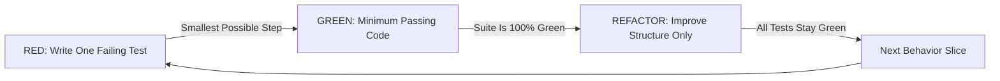
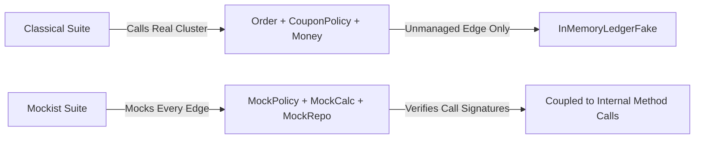
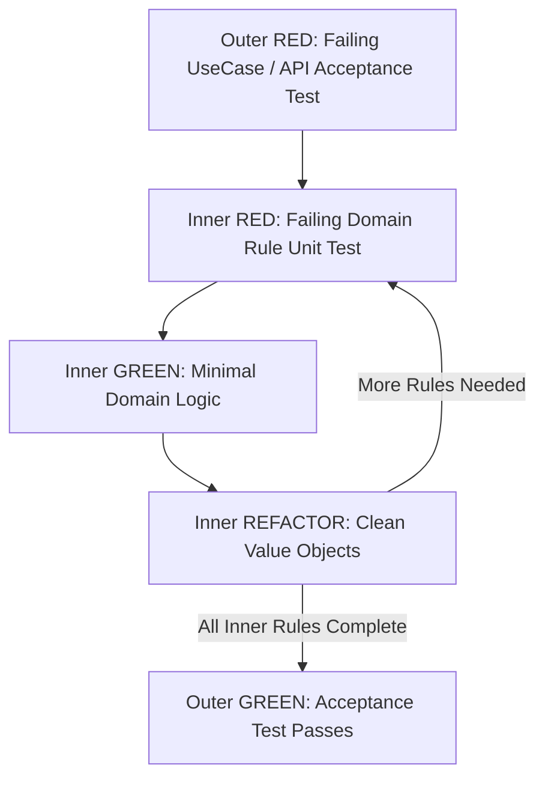

---
tags:
  - software-engineering
  - testing
  - tdd
created: 2026-01-02
updated: 2026-11-13
status: 🟢
level: mid-to-senior
---
# Test-Driven Development (TDD)

> [!abstract] Hub Context
> Part of [[Programming/Software Engineering/Testing/Testing Complete Guide|Testing Complete Guide]]. Pairs directly with [[Programming/Software Engineering/Testing/Unit Testing|Unit Testing]], [[Programming/Software Engineering/Testing/Mocking|Mocking]], [[Programming/Software Engineering/Testing/Integration Testing|Integration Testing]], [[Programming/Software Engineering/Architectural Patterns/Hexagonal Architecture|Hexagonal Architecture]], and [[Programming/Software Engineering/Refactoring/Refactoring Complete Guide|Refactoring Complete Guide]].

Test-Driven Development (TDD) is an incremental design feedback loop rather than a post-hoc QA technique. Writing an executable specification before writing production code forces the engineer to inhabit the caller's call site first—exposing awkward parameter lists, hidden global state, missing error variants, and coupled boundaries while the implementation cost is still zero. When executed with strict micro-cycle discipline, TDD produces cohesive modules with explicit dependency seams and a regression safety net as a structural byproduct.

---

## 1. First-Principles Mechanics & Complete Architecture

### The Red-Green-Refactor State Machine

Every TDD increment operates as a deterministic three-state machine that strictly separates **specification** (Red), **behavioral satisfaction** (Green), and **structural cleanup** (Refactor). Mixing these states destroys the safety invariant: refactoring while tests are failing removes your behavioral oracle, making it impossible to distinguish whether an edit fixed a bug or silently broke unrelated invariants.



#### Robert C. Martin's Three Laws of TDD

1. **Law 1**: Write **no production code** until you have written a failing unit test.
2. **Law 2**: Write **no more of a unit test** than is sufficient to fail—and in statically typed languages (TypeScript, Go, Rust, Java), **compilation failures count as Red**.
3. **Law 3**: Write **no more production code** than is sufficient to pass the currently failing test.

#### Baby-Step Execution Mechanics

- **Verify the Failure Reason in Red**: Never skip running the Red step. Running the failing test proves the test runner actually executes the file, evaluates the intended assertion, and fails for the expected reason (missing symbol, wrong value, unthrown error) rather than passing vacuously due to an unawaited promise or inverted boolean.
- **Keep Cycle Time Under 120 Seconds**: Each Red-Green-Refactor loop targets a single micro-requirement. If a loop stalls beyond five minutes because too many types or collaborators are missing simultaneously, the step size is too large—discard or stash the partial edit (`git checkout -- .`) and slice off a smaller intermediate invariant.
- **Refactor Exclusively on Green**: Once the target test and all prior tests pass, inspect both production code and test code for structural duplication, primitive obsession, excessive nesting, or unclear names. Extract helpers, Value Objects, or domain policies while re-running the test suite after every micro-edit. Never add new behavioral rules during the Refactor phase.

---

### Triangulation & Transformation Priority Premise (TPP)

When the general algorithm is immediately obvious and low-risk (for example, `subtotalCents - discountCents`), TDD permits **Obvious Implementation**—writing the direct expression immediately in Green. When the general rule involves subtle edge cases, state transitions, or mathematical invariants, jumping straight to generic abstractions invites speculative over-engineering. TDD resolves this via **Fake It** followed by **Triangulation**, guided by Robert C. Martin's **Transformation Priority Premise (TPP)**.

#### Fake It Until You Make It + Triangulation

1. Write Test 1 (`applyDiscount(1000, 'SAVE10') -> 900`). Pass it trivially if needed (`return 900`) simply to confirm test plumbing, imports, and type signatures compile cleanly.
2. Immediately write Test 2 with a distinct input (`applyDiscount(2500, 'SAVE10') -> 1500`). The constant `900` now fails, **forcing** you to replace the hardcoded literal with the genuine domain expression (`subtotalCents - 1000`).
3. Write Test 3 at the domain boundary (`applyDiscount(400, 'SAVE10') -> 0`). Returning a negative total `-600` now fails, **forcing** the floor clamp (`Math.max(0, subtotalCents - 1000)`).

#### TPP Complexity Ladder

The Transformation Priority Premise ranks structural code changes from simplest (top) to most complex (bottom). During Green, always prefer the **highest valid transformation** on the ladder that makes the failing test pass:

| Priority | Transformation | Code Delta Example | Structural Risk |
|---|---|---|---|
| **1** | `{}` $\to$ `nil` / error throw | Return `undefined` or throw `NotFoundError` | Lowest; establishes baseline failure contract |
| **2** | `nil` $\to$ constant | `return 0` or `return { valid: true }` | Proves plumbing and assertion wiring |
| **3** | Constant $\to$ scalar variable | Replace `900` with `subtotalCents - discountCents` | Eliminates hardcoded fake values via triangulation |
| **4** | Unconditional $\to$ conditional | Add `if (nowUtc >= expiresAtUtc)` guard | Introduces exactly one verified decision branch |
| **5** | Scalar $\to$ array / map | Store `Map<UserId, number>` instead of single field | Generalizes cardinality only when multi-entity tests demand it |
| **6** | Statement $\to$ tail recursion / loop | Iterate `lineItems` via `reduce` or `for...of` | Handles arbitrary collection length cleanly |
| **7** | Expression $\to$ extracted function / policy | Extract `CouponPolicy` interface or strategy | Applied during **Refactor** after the Rule of Three confirms stable variation |

---

### Classical (Detroit / Chicago) vs Mockist (London) Schools

Two major lineages emerged inside the TDD community, differing fundamentally on what constitutes a "unit", how collaborators are wired, and where design pressure is applied.



| Engineering Dimension | Classical (Detroit / Chicago) | Mockist (London) |
|---|---|---|
| **Definition of a Unit** | A **unit of observable behavior**: one function, aggregate, or cohesive cluster of real domain objects | A **single class or module** strictly isolated from every injected collaborator |
| **Use of Test Doubles** | Doubles used **only** at unmanaged I/O boundaries (clock, HTTP payment API, SMTP) or slow out-of-process stores via stateful Fakes | Every dependency (`TaxCalculator`, `DiscountPolicy`, `Validator`, `Repo`) replaced by stubs/mocks |
| **Design Trajectory** | **Inside-Out** or **Behavior-First**: prove pure domain state machines first, then compose application orchestration | **Outside-In**: write top-level controller/use-case test with mocked lower layers, then build each mocked dependency next |
| **Assertion Target** | **State & Return Values**: resulting entity fields, ledger entries, domain errors, and returned receipts | **Protocol & Interactions**: `expect(calc.compute).toHaveBeenCalledWith(8500)` and exact call counts |
| **Refactoring Resistance** | **High**: merging two domain services, splitting private methods, or changing internal parameters breaks zero tests | **Low (Brittle)**: renaming an internal method, caching a lookup, or restructuring parameters breaks mock expectations despite identical business output |
| **Defect Detection Power** | High across real interactions between domain objects (catches integration bugs between `DiscountPolicy` and `TaxCalculator` immediately) | Low at seams unless backed by separate integration tests—stubbed collaborators happily return impossible values |

#### When London-School Mockism Breaks Down

When engineers mock internal domain collaborators inside rich business logic, unit tests become a structural mirror of the implementation body. Extracting a `PricingPolicy` from `TaxCalculator` and `DiscountCalculator`, passing a `Money` Value Object instead of a raw `number`, or deduplicating two `getRate()` calls into a batch call breaks dozens of green tests even though external HTTP responses and persisted rows remain unchanged. Worse, because mocked collaborators return synthetic values, a bug in `TaxCalculator` rounding or incompatible unit assumptions (`dollars` vs `cents`) passes both isolated test suites silently.

#### When Outside-In Design Shines (Without Mockist Rot)

Outside-In discovery excels at clarifying top-level application workflows and external API contracts before writing low-level domain math. The senior resolution is **Double-Loop TDD**: use Outside-In **without** mocking internal domain classes, reserving test doubles strictly for unmanaged external gateways and stateful in-memory repository fakes.

---

### Double-Loop TDD (Outside-In Acceptance + Inner Unit Loops)

Double-Loop TDD (popularized in *Growing Object-Oriented Software, Guided by Tests* by Steve Freeman and Nat Pryce) nests fast Classical inner TDD loops inside a slow-moving outer acceptance or contract loop.



#### Exact Execution Protocol

1. **Outer Loop Red**: Write **one** executable specification exercising the vertical slice entry point (such as `RedeemCouponUseCase` backed by `InMemoryCouponRepository` + `FixedClock`, or an HTTP integration test via Fastify/Express `inject` + Testcontainers + WireMock). Run it. It fails immediately (`NotImplementedError` or HTTP `404`/`500`). Leave this outer test **red** while you build its supporting components.
2. **Inner Loop Iterations**: Drop down into pure domain entities, Value Objects, and policies (`Coupon`, `SlidingWindowRateLimiter`, `Money`). Drive every mathematical rule, edge case, and boundary condition through rapid sub-millisecond Classical Red-Green-Refactor micro-loops. Every inner loop finishes on **Green** for the unit suite.
3. **Wire & Observe Outer Loop Green**: Connect the completed domain modules inside the application use case or HTTP handler. Re-run the outer acceptance test. When it turns Green, the vertical slice is genuinely integrated end-to-end. Commit, then pull the next requirement slice as a new Outer Red test.

---

### Legacy Code Characterization Tests (Michael Feathers)

Standard TDD presupposes modular boundaries and clean dependency injection. Legacy systems typically couple business calculations directly to global singletons (`new Date()`, `process.env`, static database pools, `fs.appendFileSync`, global HTTP clients). Applying Red-Green-Refactor blindly without a safety net guarantees silent regressions in undocumented edge cases.

Michael Feathers (*Working Effectively with Legacy Code*) defines a deterministic four-step rescue protocol:

1. **Identify the Change Point & Introduce a Seam**:
   - A **Seam** is a place where you can alter program behavior without editing the surrounding legacy function body—for instance, converting a hardcoded `mysql.query` call into a default parameter `{ query = mysql.query, now = () => new Date() }` (**Object / Parameter Seam**). Production callers require zero signature changes.
2. **Write Characterization Tests (Golden Master / Approval Lock)**:
   - Execute the legacy function against representative production inputs (null fields, zero amounts, negative adjustments, expired timestamps, legacy boolean flags).
   - Deliberately write an intentionally wrong assertion (`expect(result).toBe('__CAPTURE__')`), run the test once, observe the exact current output produced by the legacy code, and lock that exact output into the assertion.
   - **Invariant**: Characterization tests capture **what the system actually does today**—even historical bugs—never what a specification document claims it *should* do.
3. **Implement New Requirements via Sprout Function or Sprout Class**:
   - Do not modify tangled inline branching inside a 400-line legacy procedure. Develop the *new* behavior inside a standalone pure function or collaborator (`computeWeekendSurcharge(...)`) using strict Classical Red-Green-Refactor, then invoke it through one minimal hook line inside the legacy function.
4. **Refactor Under the Safety Net**:
   - Once characterization tests pin every observed branch and sprouted unit tests verify new rules, incrementally extract cohesive classes and replace parameter defaults with formal dependency injection.

---

## 2. Real-World Use Cases & Decision Matrix

Strict TDD is an engineering tool with clear economic trade-offs, not a religious ritual. Senior engineers select the TDD variant—or suspend TDD deliberately—based on **domain stability**, **algorithmic complexity**, and **feedback cost**.

| Engineering Scenario | Recommended Approach | Rationale & Architectural Trade-Off |
|---|---|---|
| **Financial ledgers, pricing, tax brackets, rate limiters, permission engines** | **Classical TDD + TPP + Triangulation** | High branching density and exact boundary math (`>=` vs `>`, rounding modes); TDD keeps pure logic decoupled from DB/HTTP frameworks and produces sub-millisecond regression coverage |
| **Full-stack vertical slice (HTTP endpoint $\to$ Use Case $\to$ Domain $\to$ DB)** | **Double-Loop TDD** | Outer acceptance/integration test pins payload schema and DB persistence semantics; inner Classical unit loops verify domain combinations without spinning up Docker per edge case |
| **Modifying untested 500-line legacy billing/payroll module** | **Characterization Tests + Sprout Function** | Zero existing test harness makes immediate refactoring reckless; characterization locks existing invariants while sprouted functions evolve under clean TDD |
| **Exploratory UX prototype, WebGL canvas experiment, brand-new API spike** | **Time-Boxed Spike (No TDD) $\to$ Discard or Re-Implement via TDD** | When requirements and visual/API ergonomics are unknown, writing tests locks premature guesses; spike rapidly to learn constraints, then delete spike code (or wrap with tests) once invariants stabilize |
| **Declarative IaC (Terraform), static CSS styling, trivial DTO wrappers** | **Static Checks + Integration/E2E Smoke (No Unit TDD)** | Testing getter assignments or CSS margins via TDD yields zero defect protection and severe refactoring brittleness; verify via `tsc`, `terraform plan`, and Playwright smoke tests |

### Why TDD Does Not Replace Architecture & System Design

TDD excels at **local design feedback**—revealing when a function takes seven parameters, when a module has hidden temporal coupling, or when two classes share circular responsibilities. However, TDD **cannot discover distributed-systems or architectural boundaries** on its own:

- **No unit test tells you** whether a payment flow requires an outbox table (`[[Programming/Software Engineering/Database Design/Transactions|Transactions]]`), idempotency keys across HTTP retries, optimistic version locking (`version` column), or CQRS read-model separation.
- **No unit test discovers Bounded Contexts** (`[[Programming/Software Engineering/DDD/Strategic Design|Strategic Design]]`) or Hexagonal port boundaries unless the engineer intentionally separates core domain rules from I/O adapters (`[[Programming/Software Engineering/Clean Architecture/Dependency Rule|Dependency Rule]]`).
- Senior workflow combines **brief upfront architectural sketching** (identifying domain aggregates, transactional boundaries, and unmanaged external ports) with **TDD inside those boundaries** to evolve exact APIs and internal algorithms.

---

## 3. Step-by-Step Practical Application: Rate-Limited Promo Coupon Redemption Engine

Below is a complete, runnable TypeScript + Vitest walkthrough implementing a production **Rate-Limited Promo Coupon Redemption Engine** from Increment 1 through Increment 8, concluding with a full Double-Loop outer acceptance test.

### Project Directory Layout

```text
promo-engine/
  package.json
  tsconfig.json
  vitest.config.ts
  src/
    domain/
      types.ts
      coupon-engine.ts
    application/
      ports.ts
      redeem-coupon.usecase.ts
    infrastructure/
      in-memory-stores.ts
  tests/
    unit/
      coupon-engine.spec.ts
    acceptance/
      redeem-coupon-double-loop.spec.ts
```

### Workspace Configuration (`package.json`, `tsconfig.json`, `vitest.config.ts`)

```json
{
  "name": "promo-coupon-engine",
  "version": "1.0.0",
  "private": true,
  "type": "module",
  "scripts": {
    "test": "TZ=UTC vitest run",
    "test:watch": "TZ=UTC vitest",
    "typecheck": "tsc --noEmit"
  },
  "devDependencies": {
    "typescript": "^5.7.2",
    "vitest": "^3.0.4"
  }
}
```

```json
{
  "compilerOptions": {
    "target": "ES2023",
    "module": "ESNext",
    "moduleResolution": "Bundler",
    "strict": true,
    "noUncheckedIndexedAccess": true,
    "exactOptionalPropertyTypes": true,
    "isolatedModules": true,
    "skipLibCheck": true
  },
  "include": ["src", "tests"]
}
```

```typescript
// vitest.config.ts
import { defineConfig } from 'vitest/config';

export default defineConfig({
  test: {
    environment: 'node',
    globals: false,
    restoreMocks: true,
    clearMocks: true,
  },
});
```

---

### Sequential 8-Increment TDD Transcript

Every step below enforces strict Red $\to$ Green $\to$ Refactor discipline. Only Increment 8 contains the final consolidated production files; Increments 1–7 trace exact intermediate states so you observe how complexity emerges strictly on demand.

#### Increment 1 — Reject Empty or Missing Coupon Code (Baseline Failure Contract)

- **RED**: Write Test 1 asserting empty coupon codes throw `InvalidCouponError`. Compilation fails because `evaluateCoupon` does not exist.

```typescript
// tests/unit/coupon-engine.spec.ts (Step 1)
import { describe, expect, it } from 'vitest';
import { evaluateCoupon, InvalidCouponError } from '../../src/domain/coupon-engine';

describe('evaluateCoupon', () => {
  it('rejects an empty or whitespace coupon code', () => {
    expect(() =>
      evaluateCoupon({
        code: '   ',
        subtotalCents: 5_000,
        coupon: undefined,
        userRedemptionCount: 0,
        nowUtcMs: Date.UTC(2026, 10, 13, 12, 0, 0),
      }),
    ).toThrow(InvalidCouponError);
  });
});
```

- **GREEN**: Create minimal `InvalidCouponError` and `evaluateCoupon` throwing immediately when `code.trim().length === 0` or `!coupon`.

```typescript
// src/domain/coupon-engine.ts (Step 1 - Minimal Green)
export class InvalidCouponError extends Error {
  constructor(message: string) {
    super(message);
    this.name = 'InvalidCouponError';
  }
}

export function evaluateCoupon(input: {
  code: string;
  subtotalCents: number;
  coupon: undefined;
  userRedemptionCount: number;
  nowUtcMs: number;
}): never {
  if (input.code.trim().length === 0 || !input.coupon) {
    throw new InvalidCouponError('Coupon code is invalid or unknown');
  }
  throw new InvalidCouponError('Unreachable');
}
```

- **REFACTOR**: None yet—wait until a second rule creates real structure.

#### Increment 2 — Fixed-Amount Discount & Floor Clamping (Triangulation)

- **RED**: Add two tests forcing triangulation: `$10.00` off a `$25.00` subtotal returns `discountCents: 1000, finalTotalCents: 1500`; `$10.00` off a `$4.00` subtotal clamps at `finalTotalCents: 0, discountCents: 400` (never negative!).

```typescript
// tests/unit/coupon-engine.spec.ts (Step 2 addition)
it('applies fixed amount discount and prevents negative totals', () => {
  const fixedCoupon = {
    code: 'SAVE10',
    kind: 'FIXED' as const,
    amountCents: 1_000,
    minSubtotalCents: 0,
    expiresAtUtcMs: Date.UTC(2026, 11, 31),
    maxTotalRedemptions: 100,
    totalRedemptions: 0,
    maxPerUser: 1,
  };

  const standard = evaluateCoupon({
    code: 'save10',
    subtotalCents: 2_500,
    coupon: fixedCoupon,
    userRedemptionCount: 0,
    nowUtcMs: Date.UTC(2026, 10, 13),
  });
  expect(standard).toEqual({ discountCents: 1_000, finalTotalCents: 1_500 });

  const clamped = evaluateCoupon({
    code: 'SAVE10',
    subtotalCents: 400,
    coupon: fixedCoupon,
    userRedemptionCount: 0,
    nowUtcMs: Date.UTC(2026, 10, 13),
  });
  expect(clamped).toEqual({ discountCents: 400, finalTotalCents: 0 });
});
```

- **GREEN**: Implement `Math.min(input.subtotalCents, input.coupon.amountCents)` and return `{ discountCents, finalTotalCents }`.
- **REFACTOR**: Extract clean `CouponDefinition` and `CouponEvaluationResult` interfaces into `src/domain/types.ts` and validate non-negative integer `subtotalCents` (`Number.isSafeInteger` and `>= 0`).

#### Increment 3 — Percentage Discounts (Integer Rounding) & Minimum Subtotal Gate

- **RED**: Test `20%` (`basisPoints: 2000`) off `$33.33` (`3333` cents) $\to$ exact integer discount `667` (`Math.round((3333 * 2000) / 10_000)`) leaving `finalTotalCents: 2666`, plus test rejecting orders below `minSubtotalCents` (`MinimumOrderNotMetError`).
- **GREEN**: Compute percentage via integer basis points (`0..10_000`) instead of IEEE-754 floats (`0.2 * 3333`) to prevent floating-point drift, and check `subtotalCents < coupon.minSubtotalCents`.
- **REFACTOR**: Extract `computeRawDiscountCents(subtotalCents, coupon)` helper so percentage and fixed paths share identical clamping (`Math.min(subtotalCents, rawDiscount)`).

#### Increment 4 — Deterministic UTC Expiration Boundary (`expiresAtUtcMs`)

- **RED**: Parameterize boundary test at `expiresAtUtcMs - 1ms` (accepted), `expiresAtUtcMs` exact millisecond (rejected with `CouponExpiredError`), and `expiresAtUtcMs + 1ms` (rejected).
- **GREEN**: Add `if (input.nowUtcMs >= input.coupon.expiresAtUtcMs) throw new CouponExpiredError(...)`.
- **REFACTOR**: Group all validation preconditions into cohesive pure guard helpers before discount calculation.

#### Increment 5 — Global Usage Cap & Per-User Redemption Limit

- **RED**: Test `totalRedemptions === maxTotalRedemptions` throws `CouponExhaustedError`, and `userRedemptionCount >= coupon.maxPerUser` throws `UserRedemptionLimitError`.
- **GREEN**: Add `>=` capacity checks in `evaluateCoupon`.
- **REFACTOR**: Extract explicit domain error subclasses (`CouponRuleError` base class with machine-readable `code` property) so HTTP/use-case layers map domain failures cleanly to `400` / `409` / `429` without regex parsing `error.message`.

#### Increment 6 — Per-User Sliding-Window Rate Limiter (Brute-Force Protection)

- **RED**: Test a `SlidingWindowRateLimiter` allowing `maxAttempts: 3` within `windowMs: 60_000`: attempts at `t=0`, `t=10_000`, `t=20_000` succeed; attempt 4 at `t=25_000` throws `RateLimitExceededError` reporting `retryAfterMs: 35_000`; attempt at `t=60_000` (when `t=0` expires cleanly out of the closed-open window `[now - windowMs, now)`) succeeds!
- **GREEN**: Implement pure deterministic window pruning (`timestamps.filter((ts) => ts > nowUtcMs - windowMs)`) and compute exact `retryAfterMs`.
- **REFACTOR**: Isolate `SlidingWindowRateLimiter` cleanly in `coupon-engine.ts` with immutable input/output or explicit store contract.

#### Increment 7 — Idempotency Key Replay Protection

- **RED**: Retrying `RedeemCouponUseCase.execute` twice with the same `idempotencyKey` (`"idem-req-99"`) must return the **exact stored receipt** on the second call **without** throwing `UserRedemptionLimitError` or decrementing coupon capacity twice—even if the coupon's remaining uses hit zero after the first call!
- **GREEN**: Check `idempotencyStore.find(command.idempotencyKey)` before consuming usage quota or mutating coupon count; reject conflicting key reuse if `userId` or `couponCode` mismatches (`IdempotencyConflictError`).
- **REFACTOR**: Ensure atomic ordering inside `RedeemCouponUseCase`: check rate limit $\to$ check idempotency replay $\to$ evaluate domain rules $\to$ persist coupon increment + receipt + idempotency key.

---

### Increment 8 — Complete Final Production Code & Tests

#### `src/domain/types.ts`

```typescript
export type CouponKind = 'FIXED' | 'PERCENT_BPS';

export interface CouponDefinition {
  readonly code: string;
  readonly kind: CouponKind;
  /** Minor currency units (cents) when kind === 'FIXED'; unused (0) otherwise. */
  readonly amountCents: number;
  /** Basis points (e.g. 2000 = 20.00%) when kind === 'PERCENT_BPS'. */
  readonly percentBasisPoints: number;
  readonly minSubtotalCents: number;
  readonly expiresAtUtcMs: number;
  readonly maxTotalRedemptions: number;
  readonly totalRedemptions: number;
  readonly maxPerUser: number;
}

export interface EvaluateCouponInput {
  readonly code: string;
  readonly subtotalCents: number;
  readonly coupon: CouponDefinition | undefined;
  readonly userRedemptionCount: number;
  readonly nowUtcMs: number;
}

export interface CouponEvaluationResult {
  readonly normalizedCode: string;
  readonly discountCents: number;
  readonly finalTotalCents: number;
}

export interface RedemptionReceipt {
  readonly redemptionId: string;
  readonly idempotencyKey: string;
  readonly userId: string;
  readonly couponCode: string;
  readonly subtotalCents: number;
  readonly discountCents: number;
  readonly finalTotalCents: number;
  readonly redeemedAtUtcMs: number;
}
```

#### `src/domain/coupon-engine.ts`

```typescript
import type {
  CouponDefinition,
  CouponEvaluationResult,
  EvaluateCouponInput,
} from './types';

export abstract class CouponDomainError extends Error {
  abstract readonly errorCode: string;
}

export class InvalidCouponError extends CouponDomainError {
  readonly errorCode = 'INVALID_COUPON';
}

export class InvalidSubtotalError extends CouponDomainError {
  readonly errorCode = 'INVALID_SUBTOTAL';
}

export class CouponExpiredError extends CouponDomainError {
  readonly errorCode = 'COUPON_EXPIRED';
}

export class MinimumOrderNotMetError extends CouponDomainError {
  readonly errorCode = 'MIN_ORDER_NOT_MET';
}

export class CouponExhaustedError extends CouponDomainError {
  readonly errorCode = 'COUPON_EXHAUSTED';
}

export class UserRedemptionLimitError extends CouponDomainError {
  readonly errorCode = 'USER_REDEMPTION_LIMIT';
}

export class RateLimitExceededError extends CouponDomainError {
  readonly errorCode = 'RATE_LIMIT_EXCEEDED';
  constructor(readonly retryAfterMs: number) {
    super(`Rate limit exceeded; retry after ${retryAfterMs}ms`);
  }
}

export class IdempotencyConflictError extends CouponDomainError {
  readonly errorCode = 'IDEMPOTENCY_CONFLICT';
}

export function normalizeCouponCode(rawCode: string): string {
  return rawCode.trim().toUpperCase();
}

function computeRawDiscountCents(subtotalCents: number, coupon: CouponDefinition): number {
  if (coupon.kind === 'FIXED') {
    return coupon.amountCents;
  }
  return Math.round((subtotalCents * coupon.percentBasisPoints) / 10_000);
}

export function evaluateCoupon(input: EvaluateCouponInput): CouponEvaluationResult {
  const normalizedCode = normalizeCouponCode(input.code);
  if (normalizedCode.length === 0 || !input.coupon) {
    throw new InvalidCouponError('Coupon code is missing or unrecognized');
  }
  if (!Number.isSafeInteger(input.subtotalCents) || input.subtotalCents < 0) {
    throw new InvalidSubtotalError('Subtotal must be a non-negative integer in minor units');
  }

  const { coupon } = input;
  if (normalizeCouponCode(coupon.code) !== normalizedCode) {
    throw new InvalidCouponError('Coupon code mismatch');
  }
  if (input.nowUtcMs >= coupon.expiresAtUtcMs) {
    throw new CouponExpiredError(`Coupon ${normalizedCode} expired`);
  }
  if (input.subtotalCents < coupon.minSubtotalCents) {
    throw new MinimumOrderNotMetError(
      `Order subtotal ${input.subtotalCents} is below minimum ${coupon.minSubtotalCents}`,
    );
  }
  if (coupon.totalRedemptions >= coupon.maxTotalRedemptions) {
    throw new CouponExhaustedError(`Coupon ${normalizedCode} has reached global capacity`);
  }
  if (input.userRedemptionCount >= coupon.maxPerUser) {
    throw new UserRedemptionLimitError(`User has reached limit for coupon ${normalizedCode}`);
  }

  const rawDiscountCents = computeRawDiscountCents(input.subtotalCents, coupon);
  const discountCents = Math.max(0, Math.min(input.subtotalCents, rawDiscountCents));
  const finalTotalCents = input.subtotalCents - discountCents;

  return {
    normalizedCode,
    discountCents,
    finalTotalCents,
  };
}

export interface RateLimitDecision {
  readonly allowed: boolean;
  readonly updatedTimestampsUtcMs: readonly number[];
  readonly retryAfterMs: number;
}

export function evaluateSlidingWindowAttempt(params: {
  readonly recentTimestampsUtcMs: readonly number[];
  readonly nowUtcMs: number;
  readonly maxAttempts: number;
  readonly windowMs: number;
}): RateLimitDecision {
  const windowStartMs = params.nowUtcMs - params.windowMs;
  const active = params.recentTimestampsUtcMs
    .filter((ts) => ts > windowStartMs && ts <= params.nowUtcMs)
    .sort((a, b) => a - b);

  if (active.length >= params.maxAttempts) {
    const oldestActiveMs = active[0]!;
    const retryAfterMs = Math.max(1, oldestActiveMs + params.windowMs - params.nowUtcMs);
    return {
      allowed: false,
      updatedTimestampsUtcMs: active,
      retryAfterMs,
    };
  }

  return {
    allowed: true,
    updatedTimestampsUtcMs: [...active, params.nowUtcMs],
    retryAfterMs: 0,
  };
}
```

#### `src/application/ports.ts`

```typescript
import type { CouponDefinition, RedemptionReceipt } from '../domain/types';

export interface ClockPort {
  nowUtcMs(): number;
}

export interface IdGeneratorPort {
  nextId(): string;
}

export interface CouponRepositoryPort {
  findByCode(normalizedCode: string): Promise<CouponDefinition | undefined>;
  save(coupon: CouponDefinition): Promise<void>;
}

export interface RedemptionLedgerPort {
  countUserRedemptions(userId: string, normalizedCode: string): Promise<number>;
  findByIdempotencyKey(idempotencyKey: string): Promise<RedemptionReceipt | undefined>;
  recordRedemption(receipt: RedemptionReceipt): Promise<void>;
}

export interface AttemptWindowStorePort {
  getAttemptTimestamps(userId: string): Promise<readonly number[]>;
  saveAttemptTimestamps(userId: string, timestampsUtcMs: readonly number[]): Promise<void>;
}
```

#### `src/application/redeem-coupon.usecase.ts`

```typescript
import {
  evaluateCoupon,
  evaluateSlidingWindowAttempt,
  IdempotencyConflictError,
  normalizeCouponCode,
  RateLimitExceededError,
} from '../domain/coupon-engine';
import type { RedemptionReceipt } from '../domain/types';
import type {
  AttemptWindowStorePort,
  ClockPort,
  CouponRepositoryPort,
  IdGeneratorPort,
  RedemptionLedgerPort,
} from './ports';

export interface RedeemCouponCommand {
  readonly userId: string;
  readonly code: string;
  readonly subtotalCents: number;
  readonly idempotencyKey: string;
}

export interface RedeemCouponConfig {
  readonly maxAttemptsPerWindow: number;
  readonly rateLimitWindowMs: number;
}

export class RedeemCouponUseCase {
  constructor(
    private readonly coupons: CouponRepositoryPort,
    private readonly ledger: RedemptionLedgerPort,
    private readonly attemptStore: AttemptWindowStorePort,
    private readonly clock: ClockPort,
    private readonly ids: IdGeneratorPort,
    private readonly config: RedeemCouponConfig,
  ) {}

  async execute(command: RedeemCouponCommand): Promise<RedemptionReceipt> {
    const nowUtcMs = this.clock.nowUtcMs();
    const normalizedCode = normalizeCouponCode(command.code);

    const existingReceipt = await this.ledger.findByIdempotencyKey(command.idempotencyKey);
    if (existingReceipt) {
      if (
        existingReceipt.userId !== command.userId ||
        existingReceipt.couponCode !== normalizedCode ||
        existingReceipt.subtotalCents !== command.subtotalCents
      ) {
        throw new IdempotencyConflictError(
          'Idempotency key reused with differing redemption parameters',
        );
      }
      return existingReceipt;
    }

    const recentAttempts = await this.attemptStore.getAttemptTimestamps(command.userId);
    const rateDecision = evaluateSlidingWindowAttempt({
      recentTimestampsUtcMs: recentAttempts,
      nowUtcMs,
      maxAttempts: this.config.maxAttemptsPerWindow,
      windowMs: this.config.rateLimitWindowMs,
    });
    await this.attemptStore.saveAttemptTimestamps(
      command.userId,
      rateDecision.updatedTimestampsUtcMs,
    );
    if (!rateDecision.allowed) {
      throw new RateLimitExceededError(rateDecision.retryAfterMs);
    }

    const coupon = normalizedCode ? await this.coupons.findByCode(normalizedCode) : undefined;
    const userRedemptionCount = normalizedCode
      ? await this.ledger.countUserRedemptions(command.userId, normalizedCode)
      : 0;

    const evaluation = evaluateCoupon({
      code: command.code,
      subtotalCents: command.subtotalCents,
      coupon,
      userRedemptionCount,
      nowUtcMs,
    });

    const receipt: RedemptionReceipt = {
      redemptionId: this.ids.nextId(),
      idempotencyKey: command.idempotencyKey,
      userId: command.userId,
      couponCode: evaluation.normalizedCode,
      subtotalCents: command.subtotalCents,
      discountCents: evaluation.discountCents,
      finalTotalCents: evaluation.finalTotalCents,
      redeemedAtUtcMs: nowUtcMs,
    };

    await this.coupons.save({
      ...coupon!,
      totalRedemptions: coupon!.totalRedemptions + 1,
    });
    await this.ledger.recordRedemption(receipt);

    return receipt;
  }
}
```

#### `src/infrastructure/in-memory-stores.ts`

```typescript
import type {
  AttemptWindowStorePort,
  ClockPort,
  CouponRepositoryPort,
  IdGeneratorPort,
  RedemptionLedgerPort,
} from '../application/ports';
import { normalizeCouponCode } from '../domain/coupon-engine';
import type { CouponDefinition, RedemptionReceipt } from '../domain/types';

export class InMemoryCouponRepository implements CouponRepositoryPort {
  private readonly store = new Map<string, CouponDefinition>();

  async findByCode(normalizedCode: string): Promise<CouponDefinition | undefined> {
    const found = this.store.get(normalizeCouponCode(normalizedCode));
    return found ? structuredClone(found) : undefined;
  }

  async save(coupon: CouponDefinition): Promise<void> {
    this.store.set(normalizeCouponCode(coupon.code), structuredClone(coupon));
  }
}

export class InMemoryRedemptionLedger implements RedemptionLedgerPort {
  private readonly receipts: RedemptionReceipt[] = [];
  private readonly byIdempotencyKey = new Map<string, RedemptionReceipt>();

  async countUserRedemptions(userId: string, normalizedCode: string): Promise<number> {
    return this.receipts.filter(
      (r) => r.userId === userId && r.couponCode === normalizedCode,
    ).length;
  }

  async findByIdempotencyKey(idempotencyKey: string): Promise<RedemptionReceipt | undefined> {
    const found = this.byIdempotencyKey.get(idempotencyKey);
    return found ? structuredClone(found) : undefined;
  }

  async recordRedemption(receipt: RedemptionReceipt): Promise<void> {
    const cloned = structuredClone(receipt);
    this.receipts.push(cloned);
    this.byIdempotencyKey.set(cloned.idempotencyKey, cloned);
  }
}

export class InMemoryAttemptWindowStore implements AttemptWindowStorePort {
  private readonly attemptsByUser = new Map<string, number[]>();

  async getAttemptTimestamps(userId: string): Promise<readonly number[]> {
    return [...(this.attemptsByUser.get(userId) ?? [])];
  }

  async saveAttemptTimestamps(userId: string, timestampsUtcMs: readonly number[]): Promise<void> {
    this.attemptsByUser.set(userId, [...timestampsUtcMs]);
  }
}

export class FakeClock implements ClockPort {
  constructor(private currentMs: number) {}

  nowUtcMs(): number {
    return this.currentMs;
  }

  advanceBy(deltaMs: number): void {
    this.currentMs += deltaMs;
  }
}

export class SequenceIdGenerator implements IdGeneratorPort {
  private counter = 0;

  nextId(): string {
    this.counter += 1;
    return `redemption_${this.counter}`;
  }
}
```

#### `tests/unit/coupon-engine.spec.ts` (Complete Inner Classical TDD Suite)

```typescript
import { describe, expect, it } from 'vitest';
import {
  CouponExhaustedError,
  CouponExpiredError,
  evaluateCoupon,
  evaluateSlidingWindowAttempt,
  InvalidCouponError,
  InvalidSubtotalError,
  MinimumOrderNotMetError,
  UserRedemptionLimitError,
} from '../../src/domain/coupon-engine';
import type { CouponDefinition } from '../../src/domain/types';

function makeCoupon(overrides: Partial<CouponDefinition> = {}): CouponDefinition {
  return {
    code: 'SAVE10',
    kind: 'FIXED',
    amountCents: 1_000,
    percentBasisPoints: 0,
    minSubtotalCents: 0,
    expiresAtUtcMs: Date.UTC(2026, 11, 31, 0, 0, 0),
    maxTotalRedemptions: 100,
    totalRedemptions: 0,
    maxPerUser: 1,
    ...overrides,
  };
}

describe('evaluateCoupon (Classical Inner TDD)', () => {
  const baselineNowMs = Date.UTC(2026, 10, 13, 12, 0, 0);

  it('rejects empty or missing coupons', () => {
    expect(() =>
      evaluateCoupon({
        code: '   ',
        subtotalCents: 2_000,
        coupon: makeCoupon(),
        userRedemptionCount: 0,
        nowUtcMs: baselineNowMs,
      }),
    ).toThrow(InvalidCouponError);

    expect(() =>
      evaluateCoupon({
        code: 'MISSING',
        subtotalCents: 2_000,
        coupon: undefined,
        userRedemptionCount: 0,
        nowUtcMs: baselineNowMs,
      }),
    ).toThrow(InvalidCouponError);
  });

  it('rejects negative or non-integer subtotals', () => {
    for (const invalidSubtotal of [-1, 12.5, Number.NaN]) {
      expect(() =>
        evaluateCoupon({
          code: 'SAVE10',
          subtotalCents: invalidSubtotal,
          coupon: makeCoupon(),
          userRedemptionCount: 0,
          nowUtcMs: baselineNowMs,
        }),
      ).toThrow(InvalidSubtotalError);
    }
  });

  it('applies fixed discounts and clamps final total at zero', () => {
    const normal = evaluateCoupon({
      code: ' save10 ',
      subtotalCents: 2_500,
      coupon: makeCoupon({ amountCents: 1_000 }),
      userRedemptionCount: 0,
      nowUtcMs: baselineNowMs,
    });
    expect(normal).toEqual({
      normalizedCode: 'SAVE10',
      discountCents: 1_000,
      finalTotalCents: 1_500,
    });

    const clamped = evaluateCoupon({
      code: 'SAVE10',
      subtotalCents: 400,
      coupon: makeCoupon({ amountCents: 1_000 }),
      userRedemptionCount: 0,
      nowUtcMs: baselineNowMs,
    });
    expect(clamped).toEqual({
      normalizedCode: 'SAVE10',
      discountCents: 400,
      finalTotalCents: 0,
    });
  });

  it('computes percentage discounts using integer basis points with rounding', () => {
    const coupon = makeCoupon({
      code: 'PCT20',
      kind: 'PERCENT_BPS',
      amountCents: 0,
      percentBasisPoints: 2_000,
    });

    const res = evaluateCoupon({
      code: 'PCT20',
      subtotalCents: 3_333,
      coupon,
      userRedemptionCount: 0,
      nowUtcMs: baselineNowMs,
    });

    expect(res).toEqual({
      normalizedCode: 'PCT20',
      discountCents: 667,
      finalTotalCents: 2_666,
    });
  });

  it.each([
    { deltaMs: -1, shouldExpire: false },
    { deltaMs: 0, shouldExpire: true },
    { deltaMs: 1, shouldExpire: true },
  ])('enforces exact expiration boundary delta=$deltaMs', ({ deltaMs, shouldExpire }) => {
    const expiresAtUtcMs = Date.UTC(2026, 10, 15, 0, 0, 0);
    const coupon = makeCoupon({ expiresAtUtcMs });

    const act = () =>
      evaluateCoupon({
        code: 'SAVE10',
        subtotalCents: 5_000,
        coupon,
        userRedemptionCount: 0,
        nowUtcMs: expiresAtUtcMs + deltaMs,
      });

    if (shouldExpire) {
      expect(act).toThrow(CouponExpiredError);
    } else {
      expect(act().finalTotalCents).toBe(4_000);
    }
  });

  it('enforces inclusive minimum subtotal, global capacity, and per-user cap', () => {
    expect(() =>
      evaluateCoupon({
        code: 'SAVE10',
        subtotalCents: 4_999,
        coupon: makeCoupon({ minSubtotalCents: 5_000 }),
        userRedemptionCount: 0,
        nowUtcMs: baselineNowMs,
      }),
    ).toThrow(MinimumOrderNotMetError);

    expect(
      evaluateCoupon({
        code: 'SAVE10',
        subtotalCents: 5_000,
        coupon: makeCoupon({ minSubtotalCents: 5_000 }),
        userRedemptionCount: 0,
        nowUtcMs: baselineNowMs,
      }).finalTotalCents,
    ).toBe(4_000);

    expect(() =>
      evaluateCoupon({
        code: 'SAVE10',
        subtotalCents: 5_000,
        coupon: makeCoupon({ maxTotalRedemptions: 50, totalRedemptions: 50 }),
        userRedemptionCount: 0,
        nowUtcMs: baselineNowMs,
      }),
    ).toThrow(CouponExhaustedError);

    expect(() =>
      evaluateCoupon({
        code: 'SAVE10',
        subtotalCents: 5_000,
        coupon: makeCoupon({ maxPerUser: 1 }),
        userRedemptionCount: 1,
        nowUtcMs: baselineNowMs,
      }),
    ).toThrow(UserRedemptionLimitError);
  });
});

describe('evaluateSlidingWindowAttempt', () => {
  it('permits attempts within limit and reports deterministic retryAfterMs when saturated', () => {
    const t0 = Date.UTC(2026, 10, 13, 12, 0, 0);
    let history: readonly number[] = [];

    for (const offsetMs of [0, 10_000, 20_000]) {
      const step = evaluateSlidingWindowAttempt({
        recentTimestampsUtcMs: history,
        nowUtcMs: t0 + offsetMs,
        maxAttempts: 3,
        windowMs: 60_000,
      });
      expect(step.allowed).toBe(true);
      history = step.updatedTimestampsUtcMs;
    }

    const blocked = evaluateSlidingWindowAttempt({
      recentTimestampsUtcMs: history,
      nowUtcMs: t0 + 25_000,
      maxAttempts: 3,
      windowMs: 60_000,
    });
    expect(blocked.allowed).toBe(false);
    expect(blocked.retryAfterMs).toBe(35_000);

    const recovered = evaluateSlidingWindowAttempt({
      recentTimestampsUtcMs: blocked.updatedTimestampsUtcMs,
      nowUtcMs: t0 + 60_000,
      maxAttempts: 3,
      windowMs: 60_000,
    });
    expect(recovered.allowed).toBe(true);
    expect(recovered.updatedTimestampsUtcMs).toEqual([
      t0 + 10_000,
      t0 + 20_000,
      t0 + 60_000,
    ]);
  });
});
```

#### `tests/acceptance/redeem-coupon-double-loop.spec.ts` (Outer Double-Loop Acceptance Test)

```typescript
import { describe, expect, it } from 'vitest';
import { RedeemCouponUseCase } from '../../src/application/redeem-coupon.usecase';
import {
  IdempotencyConflictError,
  InvalidCouponError,
  RateLimitExceededError,
  UserRedemptionLimitError,
} from '../../src/domain/coupon-engine';
import {
  FakeClock,
  InMemoryAttemptWindowStore,
  InMemoryCouponRepository,
  InMemoryRedemptionLedger,
  SequenceIdGenerator,
} from '../../src/infrastructure/in-memory-stores';

function buildRedemptionHarness() {
  const coupons = new InMemoryCouponRepository();
  const ledger = new InMemoryRedemptionLedger();
  const attemptStore = new InMemoryAttemptWindowStore();
  const clock = new FakeClock(Date.UTC(2026, 10, 13, 12, 0, 0));
  const ids = new SequenceIdGenerator();

  const useCase = new RedeemCouponUseCase(coupons, ledger, attemptStore, clock, ids, {
    maxAttemptsPerWindow: 3,
    rateLimitWindowMs: 60_000,
  });

  return { coupons, ledger, clock, useCase };
}

describe('RedeemCouponUseCase (Double-Loop Outer Acceptance)', () => {
  it('redeems valid coupon, replays safely on idempotency retry, and enforces user limit', async () => {
    const { coupons, useCase } = buildRedemptionHarness();
    await coupons.save({
      code: 'LAUNCH25',
      kind: 'PERCENT_BPS',
      amountCents: 0,
      percentBasisPoints: 2_500,
      minSubtotalCents: 4_000,
      expiresAtUtcMs: Date.UTC(2026, 11, 1, 0, 0, 0),
      maxTotalRedemptions: 1,
      totalRedemptions: 0,
      maxPerUser: 1,
    });

    const first = await useCase.execute({
      userId: 'user_42',
      code: 'launch25',
      subtotalCents: 8_000,
      idempotencyKey: 'req-abc-1',
    });

    expect(first).toEqual({
      redemptionId: 'redemption_1',
      idempotencyKey: 'req-abc-1',
      userId: 'user_42',
      couponCode: 'LAUNCH25',
      subtotalCents: 8_000,
      discountCents: 2_000,
      finalTotalCents: 6_000,
      redeemedAtUtcMs: Date.UTC(2026, 10, 13, 12, 0, 0),
    });

    // Network retry with identical key succeeds without consuming second slot
    const retry = await useCase.execute({
      userId: 'user_42',
      code: 'LAUNCH25',
      subtotalCents: 8_000,
      idempotencyKey: 'req-abc-1',
    });
    expect(retry).toEqual(first);

    // Reusing same key with tampered subtotal fails loudly
    await expect(
      useCase.execute({
        userId: 'user_42',
        code: 'LAUNCH25',
        subtotalCents: 10_000,
        idempotencyKey: 'req-abc-1',
      }),
    ).rejects.toThrow(IdempotencyConflictError);

    // Distinct key hits global exhaustion after 1 total redemption
    await coupons.save({
      ...(await coupons.findByCode('LAUNCH25'))!,
      maxTotalRedemptions: 10,
    });
    await expect(
      useCase.execute({
        userId: 'user_42',
        code: 'LAUNCH25',
        subtotalCents: 8_000,
        idempotencyKey: 'req-abc-2',
      }),
    ).rejects.toThrow(UserRedemptionLimitError);
  });

  it('rate-limits brute-force guessing across invalid coupon attempts and recovers after window', async () => {
    const { clock, useCase } = buildRedemptionHarness();

    for (let i = 1; i <= 3; i += 1) {
      await expect(
        useCase.execute({
          userId: 'attacker_9',
          code: `GUESS${i}`,
          subtotalCents: 5_000,
          idempotencyKey: `guess-${i}`,
        }),
      ).rejects.toThrow(InvalidCouponError);
      clock.advanceBy(5_000);
    }

    // 4th attempt inside 60s window triggers RateLimitExceededError before domain lookup
    await expect(
      useCase.execute({
        userId: 'attacker_9',
        code: 'GUESS4',
        subtotalCents: 5_000,
        idempotencyKey: 'guess-4',
      }),
    ).rejects.toThrow(RateLimitExceededError);

    // Advance past oldest attempt's 60s expiry (0 + 60_000 = 60_000; current clock is 15_000)
    clock.advanceBy(45_000);
    await expect(
      useCase.execute({
        userId: 'attacker_9',
        code: 'GUESS5',
        subtotalCents: 5_000,
        idempotencyKey: 'guess-5',
      }),
    ).rejects.toThrow(InvalidCouponError);
  });
});
```

---

## 4. Complete Framework Reference & Edge Cases

### Vitest TDD Workflow Construct Matrix

| Feature | Practical TDD Purpose | Idiomatic Usage |
|---|---|---|
| `npx vitest` (Watch Mode) | Keeps Red-Green-Refactor sub-second by running only specs impacted by saved module graph changes | Run in split pane beside editor; press `p` to filter active file |
| `it.todo('...')` | Captures upcoming behavioral slices discovered mid-cycle without leaving broken tests in the suite | List edge cases discovered while implementing Green so working memory stays focused on 1 test |
| `it.each([...])` | Eliminates copy-pasted boundary permutations during Triangulation | Drive exact `<`, `=`, `>` transitions around thresholds and expiration dates |
| `expectTypeOf` | Type-level TDD for discriminated unions and strict TypeScript contracts | Verify `expectTypeOf(res).toEqualTypeOf<CouponEvaluationResult>()` in `.spec.ts` |
| `vi.useFakeTimers()` | Freezes global `Date.now()` / `setTimeout` when third-party libs forbid `ClockPort` injection | Always restore with `afterEach(() => vi.useRealTimers())` |

### Six Critical TDD Traps & Production Failure Modes

1. **Multi-Test Batching Before Green**: Writing five failing tests up front encourages designing a monolith to pass all five at once, breaking TPP baby steps and turning Refactor chaos-prone. Use `it.todo()` for upcoming slices; keep strictly **one active red test** at a time.
2. **Skipping the Refactor Step ("Red-Green-Commit")**: Leaving duplicated arithmetic, magic numbers, or mixed abstractions inside `Green` transforms TDD into a sloppy prototype generator whose tests merely cement bad design. Always inspect the diff before starting the next Red test.
3. **Testing Private Methods via `(service as any).privateHelper()`**: Directly calling non-public helpers binds tests to internal decomposition. If a private algorithm is complex enough to demand dedicated unit tests, that signals **Missing Domain Abstraction**—extract it into a cohesive pure function or Value Object (`SlidingWindowRateLimiter`, `TaxBracketPolicy`) with its own clean public contract.
4. **Testing Through Heavy Framework Bootstraps**: Booting NestJS/Express DI containers and Docker Postgres for every discount boundary permutation turns TDD into a 45-second drag per cycle, causing engineers to abandon TDD. Push pure rules into zero-I/O domain modules (`<1ms` per 100 tests) and keep 1–3 outer integration specs per endpoint.
5. **Tautological Test Assertions**: Deriving expected values using the exact same formula (`expect(calc(x)).toBe(x * 0.2)`) simply duplicates production math rather than asserting a known concrete oracle (`expect(calc(3333)).toBe(667)`). Always specify concrete literals or independent algebraic invariants.
6. **TypeScript Structural Typing Hiding Domain Mix-Ups**: Passing `subtotalDollars` into a `subtotalCents: number` parameter compiles cleanly if both are raw `number`. Use branded types (`type Cents = number & { readonly __brand: 'Cents' }`) or Value Objects (`Money`) driven during Refactor.

---

## 5. Production Debugging, Profiling & Operations Playbook

| Symptom | Root Cause | Diagnostic Command / Inspection | Resolution |
|---|---|---|---|
| **TDD watch loop takes $> 3\text{s}$ per save** | Barrel `index.ts` re-exports pull heavy Prisma/AWS SDKs or full app singletons into unit test dependency graphs | `npx vitest run --reporter=verbose` and inspect import timings with `DEBUG=vite-node* npx vitest run` | Split pure domain files from infrastructure barrels; import leaf files directly (`src/domain/coupon-engine.ts`) |
| **Test passes on first run (never observed Red)** | Assertion never ran (unawaited async `expect().rejects`), wrong file path, or Vitest executing stale compiled `.js` in `dist/` | Run single file `npx vitest run tests/unit/coupon-engine.spec.ts` and introduce temporary inverted assertion | Always await `rejects`/`resolves`, exclude `dist/` from `vitest.config.ts`, and verify exact failure output in Red |
| **Routine domain refactor breaks 20+ unrelated tests** | London-school white-box coupling (`toHaveBeenCalledWith` on internal domain services) or shared `beforeEach` fixtures | Inspect failing diffs via `git diff --stat`; count test files touched per behavior-preserving refactor commit | Replace internal collaborator mocks with real domain objects and state assertions; replace `beforeEach` mutation with `make*()` builders |
| **Silent regression after editing untested legacy function** | Missing characterization safety net around undocumented edge-case flags or global singletons | Bisect regression commit via `git bisect start HEAD v1.4.0` + inspect parameter assumptions | Wrap legacy call site with object seam, capture Golden Master fixtures, and sprout new logic cleanly |
| **Test fails intermittently under `--sequence.shuffle`** | Shared module-level mutable state (`const cache = new Map()`) or uncleaned `vi.useFakeTimers()` | `npx vitest run --sequence.shuffle --sequence.seed=1729` | Eliminate module-level mutable state; inject fresh stores per test and reset timers in `afterEach` |

---

## 6. Worked Exercises

### Exercise 1: Diagnosing Brittle Mockist TDD Coupling & Classical Rewrite

A developer applies strict London-school TDD to an order-pricing orchestrator and commits this test:

```typescript
test('applies VIP discount and saves order', async () => {
  const discountMock = { getRate: vi.fn().mockResolvedValue(0.15) };
  const taxMock = { compute: vi.fn().mockReturnValue(850) };
  const repoMock = { findById: vi.fn().mockResolvedValue(order), save: vi.fn() };

  const svc = new CheckoutService(discountMock, taxMock, repoMock);
  await svc.checkout('order-1', 'vip-user');

  expect(discountMock.getRate).toHaveBeenCalledTimes(1);
  expect(discountMock.getRate).toHaveBeenCalledWith('vip-user');
  expect(taxMock.compute).toHaveBeenCalledWith(8500);
  expect(repoMock.save).toHaveBeenCalledTimes(1);
});
```

1. Identify **two structural reasons** this test turns red during behavior-preserving refactorings (**false positives**).
2. Identify **two distinct production defects** that still pass this test (**false negatives**).
3. Rewrite both the collaborators wiring and the test following **Classical TDD**.

### Solution 1

#### 1. False Positives (White-Box Refactoring Fragility)

1. Merging `discountMock.getRate('vip-user')` and `taxMock.compute(...)` into a single `PricingPolicy` object—or passing a `Customer` entity instead of a raw `'vip-user'` string—immediately fails `toHaveBeenCalledWith('vip-user')` even though finalized order cents are unchanged.
2. Calling `discountMock.getRate` inside an audit summary helper before checkout (2 calls) or caching rates in batch (`getRates(['vip-user'])`) fails `toHaveBeenCalledTimes(1)` despite identical billing outcome.

#### 2. False Negatives (Undetected Production Bugs)

1. Because `taxMock.compute` is stubbed to return `850`, any rounding or tax-rate bug inside the real `TaxCalculator` (for example truncating fractional cents instead of rounding, or applying tax *before* discount in production) is completely invisible to this suite.
2. Asserting `expect(repoMock.save).toHaveBeenCalledTimes(1)` never verifies *what* `Order` state was passed to `save`—if `CheckoutService` saves `order` with `status: 'DRAFT'` or forgets to subtract the `1500` discount cents from `order.totalCents`, the mock assertion still passes green.

#### 3. Classical TDD Rewrite

```typescript
import { describe, expect, it } from 'vitest';

class Money {
  private constructor(readonly minorUnits: number) {}
  static usd(cents: number): Money {
    return new Money(cents);
  }
  multiply(factor: number): Money {
    return new Money(Math.round(this.minorUnits * factor));
  }
  subtract(other: Money): Money {
    return new Money(this.minorUnits - other.minorUnits);
  }
  add(other: Money): Money {
    return new Money(this.minorUnits + other.minorUnits);
  }
}

class DiscountPolicy {
  discountFor(subtotal: Money, tier: 'STANDARD' | 'VIP'): Money {
    return tier === 'VIP' ? subtotal.multiply(0.15) : Money.usd(0);
  }
}

class TaxCalculator {
  constructor(private readonly taxRate: number) {}
  compute(taxableAmount: Money): Money {
    return taxableAmount.multiply(this.taxRate);
  }
}

interface OrderState {
  readonly id: string;
  readonly subtotalCents: number;
  status: 'DRAFT' | 'FINALIZED';
  totalCents: number;
}

class InMemoryOrderRepo {
  private readonly rows = new Map<string, OrderState>();
  async save(order: OrderState): Promise<void> {
    this.rows.set(order.id, structuredClone(order));
  }
  async findById(id: string): Promise<OrderState | undefined> {
    const row = this.rows.get(id);
    return row ? structuredClone(row) : undefined;
  }
}

class CheckoutService {
  constructor(
    private readonly discounts: DiscountPolicy,
    private readonly taxes: TaxCalculator,
    private readonly repo: InMemoryOrderRepo,
  ) {}

  async checkout(orderId: string, tier: 'STANDARD' | 'VIP'): Promise<void> {
    const order = await this.repo.findById(orderId);
    if (!order) throw new Error(`Order ${orderId} not found`);

    const subtotal = Money.usd(order.subtotalCents);
    const discounted = subtotal.subtract(this.discounts.discountFor(subtotal, tier));
    const tax = this.taxes.compute(discounted);

    order.totalCents = discounted.add(tax).minorUnits;
    order.status = 'FINALIZED';
    await this.repo.save(order);
  }
}

describe('CheckoutService (Classical TDD)', () => {
  it('applies 15% VIP discount before 10% tax and persists finalized state', async () => {
    const repo = new InMemoryOrderRepo();
    await repo.save({ id: 'order-1', subtotalCents: 10_000, status: 'DRAFT', totalCents: 10_000 });

    const svc = new CheckoutService(new DiscountPolicy(), new TaxCalculator(0.1), repo);
    await svc.checkout('order-1', 'VIP');

    const saved = await repo.findById('order-1');
    // $100.00 - 15% ($15.00) = $85.00; + 10% tax ($8.50) = $93.50 (9350 cents)
    expect(saved).toEqual({
      id: 'order-1',
      subtotalCents: 10_000,
      status: 'FINALIZED',
      totalCents: 9_350,
    });
  });
});
```

---

### Exercise 2: Triangulation & TPP Progression for a Token Bucket Limiter

After writing a single failing test (`new TokenBucket(5, 1).allow(0) === true`), a teammate jumps straight to implementing a Redis Lua script adapter, a `RefillStrategy` interface hierarchy, and multi-region synchronization hooks. Identify the exact TDD violations and construct the minimal 4-step TPP + Triangulation test sequence and final pure domain `TokenBucket` implementation.

### Solution 2

#### Violations Diagnosed

- **Law 3 & TPP Violation**: Implementing distributed Redis Lua scripts and abstract strategy hierarchies to satisfy a single `return true` test violates minimum-code Green and YAGNI, prematurely locking unverified concurrency interfaces before single-node fractional refill math is proven.

#### 4-Step Triangulation Sequence & Final Pure Domain Implementation

```typescript
import { describe, expect, it } from 'vitest';

export class TokenBucket {
  private tokens: number;
  private lastRefillMs: number;

  constructor(
    private readonly capacity: number,
    private readonly refillPerSecond: number,
    initialNowMs: number,
  ) {
    this.tokens = capacity;
    this.lastRefillMs = initialNowMs;
  }

  allow(nowMs: number): boolean {
    if (nowMs > this.lastRefillMs) {
      const elapsedSeconds = (nowMs - this.lastRefillMs) / 1_000;
      this.tokens = Math.min(this.capacity, this.tokens + elapsedSeconds * this.refillPerSecond);
      this.lastRefillMs = nowMs;
    }
    if (this.tokens < 1) {
      return false;
    }
    this.tokens -= 1;
    return true;
  }
}

describe('TokenBucket Triangulation', () => {
  it('1. consumes up to capacity and rejects once exhausted', () => {
    const bucket = new TokenBucket(2, 1, 0);
    expect([bucket.allow(0), bucket.allow(0), bucket.allow(0)]).toEqual([true, true, false]);
  });

  it('2. accrues fractional tokens proportionally over elapsed milliseconds', () => {
    const bucket = new TokenBucket(2, 1, 0);
    expect(bucket.allow(0)).toBe(true);
    expect(bucket.allow(0)).toBe(true);
    expect(bucket.allow(500)).toBe(false); // 0.5 tokens accrued < 1.0
    expect(bucket.allow(1_000)).toBe(true); // 0.5 + 0.5 = 1.0 token accrued
  });

  it('3. clamps accrued tokens strictly to maximum capacity after long idle periods', () => {
    const bucket = new TokenBucket(2, 1, 0);
    expect(bucket.allow(60_000)).toBe(true);
    expect(bucket.allow(60_000)).toBe(true);
    expect(bucket.allow(60_000)).toBe(false);
  });

  it('4. ignores non-monotonic clock regression without corrupting token balance', () => {
    const bucket = new TokenBucket(1, 1, 10_000);
    expect(bucket.allow(10_000)).toBe(true);
    expect(bucket.allow(9_000)).toBe(false);
  });
});
```

---

### Exercise 3: Breaking Dependencies for Legacy Characterization Testing

You must add a `+$5.00` (`500` cents) UTC weekend surcharge rule inside an untested 350-line legacy function `processLegacyInvoice(invoiceId: string)` that directly calls `mysql.query(...)`, reads `new Date().getUTCDay()`, and calls `fs.appendFileSync('/var/log/billing.log', ...)`. Write the runnable **Object Seam + Characterization Test + Sprout Function** implementation proving weekday behavior remains bit-for-bit identical while Saturday/Sunday UTC invoices receive the `+$5.00` surcharge.

### Solution 3

```typescript
import { describe, expect, it } from 'vitest';

export interface LegacyInvoiceRow {
  readonly id: string;
  readonly baseCents: number;
  readonly vipFlag: boolean;
}

export interface LegacyBillingDeps {
  readonly queryInvoice: (id: string) => Promise<LegacyInvoiceRow>;
  readonly now: () => Date;
  readonly appendLog: (path: string, line: string) => void;
}

// Step 3: Pure Sprout Function developed independently via Red-Green-Refactor
export function computeWeekendSurchargeCents(timestampUtc: Date): number {
  const day = timestampUtc.getUTCDay(); // 0 = Sunday, 6 = Saturday
  return day === 0 || day === 6 ? 500 : 0;
}

// Step 1: Parameter/Object Seam preserving backwards compatibility for legacy callers
export async function processLegacyInvoice(
  invoiceId: string,
  deps: LegacyBillingDeps,
): Promise<{ totalCents: number }> {
  const row = await deps.queryInvoice(invoiceId);
  let totalCents = row.vipFlag ? Math.floor(row.baseCents * 0.9) : row.baseCents;

  // Step 4: Single minimal hook calling the TDD-verified sprouted helper
  totalCents += computeWeekendSurchargeCents(deps.now());

  deps.appendLog('/var/log/billing.log', `${row.id}:${totalCents}\n`);
  return { totalCents };
}

describe('Legacy Characterization + Weekend Surcharge Sprout', () => {
  it('characterizes untouched weekday legacy calculation and log format', async () => {
    const logs: string[] = [];
    const weekdayDeps: LegacyBillingDeps = {
      queryInvoice: async () => ({ id: 'INV-88', baseCents: 1_995, vipFlag: true }),
      now: () => new Date('2026-11-13T18:30:00.000Z'), // Friday UTC
      appendLog: (path, line) => logs.push(`${path}|${line}`),
    };

    const result = await processLegacyInvoice('INV-88', weekdayDeps);

    // Legacy code quirk: Math.floor(1995 * 0.9) = 1795 pinned via Golden Master
    expect(result).toEqual({ totalCents: 1_795 });
    expect(logs).toEqual(['/var/log/billing.log|INV-88:1795\n']);
  });

  it.each([
    { iso: '2026-11-13T23:59:59.999Z', expectedSurcharge: 0 },
    { iso: '2026-11-14T00:00:00.000Z', expectedSurcharge: 500 }, // Saturday UTC
    { iso: '2026-11-15T23:59:59.999Z', expectedSurcharge: 500 }, // Sunday UTC
    { iso: '2026-11-16T00:00:00.000Z', expectedSurcharge: 0 }, // Monday UTC
  ])('computes UTC weekend surcharge boundary at $iso', ({ iso, expectedSurcharge }) => {
    expect(computeWeekendSurchargeCents(new Date(iso))).toBe(expectedSurcharge);
  });
});
```

---

### Exercise 4: Executing Double-Loop TDD on Webhook Event Deduplication

You are building an inbound Stripe webhook processor `handleStripeEvent(rawBody, signatureHeader)` that must:
1. Verify HMAC signature via an injected verifier port (reject invalid signatures with `401`).
2. Persist processed `eventId` atomically so duplicate webhook deliveries return `200` with `deduplicated: true` without triggering downstream invoice settlement twice.
Design the exact **Outer Loop Acceptance Test** and **Inner Domain Unit Test** sequence showing why the outer test stays red until the inner domain components complete.

### Solution 4

1. **Outer Loop RED (`tests/acceptance/webhook-double-loop.spec.ts`)**: Write one acceptance spec invoking `handleStripeEvent` twice with identical valid `evt_123` payload against an `InMemoryEventStore` and a `RecordingLedgerSpy`, asserting status `200` both times while `ledgerSpy.settledEvents` contains `['evt_123']` **exactly once**. Run it—fails with `404 / NotImplemented`.
2. **Inner Loop 1 (Signature Guard)**: TDD `verifyWebhookSignature(rawBody, header, secret, nowMs, toleranceSec)` verifying constant-time HMAC check + replay timestamp window rejection (`|now - headerTs| > 300s`).
3. **Inner Loop 2 (Idempotent Event State Transition)**: TDD pure `WebhookInbox.tryAcquire(eventId)` returning `'ACQUIRED' | 'DUPLICATE'` semantics.
4. **Outer Loop GREEN**: Wire `verifyWebhookSignature` + `InMemoryEventStore` + `ledgerSpy` inside `handleStripeEvent`. Re-run the Outer Acceptance Test; it turns green on the first try because every inner rule was proven independently.

---

### Exercise 5: Deciding When NOT to Force Strict TDD

Evaluate four engineering tasks below and decide for each: **(a)** Strict Classical TDD, **(b)** Double-Loop TDD, **(c)** Characterization + Sprout, or **(d)** Spike-First (Suspend TDD) with concrete justification:

1. An interactive drag-and-drop Kanban card animation layout using CSS Grid + Framer Motion whose visual spacing the designer hasn't finalized.
2. A progressive tax withholding calculator with 7 income brackets, marriage filing adjustments, and cap thresholds.
3. Fixing a crash inside a 2019 untested PHP/TypeScript CSV export script that reads `process.env.TAX_MODE` directly.
4. A new `POST /v1/payouts` microservice endpoint writing to Postgres, checking fraud rules, and publishing an outbox event.

### Solution 5

| Task | Selection | Engineering Rationale |
|---|---|---|
| **1. Unsettled drag-and-drop UI animation** | **(d) Spike-First (No TDD)** | Layout physics, spring stiffness, and DOM animation timing change hourly during design iteration; writing unit assertions against transient visual coordinates yields pure test churn. Verify accessibility/keyboard drop semantics once UX stabilizes |
| **2. Progressive 7-bracket tax engine** | **(a) Classical TDD + TPP + Triangulation** | Pure arithmetic with strict regulatory thresholds (`<=` vs `<`), zero I/O, and extreme defect cost—ideal Classical TDD + `it.each` sweet spot |
| **3. 2019 untested CSV export with global env reads** | **(c) Characterization + Sprout** | Global `process.env` coupling and undocumented CSV quoting quirks require an env/stream seam and Golden Master fixture lock before safely sprouting the bug fix |
| **4. `POST /v1/payouts` vertical slice** | **(b) Double-Loop TDD** | Outer integration test (Testcontainers Postgres + Outbox assertion) pins HTTP contract and atomic persistence; inner Classical unit loops verify fraud policy thresholds at sub-millisecond speed |

---

### Exercise 6: Eliminating a TypeScript Structural-Typing Currency Bug via Refactoring

During a TDD refactor step, an engineer spots that `transfer(fromAccount, toAccount, amount)` accepts raw `number` arguments, which caused a caller to pass `100` (`$100` dollars) into a function expecting `cents` (`10_000`), while another caller accidentally subtracted `EUR` cents from `USD` cents. Refactor the raw `number` parameters into an immutable `Money` Value Object enforcing exact integer minor units and currency parity at runtime and compile time, backed by unit tests.

### Solution 6

```typescript
import { describe, expect, it } from 'vitest';

export type CurrencyCode = 'USD' | 'EUR';

export class CurrencyMismatchError extends Error {
  constructor(left: CurrencyCode, right: CurrencyCode) {
    super(`Cannot operate across mismatched currencies: ${left} vs ${right}`);
    this.name = 'CurrencyMismatchError';
  }
}

export class Money {
  private constructor(
    readonly minorUnits: number,
    readonly currency: CurrencyCode,
  ) {}

  static fromMinorUnits(minorUnits: number, currency: CurrencyCode): Money {
    if (!Number.isSafeInteger(minorUnits)) {
      throw new RangeError(`Money minorUnits must be a safe integer; received ${minorUnits}`);
    }
    return new Money(minorUnits, currency);
  }

  add(other: Money): Money {
    this.assertSameCurrency(other);
    return Money.fromMinorUnits(this.minorUnits + other.minorUnits, this.currency);
  }

  subtract(other: Money): Money {
    this.assertSameCurrency(other);
    return Money.fromMinorUnits(this.minorUnits - other.minorUnits, this.currency);
  }

  private assertSameCurrency(other: Money): void {
    if (this.currency !== other.currency) {
      throw new CurrencyMismatchError(this.currency, other.currency);
    }
  }
}

describe('Money Value Object Invariants', () => {
  it('adds and subtracts identical currencies in exact integer minor units', () => {
    const balance = Money.fromMinorUnits(10_000, 'USD');
    const fee = Money.fromMinorUnits(250, 'USD');
    expect(balance.subtract(fee).minorUnits).toBe(9_750);
  });

  it('rejects fractional floats and cross-currency arithmetic immediately', () => {
    expect(() => Money.fromMinorUnits(19.99, 'USD')).toThrow(RangeError);
    const usd = Money.fromMinorUnits(500, 'USD');
    const eur = Money.fromMinorUnits(500, 'EUR');
    expect(() => usd.add(eur)).toThrow(CurrencyMismatchError);
  });
});
```
