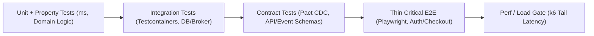

---
tags:
  - software-engineering
  - testing
  - dashboard
created: 2026-01-02
updated: 2026-11-13
status: 🟢
level: mid-to-senior
---
# Testing Complete Guide

> [!abstract] Vault Navigation
> Quality verification hub within [[Programming/Software Engineering/Software Engineering Roadmap|Software Engineering Roadmap]]. Integrates directly with [[Programming/Software Engineering/DevOps/CI-CD|CI/CD]], [[Programming/Software Engineering/DevOps/Pipeline Design|Pipeline Design]], [[Programming/Software Engineering/SDLC/Release Engineering & Migrations|Release Engineering & Migrations]], and [[Programming/Software Engineering/SDLC/SDLC Complete Guide|SDLC Complete Guide]].

Automated verification proves behavioral invariants across changing implementations while balancing **defect detection power**, **refactoring resilience**, **execution speed**, and **maintenance cost**. High-performing engineering teams design test portfolios around **where bugs actually originate** (domain logic, SQL/transaction semantics, serialization contracts, async race conditions, and critical user journeys) rather than chasing arbitrary line-coverage percentages.

---

## 1. Core Curriculum

| Module | Engineering Scope | Status |
|---|---|---|
| [[Programming/Software Engineering/Testing/TDD\|TDD]] | Red-Green-Refactor, Classical (Detroit) vs Mockist (London) schools, triangulation, legacy characterization tests | 🟢 |
| [[Programming/Software Engineering/Testing/Unit Testing\|Unit Testing]] | Khorikov's 4 pillars, behavioral vs implementation-coupled assertions, property-based testing, mutation testing (PIT/Stryker) | 🟢 |
| [[Programming/Software Engineering/Testing/Integration Testing\|Integration Testing]] | Testcontainers (Postgres/Redis/Kafka), DB isolation strategies (rollback vs truncation vs schema-per-worker), async polling | 🟢 |
| [[Programming/Software Engineering/Testing/Mocking\|Mocking]] | Test doubles taxonomy (Dummy, Stub, Spy, Mock, Fake), white-box test rot, WireMock & MSW network stubbing | 🟢 |
| [[Programming/Software Engineering/Testing/E2E Testing\|E2E Testing]] | Playwright determinism, web-first auto-wait, eliminating `sleep`, Pact Consumer-Driven Contracts, k6 load & tail-latency SLOs | 🟢 |

---

## 2. Portfolio Topologies: Pyramid vs Trophy vs Honeycomb

| Model | Primary Shape | Core Thesis | Optimal Architectural Fit |
|---|---|---|---|
| **Test Pyramid (Cohn)** | Broad Unit base $\to$ moderate Integration $\to$ tiny E2E tip | Isolate complex business math into pure fast unit tests; verify wiring at boundaries | Domain-rich backends, Clean/Hexagonal architectures, compilers, algorithms |
| **Testing Trophy (Dodds)** | Static types/lint base $\to$ small Unit $\to$ dominant **Integration** $\to$ slim E2E | Most UI/CRUD defects sit in component-state + API/DB composition rather than isolated leaf helpers | React/Next.js SPAs, CRUD microservices, Vertical Slice APIs |
| **Testing Honeycomb (Spotify)** | Implementation details untouched $\to$ small Unit $\to$ dominant **Service Integration** $\to$ Contracts | Microservices contain thin domain logic and heavy RPC/broker wiring; mock downstream services cleanly via contracts | Network-heavy microservices and event-driven systems |

---

## 3. CI Pipeline Gate Budgeting

| Pipeline Stage | Trigger Cadence | Budgeted Wall Time | Permitted Infrastructure |
|---|---|---|---|
| **Static & Unit Gate** | Every push / PR commit | $< 2\text{ min}$ | In-memory only (types, lint, unit, property-based tests) |
| **Integration & Contract Gate** | Every PR prior to merge | $3\text{–}7\text{ min}$ | Ephemeral Docker Testcontainers + Pact broker `can-i-deploy` check |
| **Critical E2E Smoke** | Pre-prod / Merge Queue | $3\text{–}5\text{ min}$ | Ephemeral preview stack + Playwright headless browsers (3–10 core revenue flows) |
| **Mutation / Load / Soak** | Nightly or Release Candidate | $15\text{–}60\text{ min}$ | Stryker/PIT incremental diffs; k6 arrival-rate stress & memory-leak soak tests |

---

## 4. Cross-Cutting Engineering Standards

- **Zero Shared Mutable CI State**: Tests execute in parallel across workers without cross-test ordering assumptions.
- **No Arbitrary `sleep()` Calls**: Asynchronous waits must poll bounded conditions or attach to deterministic event signals.
- **Test Doubles Strictly at Unmanaged Boundaries**: Mock external SaaS APIs (`WireMock`, `MSW`), never internal domain collaborators or your own database semantics. See [[Programming/Software Engineering/Clean Architecture/Clean Architecture Complete Guide|Clean Architecture Complete Guide]].
