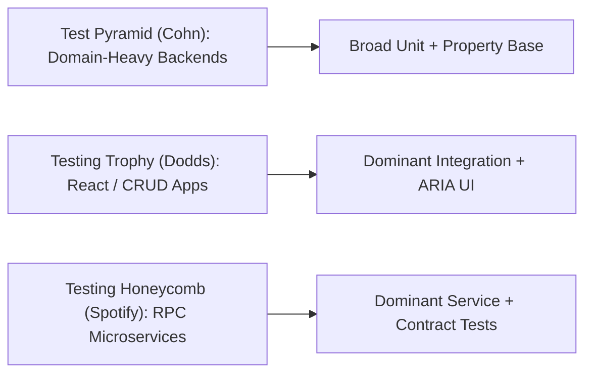
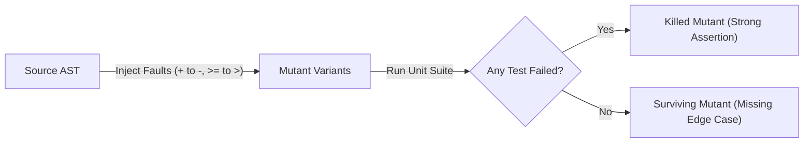

---
tags:
  - software-engineering
  - testing
  - unit-testing
  - mutation-testing
created: 2026-01-02
updated: 2026-11-13
status: 🟢
level: mid-to-senior
---
# Unit Testing

> [!abstract] Hub Context
> Part of [[Programming/Software Engineering/Testing/Testing Complete Guide|Testing Complete Guide]]. Integrates directly with [[Programming/Software Engineering/Testing/TDD|TDD]], [[Programming/Software Engineering/Testing/Mocking|Mocking]], [[Programming/Software Engineering/Testing/Integration Testing|Integration Testing]], and [[Programming/Software Engineering/Clean Architecture/Clean Architecture Complete Guide|Clean Architecture Complete Guide]].

A unit test verifies a single coherent unit of **observable behavior** deterministically in memory. Evaluating suite health by raw line or branch coverage is hazardous: a suite reporting 95% coverage frequently turns into an unmaintainable liability when internal code reorganizations trigger dozens of false-positive failures while subtle boundary regressions escape to production. Senior engineering optimizes test suites around defect-detection ROI, refactoring survival, sub-millisecond execution speed, and low setup entropy.

---

## 1. First-Principles Mechanics & Complete Architecture

### Vladimir Khorikov's 4 Pillars of a Valuable Test

Vladimir Khorikov (*Unit Testing Principles, Practices, and Patterns*) models test value as a multiplicative product across four independent axes:

$$\text{Test Value} = \text{Protection} \times \text{Resistance} \times \text{Fast Feedback} \times \text{Maintainability}$$

Because the relationship is **multiplicative**, any axis dropping near zero collapses the entire test's net value—even if the remaining three scores are maximal.

| Pillar | Exact Engineering Definition | Structural Failure Mechanism |
|---|---|---|
| **1. Protection Against Regressions** | Probability that the test fails when a genuine defect breaks production semantics | Testing trivial field getters/constructors, asserting mock return echoes, or missing boundary predicates (`>=` vs `>`) |
| **2. Resistance to Refactoring** | Probability that the test **remains green** during behavior-preserving structural refactors (**Zero False Positives**) | Asserting private helper call counts, internal SQL query strings, exact log formatting, or CSS utility classes |
| **3. Fast Feedback** | Sub-millisecond execution latency permitting execution on every file save | Booting Express/NestJS containers, opening Postgres connections, or sleeping inside unit specs |
| **4. Maintainability** | Effort required to comprehend intent and update fixtures when legitimate business requirements evolve | Shared mutable `beforeEach` blocks, 90-line setup boilerplate, and fragile implicit data dependencies |

> [!danger] The False-Positive Death Spiral
> False negatives (bugs slipping past tests) degrade product reliability; **false positives (tests turning red when internal code is cleaned up without changing external outputs) destroy engineering velocity**. Once engineers observe that extracting a helper class triggers 35 unrelated test failures, they stop refactoring—accelerating structural decay—and eventually distrust or delete failing tests.

---

### Portfolio Topologies: Test Pyramid vs Testing Trophy vs Testing Honeycomb

Engineering organizations calibrate their test portfolios differently depending on where complexity actually lives in the runtime call graph.



| Portfolio Model | Primary Center of Gravity | Architectural Drivers & Optimal Domain Fit | Core Anti-Pattern When Misapplied |
|---|---|---|---|
| **Test Pyramid (Mike Cohn)** | **Broad Unit Base** $\to$ Moderate Integration $\to$ Minimal E2E | High cyclomatic domain math (compilers, billing ledgers, pricing engines, Hexagonal cores) where most bugs live in pure computation | Applying a broad unit base to thin CRUD endpoints by mocking ORM queries—producing 100% tautological white-box tests |
| **Testing Trophy (Kent C. Dodds)** | Static Types/Lint $\to$ Small Unit $\to$ **Dominant Integration** $\to$ Slim E2E | Frontend React/Next.js SPAs and CRUD APIs where bugs originate in form validation, state hooks, HTTP serialization, and DB constraints | Testing React components by mocking child hooks or inspecting internal component `.state` instead of DOM ARIA interactions |
| **Testing Honeycomb (Spotify)** | Small Unit $\to$ **Dominant Service Integration** $\to$ Pact Contracts | Network-heavy microservices with thin domain rules and heavy gRPC/Kafka/Postgres wiring | Attempting isolated unit tests on every message handler via driver mocks instead of spinning up real container dependencies |

---

### Observable Behavior vs Implementation Details

Every module exposes an intentional public contract (inputs, outputs, persisted state changes, unmanaged external messages) alongside transient internal mechanics (private helper decomposition, caching strategies, internal loop ordering, CSS utility tokens). Unit tests achieve maximum **Resistance to Refactoring** strictly when every assertion targets observable behavior.

| Target Under Assertion | Classification | Test Verdict |
|---|---|---|
| Return value, computed ledger entry, or typed domain error | **Observable Behavior** | **Assert Strictly** |
| Persisted entity state read back through repository query | **Observable Behavior** | **Assert Strictly** |
| Outbound HTTP/email payload emitted across an unmanaged port | **Observable Side Effect** | **Assert Strictly** |
| Accessible DOM role, label text, disabled state, `aria-live` alert | **Observable UI Behavior** | **Assert Strictly** |
| Private function invocation count, internal helper arguments | **Implementation Detail** | **Never Assert** |
| Raw SQL whitespace, internal field names, CSS Tailwind classes | **Implementation Detail** | **Never Assert** |

---

### AAA Discipline & Functional Fixture Builders

Every unit test must partition cleanly into **Arrange**, **Act**, and **Assert** phases with a single cohesive **Act** step:

1. **Zero Multi-Act Scripts**: Mixing `Act -> Assert -> Act -> Assert` chains inside one test obscures which transition broke and encourages shared mutable setup. Split distinct behavioral transitions into focused tests.
2. **Eliminate Shared Mutable `beforeEach` State**: Initializing `let order: Order;` inside a suite-level `beforeEach` forces readers to jump vertically across 80 lines to reconstruct test preconditions and creates hidden cross-test mutation risk if nested `describe` hooks modify the same reference.
3. **Use Functional Builders (`makeOrder(overrides)`)**: Factory builders supply valid baseline defaults (`currency: 'USD'`, `items: [makeOrderLine()]`) while forcing each test to pass **only the specific attributes causally relevant to its assertion** (`makeOrder({ customerTier: 'VIP', subtotalCents: 10_000 })`).

---

### Determinism Engineering (Clock, Timers, Randomness, Timezones)

Non-deterministic inputs turn reliable suites into flaky CI noise ("Heisenbugs") that pass on developer laptops in `America/New_York` (`UTC-4`) and crash in GitHub Actions (`UTC`) between `20:00` and `23:59` local time:

- **Timezone Pinning (`TZ=UTC`)**: Always execute Node/Vitest test scripts with `TZ=UTC` so `Date` formatting, day-of-week checks, and midnight boundaries execute identically across macOS, Windows, and Linux CI runners.
- **Explicit `Clock` Injection vs `vi.useFakeTimers()`**:
  - Prefer passing `nowUtcMs: number` or injecting a tiny `Clock` interface (`now(): Date`) into pure domain functions—zero global monkey-patching, zero cleanup bugs, full worker thread parallelism.
  - When testing `setTimeout`, debounce intervals, TTL caches, or legacy code calling `Date.now()` directly, invoke `vi.useFakeTimers()` + `vi.setSystemTime(new Date('2026-11-13T12:00:00.000Z'))` and **unconditionally restore** with `afterEach(() => vi.useRealTimers())`.
- **Deterministic Identifiers & Entropy**: Never let domain tests depend on `Math.random()` or `crypto.randomUUID()` without injecting an `IdGenerator` or seeded PRNG.

---

### Property-Based Testing (PBT) with `fast-check`

Example-based tests verify only the concrete inputs a human remembered to write. **Property-Based Testing** generates hundreds of adversarial inputs across boundary distributions (`0`, `-0`, `Number.MAX_SAFE_INTEGER`, empty arrays, duplicate weights, surrogate UTF-16 pairs) and evaluates universal **algebraic invariants** across all generated trials.

#### The 5 High-Leverage Algebraic Properties

1. **Conservation / Zero-Loss Invariant**: `sum(allocate(totalCents, weights)) === totalCents` (proves integer penny-splitting never drops or manufactures cents under rounding).
2. **Idempotence**: `f(f(x)) === f(x)` (coupon normalization, event deduplication, canonical string formatting).
3. **Round-Trip Invertibility**: `decode(encode(x))` equals `x` deeply (binary frames, invoice JSON/CSV codecs, URL query serializers).
4. **Commutativity / Order Independence**: `calculateTotals(shuffle(items)) === calculateTotals(items)` (order lines added in reverse order must yield identical tax and discount totals).
5. **Oracle Equivalence**: `optimizedAlgorithm(xs)` produces identical output to `bruteForceReference(xs)`.

#### Shrinking & Seed Reproducibility Mechanics

When `fast-check` discovers a failing tuple such as `totalCents = 948271, weights = [41, 0, 8821, 17]`, its **shrinker** systematically bisects integers toward zero and removes array elements while keeping the failure alive, converging automatically to the **minimal counterexample** (`totalCents = 1, weights = [1, 1, 1]`) and printing `{ seed, path }` so CI failures replay identically with one configuration option.

---

### Mutation Testing with Stryker (`stryker.config.mjs`)

Line coverage measures **execution**, not **verification**—a test calling `calculateDiscount(100)` with **zero `expect()` statements** records 100% line coverage while detecting 0% of bugs. **Mutation Testing** quantifies the genuine assertion power of a test suite by injecting deliberate syntactic faults into the AST.



#### Mutation Score Mechanics & Incremental CI Guardrails

- **Killed**: At least one unit test failed when the mutant replaced `>=` with `>` or removed a `Math.min` cap.
- **Survived**: Every test remained green despite corrupted production logic—exposing either an untested edge case, a weak assertion (`toBeDefined()` instead of `toEqual(650)`), or dead/redundant code.
- **Mutation Score**: $\frac{\text{Killed} + \text{Timeout}}{\text{Total Valid Mutants} - \text{Equivalent Mutants}}$.
- **Cost & Scope Control**: Running full mutation analysis scales as $O(\text{Mutants} \times \text{SuiteDuration})$. Restrict `mutate` strictly to high-value domain rules (`src/domain/**/*.ts`), use `coverageAnalysis: 'perTest'` so Stryker executes only tests covering each mutant line, and run incremental diffs (`npx stryker run --since origin/main`) on pull requests or nightly builds targeting $\ge 85\%$ score.

---

## 2. Real-World Use Cases & Decision Matrix

| Testing Technique | Ideal Code Targets | Primary Defect Classes Caught | When to Avoid |
|---|---|---|---|
| **Classical Unit Specs (`it`)** | Domain aggregates, state transitions, validation policies, formatters | Broken invariants, wrong error types, state leakage | Thin pass-through Express controllers with zero branching |
| **Table-Driven Tests (`it.each`)** | Tax brackets, discount tiers, RBAC permission matrices, state tables | Missing boundary permutations (`<`, `=`, `>`), off-by-one rules | Complex multi-step scenarios where shared table columns lose clarity |
| **Property-Based (`fast-check`)** | Allocators, serializers, pagination chunkers, merge/diff engines, parsers | Rounding penny loss, empty/extreme inputs, order sensitivity, round-trip drift | Simple CRUD rules where algebraic laws boil down to repeating implementation math |
| **React Testing Library + `userEvent`** | Interactive forms, checkout panels, multi-step wizards, async validation states | Broken keyboard focus, missing error announcements, race conditions on submit | Pure CSS visual spacing/layout checks (use Playwright visual/browser tests) |
| **Mutation Testing (`Stryker`)** | Financial calculations, authz policies, compliance rules, token/rate math | Weak assertions, untested `>=` boundaries, dead branches masked by 100% line coverage | Generated OpenAPI clients, static configuration objects, trivial DTO constructors |

---

## 3. Step-by-Step Practical Application: Complete Production Suites

This section provides two complete, copy-pasteable production test suites:
1. **Suite A**: An **Order Discount & Ledger Calculator** tested with strict AAA builders, fake timers, `fast-check` property invariants, and a complete `stryker.config.mjs` mutation setup.
2. **Suite B**: A **React Promo Checkout Panel** tested strictly through accessible ARIA roles and real `userEvent` interactions.

### Workspace Configuration (`package.json`, `vitest.config.ts`, `stryker.config.mjs`)

```json
{
  "name": "order-ledger-testing-suite",
  "version": "1.0.0",
  "private": true,
  "type": "module",
  "scripts": {
    "test": "TZ=UTC vitest run",
    "test:coverage": "TZ=UTC vitest run --coverage",
    "test:mutate": "TZ=UTC stryker run"
  },
  "devDependencies": {
    "@stryker-mutator/core": "^8.7.0",
    "@stryker-mutator/vitest-runner": "^8.7.0",
    "@testing-library/jest-dom": "^6.6.3",
    "@testing-library/react": "^16.2.0",
    "@testing-library/user-event": "^14.6.1",
    "@types/node": "^22.10.0",
    "@types/react": "^19.0.0",
    "@types/react-dom": "^19.0.0",
    "@vitest/coverage-v8": "^3.0.4",
    "fast-check": "^3.23.2",
    "jsdom": "^26.0.0",
    "react": "^19.0.0",
    "react-dom": "^19.0.0",
    "typescript": "^5.7.2",
    "vitest": "^3.0.4"
  }
}
```

```typescript
// vitest.config.ts
import { defineConfig } from 'vitest/config';

export default defineConfig({
  test: {
    environment: 'node',
    globals: false,
    restoreMocks: true,
    clearMocks: true,
    setupFiles: ['./tests/setup-dom.ts'],
    coverage: {
      provider: 'v8',
      include: ['src/domain/**/*.ts', 'src/ui/**/*.tsx'],
      thresholds: {
        lines: 90,
        branches: 90,
        functions: 90,
      },
    },
  },
});
```

```javascript
// stryker.config.mjs
/** @type {import('@stryker-mutator/api/core').PartialStrykerOptions} */
export default {
  packageManager: 'npm',
  testRunner: 'vitest',
  reporters: ['html', 'clear-text', 'progress'],
  coverageAnalysis: 'perTest',
  mutate: [
    'src/domain/**/*.ts',
    '!src/domain/**/*.spec.ts',
    '!src/domain/**/*.d.ts',
  ],
  vitest: {
    configFile: 'vitest.config.ts',
  },
  thresholds: {
    high: 90,
    low: 80,
    break: 80,
  },
  concurrency: 4,
  timeoutMS: 10000,
};
```

---

### Suite A: Order Discount & Ledger Calculator (`OrderLedgerCalculator`)

#### `src/domain/order-ledger.ts`

```typescript
export type CustomerTier = 'STANDARD' | 'VIP';

export interface OrderLineInput {
  readonly sku: string;
  readonly quantity: number;
  readonly unitPriceCents: number;
}

export interface OrderCalculationInput {
  readonly orderId: string;
  readonly customerTier: CustomerTier;
  readonly lines: readonly OrderLineInput[];
  readonly promoDiscountCents: number;
  readonly taxBasisPoints: number;
  readonly nowUtc: Date;
}

export interface AllocatedLineLedger {
  readonly sku: string;
  readonly lineSubtotalCents: number;
  readonly lineDiscountCents: number;
  readonly netLineCents: number;
}

export interface OrderLedgerSummary {
  readonly orderId: string;
  readonly issuedAtIsoUtc: string;
  readonly subtotalCents: number;
  readonly tierDiscountCents: number;
  readonly promoDiscountCents: number;
  readonly totalDiscountCents: number;
  readonly taxableCents: number;
  readonly taxCents: number;
  readonly grandTotalCents: number;
  readonly allocatedLines: readonly AllocatedLineLedger[];
}

export function normalizeSku(rawSku: string): string {
  return rawSku.trim().toUpperCase();
}

/**
 * Allocates `totalToAllocateCents` proportionally across positive `weights` using
 * Hamilton's Largest Remainder method so exact integer cents always sum to `totalToAllocateCents`.
 */
export function allocateProportionally(
  totalToAllocateCents: number,
  weights: readonly number[],
): number[] {
  if (!Number.isSafeInteger(totalToAllocateCents) || totalToAllocateCents < 0) {
    throw new RangeError('totalToAllocateCents must be a non-negative safe integer');
  }
  if (weights.length === 0) {
    return [];
  }
  const weightSum = weights.reduce((acc, w) => {
    if (!Number.isSafeInteger(w) || w < 0) {
      throw new RangeError('Each allocation weight must be a non-negative safe integer');
    }
    return acc + w;
  }, 0);

  if (weightSum === 0 || totalToAllocateCents === 0) {
    return weights.map(() => 0);
  }

  const shares = weights.map((weight, index) => {
    const exactNumerator = totalToAllocateCents * weight;
    const baseShare = Math.floor(exactNumerator / weightSum);
    const remainderNumerator = exactNumerator % weightSum;
    return { index, baseShare, remainderNumerator };
  });

  const allocatedSoFar = shares.reduce((acc, item) => acc + item.baseShare, 0);
  let remainingPennies = totalToAllocateCents - allocatedSoFar;

  const byLargestRemainder = [...shares].sort((a, b) => {
    if (b.remainderNumerator !== a.remainderNumerator) {
      return b.remainderNumerator - a.remainderNumerator;
    }
    return a.index - b.index;
  });

  const result = shares.map((s) => s.baseShare);
  for (let i = 0; i < remainingPennies; i += 1) {
    const target = byLargestRemainder[i]!;
    result[target.index]! += 1;
  }
  return result;
}

export function calculateOrderLedger(input: OrderCalculationInput): OrderLedgerSummary {
  if (input.lines.length === 0) {
    throw new Error('Order must contain at least one line item');
  }
  if (!Number.isSafeInteger(input.promoDiscountCents) || input.promoDiscountCents < 0) {
    throw new RangeError('promoDiscountCents must be a non-negative safe integer');
  }
  if (
    !Number.isSafeInteger(input.taxBasisPoints) ||
    input.taxBasisPoints < 0 ||
    input.taxBasisPoints > 10_000
  ) {
    throw new RangeError('taxBasisPoints must be an integer between 0 and 10000');
  }

  const normalizedLines = input.lines.map((line) => {
    const sku = normalizeSku(line.sku);
    if (sku.length === 0) {
      throw new Error('Line SKU cannot be blank');
    }
    if (!Number.isSafeInteger(line.quantity) || line.quantity <= 0) {
      throw new RangeError(`Invalid quantity for SKU ${sku}`);
    }
    if (!Number.isSafeInteger(line.unitPriceCents) || line.unitPriceCents < 0) {
      throw new RangeError(`Invalid unit price for SKU ${sku}`);
    }
    return {
      sku,
      lineSubtotalCents: line.quantity * line.unitPriceCents,
    };
  });

  const subtotalCents = normalizedLines.reduce((acc, l) => acc + l.lineSubtotalCents, 0);

  // VIP tier grants 10% discount when subtotal reaches $100.00 (10_000 cents) inclusively
  const tierDiscountCents =
    input.customerTier === 'VIP' && subtotalCents >= 10_000
      ? Math.round((subtotalCents * 1_000) / 10_000)
      : 0;

  const remainingAfterTier = subtotalCents - tierDiscountCents;
  const promoDiscountCents = Math.min(remainingAfterTier, input.promoDiscountCents);
  const totalDiscountCents = tierDiscountCents + promoDiscountCents;
  const taxableCents = subtotalCents - totalDiscountCents;

  const taxCents = Math.round((taxableCents * input.taxBasisPoints) / 10_000);
  const grandTotalCents = taxableCents + taxCents;

  const lineDiscounts = allocateProportionally(
    totalDiscountCents,
    normalizedLines.map((l) => l.lineSubtotalCents),
  );

  const allocatedLines: AllocatedLineLedger[] = normalizedLines.map((line, idx) => {
    const lineDiscountCents = lineDiscounts[idx]!;
    return {
      sku: line.sku,
      lineSubtotalCents: line.lineSubtotalCents,
      lineDiscountCents,
      netLineCents: line.lineSubtotalCents - lineDiscountCents,
    };
  });

  return {
    orderId: input.orderId,
    issuedAtIsoUtc: input.nowUtc.toISOString(),
    subtotalCents,
    tierDiscountCents,
    promoDiscountCents,
    totalDiscountCents,
    taxableCents,
    taxCents,
    grandTotalCents,
    allocatedLines,
  };
}

export function encodeLedgerReceipt(summary: OrderLedgerSummary): string {
  return Buffer.from(JSON.stringify(summary), 'utf8').toString('base64url');
}

export function decodeLedgerReceipt(token: string): OrderLedgerSummary {
  const json = Buffer.from(token, 'base64url').toString('utf8');
  return JSON.parse(json) as OrderLedgerSummary;
}
```

#### `tests/fixtures/order-builder.ts` (Clean Functional Fixture Builders)

```typescript
import type { OrderCalculationInput, OrderLineInput } from '../../src/domain/order-ledger';

export function makeOrderLine(overrides: Partial<OrderLineInput> = {}): OrderLineInput {
  return {
    sku: 'SKU-WIDGET-01',
    quantity: 1,
    unitPriceCents: 2_500,
    ...overrides,
  };
}

export function makeOrderInput(
  overrides: Partial<OrderCalculationInput> = {},
): OrderCalculationInput {
  return {
    orderId: 'ord-1001',
    customerTier: 'STANDARD',
    lines: [makeOrderLine()],
    promoDiscountCents: 0,
    taxBasisPoints: 800, // 8.00%
    nowUtc: new Date('2026-11-13T12:00:00.000Z'),
    ...overrides,
  };
}
```

#### `tests/unit/order-ledger.spec.ts` (Deterministic AAA + Mutation-Resistant Unit Suite)

```typescript
import { afterEach, describe, expect, it, vi } from 'vitest';
import {
  allocateProportionally,
  calculateOrderLedger,
  normalizeSku,
} from '../../src/domain/order-ledger';
import { makeOrderInput, makeOrderLine } from '../fixtures/order-builder';

describe('calculateOrderLedger', () => {
  afterEach(() => {
    vi.useRealTimers();
  });

  it('computes subtotal, tax, and UTC ISO timestamp deterministically with fake timers', () => {
    // Arrange
    vi.useFakeTimers();
    const fixedClock = new Date('2026-11-13T23:45:00.000Z');
    vi.setSystemTime(fixedClock);

    const order = makeOrderInput({
      lines: [
        makeOrderLine({ sku: ' sku-a ', quantity: 2, unitPriceCents: 1_500 }),
        makeOrderLine({ sku: 'sku-b', quantity: 1, unitPriceCents: 2_000 }),
      ],
      taxBasisPoints: 1_000, // 10.00%
      nowUtc: new Date(),
    });

    // Act
    const summary = calculateOrderLedger(order);

    // Assert
    expect(summary).toEqual({
      orderId: 'ord-1001',
      issuedAtIsoUtc: '2026-11-13T23:45:00.000Z',
      subtotalCents: 5_000,
      tierDiscountCents: 0,
      promoDiscountCents: 0,
      totalDiscountCents: 0,
      taxableCents: 5_000,
      taxCents: 500,
      grandTotalCents: 5_500,
      allocatedLines: [
        { sku: 'SKU-A', lineSubtotalCents: 3_000, lineDiscountCents: 0, netLineCents: 3_000 },
        { sku: 'SKU-B', lineSubtotalCents: 2_000, lineDiscountCents: 0, netLineCents: 2_000 },
      ],
    });
  });

  it('applies VIP 10% tier discount inclusively at exact 10000 cents threshold only for VIP', () => {
    // Below threshold: VIP gets 0 tier discount (kills >= to > and && to ||)
    const vipBelow = calculateOrderLedger(
      makeOrderInput({
        customerTier: 'VIP',
        lines: [makeOrderLine({ unitPriceCents: 9_999 })],
        taxBasisPoints: 0,
      }),
    );
    expect(vipBelow.tierDiscountCents).toBe(0);

    // Exact boundary: VIP gets 1000 cents discount
    const vipExact = calculateOrderLedger(
      makeOrderInput({
        customerTier: 'VIP',
        lines: [makeOrderLine({ unitPriceCents: 10_000 })],
        taxBasisPoints: 0,
      }),
    );
    expect(vipExact.tierDiscountCents).toBe(1_000);
    expect(vipExact.grandTotalCents).toBe(9_000);

    // Above threshold but STANDARD tier: gets 0 tier discount (kills && to ||)
    const standardAbove = calculateOrderLedger(
      makeOrderInput({
        customerTier: 'STANDARD',
        lines: [makeOrderLine({ unitPriceCents: 20_000 })],
        taxBasisPoints: 0,
      }),
    );
    expect(standardAbove.tierDiscountCents).toBe(0);
  });

  it('clamps promo discount to remaining balance after tier discount without negative taxable total', () => {
    const order = makeOrderInput({
      customerTier: 'VIP',
      lines: [makeOrderLine({ unitPriceCents: 10_000 })], // $100 - 10% = $90 remaining
      promoDiscountCents: 12_000, // exceeds $90 remaining
      taxBasisPoints: 1_000,
    });

    const summary = calculateOrderLedger(order);

    expect(summary.tierDiscountCents).toBe(1_000);
    expect(summary.promoDiscountCents).toBe(9_000);
    expect(summary.totalDiscountCents).toBe(10_000);
    expect(summary.taxableCents).toBe(0);
    expect(summary.taxCents).toBe(0);
    expect(summary.grandTotalCents).toBe(0);
  });

  it('rejects invalid lines, negative amounts, and out-of-range tax rates', () => {
    expect(() => calculateOrderLedger(makeOrderInput({ lines: [] }))).toThrow(
      /at least one line item/,
    );
    expect(() =>
      calculateOrderLedger(makeOrderInput({ promoDiscountCents: -1 })),
    ).toThrow(RangeError);
    expect(() =>
      calculateOrderLedger(makeOrderInput({ taxBasisPoints: -1 })),
    ).toThrow(RangeError);
    expect(() =>
      calculateOrderLedger(makeOrderInput({ taxBasisPoints: 10_001 })),
    ).toThrow(RangeError);
    expect(() =>
      calculateOrderLedger(
        makeOrderInput({ lines: [makeOrderLine({ sku: '   ' })] }),
      ),
    ).toThrow(/blank/);
    expect(() =>
      calculateOrderLedger(
        makeOrderInput({ lines: [makeOrderLine({ quantity: 0 })] }),
      ),
    ).toThrow(RangeError);
    expect(() =>
      calculateOrderLedger(
        makeOrderInput({ lines: [makeOrderLine({ unitPriceCents: -5 })] }),
      ),
    ).toThrow(RangeError);
  });

  it('allocates odd remainders via largest-remainder deterministic tie breaking', () => {
    expect(allocateProportionally(100, [1, 1, 1])).toEqual([34, 33, 33]);
    expect(allocateProportionally(100, [0, 0])).toEqual([0, 0]);
    expect(allocateProportionally(0, [50, 50])).toEqual([0, 0]);
    expect(allocateProportionally(50, [])).toEqual([]);
  });

  it('normalizes SKU whitespace and casing cleanly', () => {
    expect(normalizeSku('  ab-12  ')).toBe('AB-12');
  });
});
```

#### `tests/unit/order-ledger.properties.spec.ts` (`fast-check` Algebraic Invariant Suite)

```typescript
import fc from 'fast-check';
import { describe, expect, it } from 'vitest';
import {
  allocateProportionally,
  calculateOrderLedger,
  decodeLedgerReceipt,
  encodeLedgerReceipt,
  normalizeSku,
  type OrderLineInput,
} from '../../src/domain/order-ledger';

const orderLineArbitrary: fc.Arbitrary<OrderLineInput> = fc.record({
  sku: fc.stringOf(fc.constantFrom('A', 'B', 'C', '1', '2', '-'), {
    minLength: 1,
    maxLength: 8,
  }),
  quantity: fc.integer({ min: 1, max: 50 }),
  unitPriceCents: fc.integer({ min: 0, max: 100_000 }),
});

describe('OrderLedger Property-Based Invariants (fast-check)', () => {
  it('conserves exact cents across proportional allocation for all integer weights', () => {
    fc.assert(
      fc.property(
        fc.integer({ min: 0, max: 5_000_000 }),
        fc.array(fc.integer({ min: 1, max: 10_000 }), { minLength: 1, maxLength: 30 }),
        (totalCents, weights) => {
          const allocated = allocateProportionally(totalCents, weights);
          const sum = allocated.reduce((acc, v) => acc + v, 0);

          expect(sum).toBe(totalCents);
          expect(allocated).toHaveLength(weights.length);
          expect(allocated.every((share) => Number.isSafeInteger(share) && share >= 0)).toBe(true);
        },
      ),
      { numRuns: 300 },
    );
  });

  it('maintains line discount conservation, non-negative totals, and line-order commutativity', () => {
    fc.assert(
      fc.property(
        fc.constantFrom<'STANDARD' | 'VIP'>('STANDARD', 'VIP'),
        fc.array(orderLineArbitrary, { minLength: 1, maxLength: 15 }),
        fc.integer({ min: 0, max: 500_000 }),
        fc.integer({ min: 0, max: 3_000 }),
        (customerTier, lines, promoDiscountCents, taxBasisPoints) => {
          const baseInput = {
            orderId: 'pbt-order',
            customerTier,
            lines,
            promoDiscountCents,
            taxBasisPoints,
            nowUtc: new Date('2026-11-13T12:00:00.000Z'),
          };

          const forward = calculateOrderLedger(baseInput);
          const reversed = calculateOrderLedger({
            ...baseInput,
            lines: [...lines].reverse(),
          });

          const allocatedDiscountSum = forward.allocatedLines.reduce(
            (acc, l) => acc + l.lineDiscountCents,
            0,
          );
          const netLineSum = forward.allocatedLines.reduce((acc, l) => acc + l.netLineCents, 0);

          expect(allocatedDiscountSum).toBe(forward.totalDiscountCents);
          expect(netLineSum).toBe(forward.taxableCents);
          expect(forward.taxableCents).toBeGreaterThanOrEqual(0);
          expect(forward.grandTotalCents).toBe(forward.taxableCents + forward.taxCents);

          // Commutativity: line ordering never alters order financial totals
          expect(reversed.subtotalCents).toBe(forward.subtotalCents);
          expect(reversed.totalDiscountCents).toBe(forward.totalDiscountCents);
          expect(reversed.taxCents).toBe(forward.taxCents);
          expect(reversed.grandTotalCents).toBe(forward.grandTotalCents);
        },
      ),
      { numRuns: 200 },
    );
  });

  it('enforces idempotency of normalizeSku and exact round-trip receipt serialization', () => {
    fc.assert(
      fc.property(fc.string({ minLength: 0, maxLength: 32 }), (raw) => {
        expect(normalizeSku(normalizeSku(raw))).toBe(normalizeSku(raw));
      }),
    );

    fc.assert(
      fc.property(
        fc.array(orderLineArbitrary, { minLength: 1, maxLength: 5 }),
        fc.integer({ min: 0, max: 10_000 }),
        (lines, promoDiscountCents) => {
          const summary = calculateOrderLedger({
            orderId: 'roundtrip-1',
            customerTier: 'VIP',
            lines,
            promoDiscountCents,
            taxBasisPoints: 750,
            nowUtc: new Date('2026-11-13T12:00:00.000Z'),
          });

          const decoded = decodeLedgerReceipt(encodeLedgerReceipt(summary));
          expect(decoded).toStrictEqual(summary);
        },
      ),
    );
  });
});
```

---

### Suite B: Behavioral React Component Suite (`@testing-library/react` + `userEvent`)

Component unit tests follow **Testing Trophy** principles: render the real DOM in JSDOM, drive interactions with real keyboard/pointer events via `userEvent.setup()`, and query exclusively via **ARIA roles, accessible names, labels, and live regions**—never CSS class names, `data-testid` shortcuts, or internal React hook state.

#### `tests/setup-dom.ts`

```typescript
import '@testing-library/jest-dom/vitest';
```

#### `src/ui/PromoCheckoutPanel.tsx`

```tsx
import React, { useState } from 'react';

export interface PromoApplyResult {
  readonly discountCents: number;
  readonly finalTotalCents: number;
}

export interface PromoCheckoutPanelProps {
  readonly subtotalCents: number;
  readonly onApplyPromo: (code: string) => Promise<PromoApplyResult>;
}

function formatUsd(cents: number): string {
  return `$${(cents / 100).toFixed(2)}`;
}

export function PromoCheckoutPanel({
  subtotalCents,
  onApplyPromo,
}: PromoCheckoutPanelProps): React.JSX.Element {
  const [code, setCode] = useState('');
  const [submitting, setSubmitting] = useState(false);
  const [errorMessage, setErrorMessage] = useState<string | null>(null);
  const [applied, setApplied] = useState<PromoApplyResult | null>(null);

  async function handleSubmit(event: React.FormEvent<HTMLFormElement>): Promise<void> {
    event.preventDefault();
    const trimmed = code.trim();
    if (trimmed.length === 0) {
      setErrorMessage('Enter a promo code before applying.');
      return;
    }

    setSubmitting(true);
    setErrorMessage(null);
    try {
      const result = await onApplyPromo(trimmed.toUpperCase());
      setApplied(result);
    } catch (err) {
      setApplied(null);
      setErrorMessage(err instanceof Error ? err.message : 'Unable to apply promo code.');
    } finally {
      setSubmitting(false);
    }
  }

  const finalTotalCents = applied ? applied.finalTotalCents : subtotalCents;

  return (
    <section aria-label="Promo code checkout">
      <form onSubmit={handleSubmit} noValidate>
        <label htmlFor="promo-code-input">Promo code</label>
        <input
          id="promo-code-input"
          name="promoCode"
          type="text"
          value={code}
          onChange={(e) => setCode(e.target.value)}
          disabled={submitting}
          aria-invalid={errorMessage !== null}
        />
        <button type="submit" disabled={submitting}>
          {submitting ? 'Applying...' : 'Apply promo'}
        </button>
      </form>

      {errorMessage !== null && (
        <div role="alert" aria-live="assertive">
          {errorMessage}
        </div>
      )}

      <div role="status" aria-live="polite">
        {applied !== null && <p>Discount applied: -{formatUsd(applied.discountCents)}</p>}
        <p>Total due: {formatUsd(finalTotalCents)}</p>
      </div>
    </section>
  );
}
```

#### `tests/ui/PromoCheckoutPanel.spec.tsx`

```tsx
// @vitest-environment jsdom
import React from 'react';
import { cleanup, render, screen } from '@testing-library/react';
import userEvent from '@testing-library/user-event';
import { afterEach, describe, expect, it, vi } from 'vitest';
import { PromoCheckoutPanel } from '../../src/ui/PromoCheckoutPanel';

describe('PromoCheckoutPanel (Accessible Behavioral UI Tests)', () => {
  afterEach(() => {
    cleanup();
  });

  it('blocks empty submission with an accessible alert without calling API port', async () => {
    const user = userEvent.setup();
    const onApplyPromo = vi.fn();

    render(<PromoCheckoutPanel subtotalCents={5_000} onApplyPromo={onApplyPromo} />);

    await user.click(screen.getByRole('button', { name: 'Apply promo' }));

    expect(screen.getByRole('alert')).toHaveTextContent('Enter a promo code before applying.');
    expect(screen.getByLabelText('Promo code')).toHaveAttribute('aria-invalid', 'true');
    expect(onApplyPromo).not.toHaveBeenCalled();
  });

  it('disables controls while applying and renders updated discount and total in live status', async () => {
    const user = userEvent.setup();
    let resolveApply!: (value: { discountCents: number; finalTotalCents: number }) => void;
    const onApplyPromo = vi.fn(
      () =>
        new Promise<{ discountCents: number; finalTotalCents: number }>((resolve) => {
          resolveApply = resolve;
        }),
    );

    render(<PromoCheckoutPanel subtotalCents={10_000} onApplyPromo={onApplyPromo} />);

    const input = screen.getByLabelText('Promo code');
    await user.type(input, ' save20 ');
    await user.click(screen.getByRole('button', { name: 'Apply promo' }));

    expect(screen.getByRole('button', { name: 'Applying...' })).toBeDisabled();
    expect(input).toBeDisabled();
    expect(onApplyPromo).toHaveBeenCalledWith('SAVE20');

    resolveApply({ discountCents: 2_000, finalTotalCents: 8_000 });

    const status = await screen.findByRole('status');
    expect(status).toHaveTextContent('Discount applied: -$20.00');
    expect(status).toHaveTextContent('Total due: $80.00');
    expect(screen.getByRole('button', { name: 'Apply promo' })).toBeEnabled();
  });

  it('announces domain error messages via alert region and resets prior applied discount', async () => {
    const user = userEvent.setup();
    const onApplyPromo = vi
      .fn()
      .mockResolvedValueOnce({ discountCents: 1_000, finalTotalCents: 4_000 })
      .mockRejectedValueOnce(new Error('Coupon SAVE10 expired'));

    render(<PromoCheckoutPanel subtotalCents={5_000} onApplyPromo={onApplyPromo} />);

    await user.type(screen.getByLabelText('Promo code'), 'SAVE10');
    await user.click(screen.getByRole('button', { name: 'Apply promo' }));
    expect(await screen.findByRole('status')).toHaveTextContent('Total due: $40.00');

    await user.clear(screen.getByLabelText('Promo code'));
    await user.type(screen.getByLabelText('Promo code'), 'EXPIRED');
    await user.click(screen.getByRole('button', { name: 'Apply promo' }));

    expect(await screen.findByRole('alert')).toHaveTextContent('Coupon SAVE10 expired');
    expect(screen.getByRole('status')).toHaveTextContent('Total due: $50.00');
  });
});
```

---

## 4. Complete Framework Reference & Edge Cases

### Vitest & Testing Library Exact API Semantics

| API / Pattern | Exact Runtime Behavior | Common Pitfall & Required Usage |
|---|---|---|
| `toEqual` vs `toStrictEqual` | `toStrictEqual` checks `undefined` object keys, sparse array holes, and class prototype constructors (`new Money(5)` vs `{ minorUnits: 5 }`) | Prefer `toStrictEqual` on Value Objects and serialized structures so extra `undefined` keys never hide drift |
| `getByRole` / `queryByRole` / `findByRole` | `getBy*` throws sync if missing; `queryBy*` returns `null`; `findBy*` polls async up to `1000ms` | Use `queryByRole('alert')` **only** when asserting absence; use `await findByRole(...)` after async state transitions |
| `userEvent.setup()` + `vi.useFakeTimers()` | `userEvent` internally calls `setTimeout` between synthetic keystrokes; frozen fake timers block `await user.type()` indefinitely | Configure `userEvent.setup({ advanceTimers: vi.advanceTimersByTime })` whenever fake timers are active in component tests |
| `expect.assertions(n)` | Verifies `n` assertions actually ran before test finishes | Mandatory when asserting inside `try { await fn(); } catch (err) { expect(err)... }`—or better yet, use `await expect(fn()).rejects.toThrow(...)` |
| `fc.assert(..., { seed, path })` | Replays exact failing `fast-check` generated sequence deterministically | Copy `{ seed, path }` logged by CI failure straight into local test while isolating root cause, then remove after fix |

### Five Subtle Unit Testing Failure Modes

1. **Floating-Point Accumulation Drift**: Writing unit assertions against float dollar values (`0.1 + 0.2 === 0.30000000000000004`) forces ugly `toBeCloseTo()` hacks that mask genuine rounding bugs. Always compute currency in integer minor units (`cents`) or exact fixed-point decimals.
2. **Shallow Clone Leakage Across Tests**: Passing a shared constant array/object (`const BASE_ITEMS = [...]`) directly to an implementation that calls `.sort()` in place silently mutates `BASE_ITEMS` for every subsequent test. Always construct fresh objects inside `make*()` factories and treat domain collections immutably.
3. **Snapshot Testing Rot (`toMatchSnapshot`)**: Dumping entire 200-line serialized objects or DOM trees into `.snap` files encourages engineers to run `vitest -u` blindly whenever any field changes—giving zero protection against unintended regressions while failing loudly on harmless formatting tweaks. Reserve snapshots strictly for tiny stabilized DSLs/AST outputs (`< 20` lines).
4. **Testing Asynchronous `forEach` Loops**: `items.forEach(async (x) => { expect(await fn(x)).toBe(true); })` fires detached promises and passes immediately before any `expect()` runs! Always use `for (const x of items)` or `await Promise.all(...)`.
5. **Equivalent Mutants Skewing Stryker Budgets**: Some syntactic mutations (such as changing `i < arr.length` to `i !== arr.length` when `i` starts at `0` and increments by `1`) preserve identical semantics. Mark genuinely equivalent edge expressions cleanly with `// Stryker disable next-line ArithmeticOperator` only after proving equivalence mathematically—never disable Stryker globally to pad metrics.

---

## 5. Production Debugging, Profiling & Operations Playbook

| Symptom | Root Cause | Diagnostic CLI / Investigation | Corrective Fix |
|---|---|---|---|
| **Test passes locally (`UTC-4`) and fails in CI (`UTC`) after 20:00** | Implicit local timezone parsing (`new Date('2026-11-13')` vs `new Date(2026, 10, 13)`) or `.getDay()` instead of `.getUTCDay()` | Reproduce locally under UTC: `TZ=UTC npx vitest run` | Force `TZ=UTC` in `package.json` scripts and use `Date.UTC(...)` / ISO `Z` strings + UTC accessors exclusively |
| **Test passes standalone (`vitest run a.spec.ts`) but fails in full suite** | Shared module singleton cache, uncleaned `vi.useFakeTimers()`, or `process.env` mutation leaking across files | Trigger randomized order check: `npx vitest run --sequence.shuffle --sequence.seed=7919` | Add `afterEach(() => { vi.useRealTimers(); vi.unstubAllEnvs(); })` and pass fresh state via factory builders |
| **React test logs `"not wrapped in act(...)"` or hangs on `user.type`** | Unawaited promise settling after test completes, or `userEvent` waiting on frozen `vi.useFakeTimers()` | Run single spec with `--reporter=verbose`; inspect pending microtasks | `await screen.findByRole(...)` before exiting test; pass `advanceTimers: vi.advanceTimersByTime` to `userEvent.setup` |
| **Stryker finishes slowly or reports excessive `Timeout` mutants** | Infinite loop mutations inside `while` conditions or scanning DTOs/infra files | Run scoped incremental diff: `npx stryker run --since origin/main --logLevel debug` | Restrict `mutate` strictly to `src/domain/**/*.ts`, enable `coverageAnalysis: 'perTest'`, cap `timeoutMS` |
| **`fast-check` fails intermittently in CI with unfamiliar edge input** | Unhandled `-0`, empty string, duplicate keys, or integer overflow discovered by generator | Copy `seed` and `path` printed in `fast-check` failure output: `fc.assert(prop, { seed: 123456, path: "4:0:1" })` | Inspect minimal shrunken counterexample, fix domain invariant guard, and lock counterexample into a permanent regression `it(...)` test |

---

## 6. Worked Exercises

### Exercise 1: Killing Surviving Stryker Mutants Under 100% Line Coverage

Inspect this fee calculator and its existing test suite, which currently measures **100% statement and branch coverage**:

```typescript
export function calculateTransferFeeCents(amountCents: number, isPriority: boolean): number {
  if (amountCents <= 0) throw new Error('Amount must be positive');
  let fee = Math.round(amountCents * 0.015);
  if (isPriority && amountCents >= 10_000) {
    fee += 500;
  }
  return Math.min(fee, 2_500);
}

test('covers standard and priority transfer', () => {
  expect(calculateTransferFeeCents(1_000, false)).toBe(15);
  expect(calculateTransferFeeCents(20_000, true)).toBe(800);
  expect(() => calculateTransferFeeCents(0, false)).toThrow();
});
```

Identify **4 distinct Stryker mutants** that **survive** this 100%-coverage suite, and write the complete missing Vitest tests that kill all 4.

### Solution 1

#### 4 Surviving Mutants Under 100% Branch Coverage

1. **`amountCents <= 0` mutated to `amountCents === 0`**: Testing `0` still throws, allowing negative transfers (`-500`) to slip through silently with negative fees!
2. **`amountCents >= 10_000` mutated to `amountCents > 10_000`**: Neither `1_000` nor `20_000` sits at `10_000`, so the off-by-one boundary mutation passes all assertions.
3. **`isPriority && amountCents >= 10_000` mutated to `isPriority || amountCents >= 10_000`**: At `(1_000, false)` both sides are `false`; at `(20_000, true)` both sides are `true`—so `||` evaluates identically to `&&` across all existing test cases!
4. **`Math.min(fee, 2_500)` removed (replaced with `return fee`)**: At `20_000`, `fee = 800 < 2_500`, so removing the fee cap entirely leaves every assertion green.

#### Tests Killing All 4 Surviving Mutants

```typescript
import { describe, expect, it } from 'vitest';
import { calculateTransferFeeCents } from '../../src/domain/transfer-fee';

describe('calculateTransferFeeCents mutation kills', () => {
  it('rejects negative amounts (kills <= to ===)', () => {
    expect(() => calculateTransferFeeCents(-100, false)).toThrow('Amount must be positive');
  });

  it('applies priority surcharge inclusively at exact 10000 cents (kills >= to >)', () => {
    // 10_000 * 0.015 = 150; + 500 priority = 650
    expect(calculateTransferFeeCents(10_000, true)).toBe(650);
  });

  it('withholds priority surcharge unless both priority and threshold hold (kills && to ||)', () => {
    expect(calculateTransferFeeCents(20_000, false)).toBe(300);
    expect(calculateTransferFeeCents(5_000, true)).toBe(75);
  });

  it('caps maximum fee at 2500 cents (kills Math.min removal)', () => {
    // 500_000 * 0.015 = 7500 -> clamped to 2500
    expect(calculateTransferFeeCents(500_000, true)).toBe(2_500);
  });
});
```

---

### Exercise 2: Property-Based Bug Discovery in SQS Array Chunking

An engineer implemented an SQS batch chunker that passes `expect(chunkBatch(['a', 'b', 'c'], 2)).toEqual([['a', 'b'], ['c']])`:

```typescript
export function chunkBatch<T>(items: readonly T[], size: number): T[][] {
  const result: T[][] = [];
  for (let i = 0; i <= items.length; i += size) {
    result.push(items.slice(i, i + size));
  }
  return result;
}
```

1. Write a `fast-check` test suite asserting **3 universal invariants** for `chunkBatch`.
2. Show the **exact minimal shrunken counterexamples** exposing **2 severe production bugs**, plus the corrected `chunkBatch` implementation.

### Solution 2

#### 2 Exposed Production Bugs & Minimal Shrunken Counterexamples

1. **Empty Trailing Chunk Bug (`i <= items.length`)**: Whenever `items.length` is an exact multiple of `size` (shrinking to **`items = []`, `size = 1`**), the loop runs at `i === items.length` and appends `[]`. AWS SQS `SendMessageBatch` rejects empty batch entries with `EmptyBatchRequest`.
2. **Event-Loop Infinite Heap OOM (`size <= 0`)**: When **`items = []`, `size = 0`**, `0 <= 0` stays true forever (`i += 0`), exhausting V8 heap memory.

#### Property-Based Invariants & Corrected Implementation

```typescript
import fc from 'fast-check';
import { describe, expect, it } from 'vitest';

export function chunkBatch<T>(items: readonly T[], size: number): T[][] {
  if (!Number.isSafeInteger(size) || size <= 0) {
    throw new RangeError(`Chunk size must be a positive safe integer; received ${size}`);
  }
  const result: T[][] = [];
  for (let i = 0; i < items.length; i += size) {
    result.push(items.slice(i, i + size));
  }
  return result;
}

describe('chunkBatch PBT invariants', () => {
  it('satisfies non-empty bounds, length limits, and lossless round-trip concatenation', () => {
    fc.assert(
      fc.property(
        fc.array(fc.integer(), { maxLength: 60 }),
        fc.integer({ min: 1, max: 20 }),
        (items, size) => {
          const chunks = chunkBatch(items, size);

          // Invariant 1: Every chunk is non-empty and within size bound
          expect(chunks.every((c) => c.length >= 1 && c.length <= size)).toBe(true);
          // Invariant 2: Round-trip flattening equals original array in exact order
          expect(chunks.flat()).toStrictEqual(items);
          // Invariant 3: Exact mathematical chunk count
          expect(chunks).toHaveLength(Math.ceil(items.length / size));
        },
      ),
    );
  });

  it('rejects non-positive or fractional batch sizes synchronously without hanging', () => {
    fc.assert(
      fc.property(fc.integer({ min: -100, max: 0 }), (badSize) => {
        expect(() => chunkBatch([1, 2, 3], badSize)).toThrow(RangeError);
      }),
    );
  });
});
```

---

### Exercise 3: Fixing a Flaky Timezone & Midnight Test Using Khorikov's 4 Pillars

This integration-heavy test takes `420ms` and fails sporadically between `20:00` and `23:59` local time in `UTC-4` while passing earlier in the day:

```typescript
test('trial expires after 14 days', async () => {
  const user = await request(app).post('/users').send({ email: 'a@b.com' });
  const created = new Date(user.body.createdAt);
  created.setDate(created.getDate() - 15);
  await prisma.user.update({ where: { id: user.body.id }, data: { trialEndsAt: created } });
  const res = await request(app).get(`/users/${user.body.id}/status`);
  expect(res.body.expired).toBe(true);
});
```

Audit this test against **all 4 Khorikov Pillars**, diagnose why it flakes after `20:00`, and refactor the business logic into a deterministic sub-millisecond unit test.

### Solution 3

#### Khorikov 4-Pillar Audit & Flake Root Cause

- **Protection**: Weak—never verifies the exact 14-day boundary (`13d 23h 59m 59s` vs `14d 00h 00m 00s`).
- **Resistance to Refactoring**: **Poor**—coupled to HTTP `/users` routes, JSON envelope property names, and direct Prisma schema columns.
- **Fast Feedback**: **Poor** (`~420ms` for Express boot + HTTP + Postgres round-trip to evaluate one date inequality).
- **Maintainability & Timezone Flake Cause**: Mixing `created.setDate(...)` (which mutates local wall-clock calendar day across DST transitions!) with UTC Postgres timestamps causes date offsets to diverge whenever local midnight crosses UTC midnight (`20:00 UTC-4 === 00:00 UTC`).

#### Refactored Pure Domain Model & Boundary Unit Tests

```typescript
import { describe, expect, it } from 'vitest';

const MS_PER_DAY = 86_400_000;

export class Subscription {
  private constructor(readonly trialEndsAtUtcMs: number) {}

  static startTrial(startedAtUtc: Date, durationDays: number): Subscription {
    return new Subscription(startedAtUtc.getTime() + durationDays * MS_PER_DAY);
  }

  isTrialExpired(nowUtc: Date): boolean {
    return nowUtc.getTime() >= this.trialEndsAtUtcMs;
  }
}

describe('Subscription.isTrialExpired', () => {
  it.each([
    { nowIso: '2026-11-14T23:59:59.999Z', expectedExpired: false },
    { nowIso: '2026-11-15T00:00:00.000Z', expectedExpired: true },
    { nowIso: '2026-11-15T00:00:00.001Z', expectedExpired: true },
  ])('evaluates 14-day UTC trial boundary cleanly at $nowIso', ({ nowIso, expectedExpired }) => {
    const sub = Subscription.startTrial(new Date('2026-11-01T00:00:00.000Z'), 14);
    expect(sub.isTrialExpired(new Date(nowIso))).toBe(expectedExpired);
  });
});
```

---

### Exercise 4: Eliminating Brittle `beforeEach` State & CSS Selectors in React Tests

Refactor this flaky React test suite that breaks whenever Tailwind classes are updated or tests run in shuffled order:

```tsx
let containerEl: HTMLElement;
const sharedProps = { items: [{ id: '1', price: 1000 }], onDelete: vi.fn() };

beforeEach(() => {
  const rendered = render(<CartPanel {...sharedProps} />);
  containerEl = rendered.container;
});

test('removes item when red trash icon clicked', () => {
  const btn = containerEl.querySelector('.btn-danger.icon-sm') as HTMLElement;
  fireEvent.click(btn);
  expect(sharedProps.onDelete).toHaveBeenCalledTimes(1);
});
```

### Solution 4

1. **Defects Fixed**: Removes module-level shared `sharedProps` (`onDelete` mock counts leaked across tests), eliminates `container.querySelector('.btn-danger.icon-sm')` CSS implementation coupling, replaces low-level `fireEvent.click` with realistic `userEvent.setup()`, and provides a clean `renderCartPanel(overrides)` helper.

```tsx
// @vitest-environment jsdom
import React from 'react';
import { cleanup, render, screen } from '@testing-library/react';
import userEvent from '@testing-library/user-event';
import { afterEach, describe, expect, it, vi } from 'vitest';

interface CartItem {
  readonly id: string;
  readonly name: string;
  readonly priceCents: number;
}

function CartPanel({
  items,
  onDelete,
}: {
  readonly items: readonly CartItem[];
  readonly onDelete: (id: string) => void;
}): React.JSX.Element {
  return (
    <ul aria-label="Shopping cart items">
      {items.map((item) => (
        <li key={item.id}>
          <span>{item.name}</span>
          <button type="button" onClick={() => onDelete(item.id)}>
            Remove {item.name}
          </button>
        </li>
      ))}
    </ul>
  );
}

function renderCartPanel(overrides: {
  items?: readonly CartItem[];
  onDelete?: (id: string) => void;
} = {}) {
  const onDelete = overrides.onDelete ?? vi.fn();
  const items = overrides.items ?? [{ id: 'sku-1', name: 'Mechanical Keyboard', priceCents: 12_000 }];
  render(<CartPanel items={items} onDelete={onDelete} />);
  return { onDelete, user: userEvent.setup() };
}

describe('CartPanel', () => {
  afterEach(() => {
    cleanup();
  });

  it('invokes deletion for the specific item targeted by accessible button name', async () => {
    const { onDelete, user } = renderCartPanel({
      items: [
        { id: 'sku-1', name: 'Keyboard', priceCents: 12_000 },
        { id: 'sku-2', name: 'Mouse', priceCents: 4_500 },
      ],
    });

    await user.click(screen.getByRole('button', { name: 'Remove Mouse' }));

    expect(onDelete).toHaveBeenCalledTimes(1);
    expect(onDelete).toHaveBeenCalledWith('sku-2');
  });
});
```

---

### Exercise 5: Detecting Floating-Point Penny Drift with `fast-check`

A billing helper splits a total dollar amount (`totalDollars`) across percentage weights using JavaScript floats:

```typescript
export function naiveFloatSplit(totalDollars: number, weights: number[]): number[] {
  const sum = weights.reduce((a, b) => a + b, 0);
  return weights.map((w) => Number(((totalDollars * w) / sum).toFixed(2)));
}
```

Write a `fast-check` conservation property test demonstrating an exact minimal counterexample where `naiveFloatSplit` loses or manufactures money, and verify that converting to integer minor units + `allocateProportionally` fixes every case.

### Solution 5

- **Minimal Counterexample**: `totalDollars = 1.00` (`100` cents), `weights = [1, 1, 1]`. Each share rounds `0.3333...` to `0.33`, summing to `0.99`—**1 cent vanished into thin air**! Conversely, `totalDollars = 0.05` (`5` cents), `weights = [1, 1]` rounds `0.025` to `0.03` twice, summing to `0.06`—**1 cent manufactured from nowhere**!

```typescript
import fc from 'fast-check';
import { describe, expect, it } from 'vitest';
import { allocateProportionally } from '../../src/domain/order-ledger';

describe('Conservation of Integer Minor Units vs Float Split', () => {
  it('proves allocateProportionally never loses or manufactures pennies across 500 trials', () => {
    fc.assert(
      fc.property(
        fc.integer({ min: 0, max: 1_000_000 }),
        fc.array(fc.integer({ min: 1, max: 500 }), { minLength: 1, maxLength: 25 }),
        (totalCents, weights) => {
          const shares = allocateProportionally(totalCents, weights);
          const sum = shares.reduce((acc, s) => acc + s, 0);
          expect(sum).toBe(totalCents);
        },
      ),
      { numRuns: 500 },
    );
  });
});
```

---

### Exercise 6: Auditing a Full-Stack Portfolio Against Pyramid, Trophy & Honeycomb

An engineering team builds a Next.js + Postgres + Stripe billing portal with:
1. A pure multi-currency proration calculator (`computeProration`),
2. A React checkout form (`BillingForm`),
3. A Postgres repository (`PgInvoiceRepo`), and
4. A Stripe HTTP webhook handler (`POST /api/webhooks/stripe`).

Currently they run 120 Jest tests mocking `prisma` everywhere and 25 flaky Cypress E2E tests checking Tailwind classes. Re-architect this suite by assigning each component to its optimal layer (**Unit / PBT**, **RTL UI**, **Testcontainers Integration**, **MSW/WireMock**, **Playwright Critical Smoke**) and removing every low-value test.

### Solution 6

| System Module | Flawed Current Strategy | Optimal Senior Portfolio Assignment | Rationale |
|---|---|---|---|
| **1. `computeProration` math** | Covered indirectly only inside Cypress E2E | **Classical Unit + `fast-check` PBT + Stryker** | Pure integer math with date boundaries; zero I/O; test 100% of edge cases in `< 5ms` |
| **2. `BillingForm` React UI** | Asserted via Cypress `.btn-primary` CSS selectors | **React Testing Library (`@testing-library/react` + `userEvent`) + MSW** | Query by ARIA roles/labels (`getByRole('textbox', { name: 'Cardholder' })`); test validation and loading states in JSDOM |
| **3. `PgInvoiceRepo` SQL queries** | Mocked with `vi.mock('@prisma/client')` (false confidence!) | **Narrow Integration via Testcontainers Postgres + Shared Contract Suite** | Delete all Prisma mocks; verify real `UNIQUE` constraints, `TIMESTAMPTZ`, and transactions against real Postgres 16 |
| **4. `POST /api/webhooks/stripe`** | Unverified or skipped in CI | **Integration Test + `MSW` / `WireMock` + Boundary Spy** | Verify HMAC header rejection (`401`), idempotent duplicate event handling, and outbound Stripe client retries cleanly |
| **5. End-to-End Revenue Smoke** | 25 slow, brittle Cypress tests | **3–5 Deterministic Playwright E2E Smoke Specs** | Cover login $\to$ checkout $\to$ invoice render using semantic locators and network synchronization only |
